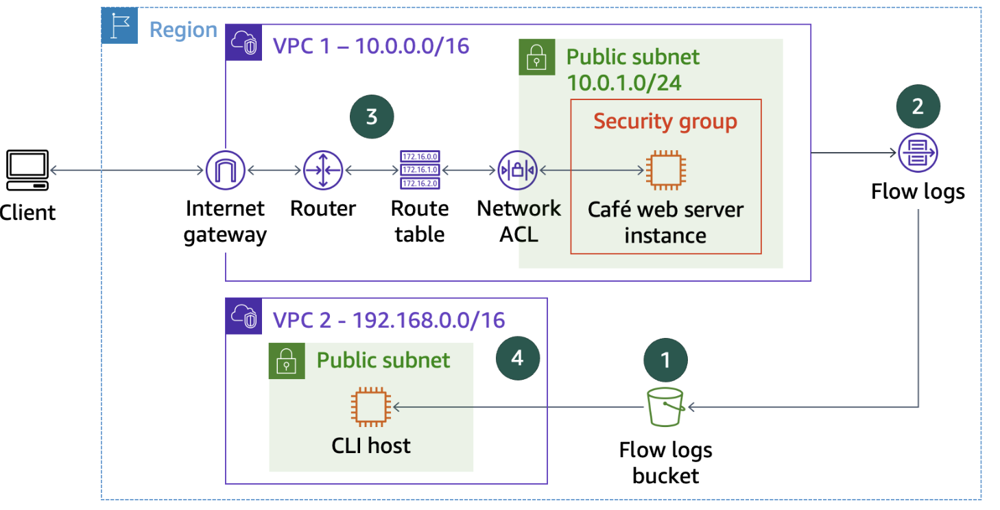

# Dépannage d'un VPC

## Présentation de l'atelier
Dans cet atelier, vous dépannez les configurations d'un cloud privé virtuel (VPC) et analysez les journaux de flux du VPC.
Vous commencez par un environnement qui comprend deux VPC, des instances Amazon Elastic Compute Cloud (Amazon EC2) et d'autres composants de mise en réseau illustrés dans le schéma suivant.
Ce diagramme montre également quatre cercles numérotés (n° 1 à 4) qui indiquent l'ordre des tâches à effectuer dans cet atelier.
Vos tâches incluent les suivantes :



* Création d'un compartiment Amazon Simple Storage Service (Amazon S3) destiné à contenir les données des journaux de flux du VPC
* Création d'un journal de flux pour capturer tout le trafic IP passant par les interfaces réseau dans le VPC
* Résolution des problèmes de configuration du VPC pour permettre l'accès aux ressources
* Téléchargement et analyse des données des journaux de flux

---

## Objectifs
À la fin de cet atelier, vous serez en mesure d'effectuer les opérations suivantes :
* Créer les journaux de flux du VPC.
* Résoudre les problèmes de configuration du VPC.
* Analyser les journaux de flux.

---

## Durée
Cet atelier dure environ 75 minutes.

---

## Accès à la console de gestion AWS
* En haut de ces instructions, choisissez **Start Lab** (Démarrer l'atelier) pour lancer l'atelier.
* Un volet **Start Lab** (Démarrer l'atelier) s'ouvre et affiche le statut de l'atelier.
* Attendez que le message *« Lab status: ready »* (Statut de l'atelier : prêt) s'affiche, puis cliquez sur **X** pour fermer le volet **Start Lab** (Démarrer l'atelier).
  > **Remarque :** il faut environ 10 minutes pour que l'atelier soit prêt à être utilisé.
* Une fois que l'atelier est prêt, en haut de ces instructions, sélectionnez **Détails**, puis **Afficher**. 
* Dans le volet **Credentials** (Justificatifs), copiez les valeurs du tableau et collez-les dans un éditeur de texte. Vous utiliserez ces valeurs tout au long de l'atelier. 
* En haut de ces instructions, choisissez **AWS** pour ouvrir la console de gestion AWS dans un nouvel onglet de navigateur. Le système vous y connecte automatiquement.
  > **Conseil :** si le nouvel onglet ne s'affiche pas, une bannière ou une icône située en haut du navigateur peut indiquer que votre navigateur bloque l'ouverture des fenêtres contextuelles. Cliquez sur la bannière ou l'icône, puis choisissez **Allow pop-ups** (Autoriser les fenêtres contextuelles).
* Disposez la console de gestion AWS de façon à l'afficher à côté de ces instructions. Dans l'idéal, vous devez pouvoir voir les deux onglets en même temps pour suivre les étapes de l'atelier.
* Laissez cet onglet de navigateur ouvert. Vous y reviendrez ultérieurement au cours de cet atelier.

---

## Tâche 1 : connexion à l'instance CLI Host
Au cours de cette tâche, vous utilisez EC2 Instance Connect pour vous connecter à l'instance CLI Host. Vous utilisez cette instance pour exécuter les commandes de l'interface de la ligne de commande AWS (AWS CLI).
1. Dans la Console de gestion AWS, dans la barre de recherche, saisissez et sélectionnez **EC2** pour ouvrir la Console de gestion EC2.
2. Dans le volet de navigation, sélectionnez **Instances**.
3. Dans la liste des instances, sélectionnez l'instance **CLI Host**.
4. Sélectionnez **Connexion**.
5. Dans l'onglet **EC2 Instance Connect**, sélectionnez **Connexion**.
   Cette option ouvre un nouvel onglet du navigateur qui affiche la fenêtre du terminal EC2 Instance Connect.
   > **Remarque :** si vous préférez utiliser un client SSH pour vous connecter à l'instance EC2, consultez les instructions fournies dans *Connect to Your Linux Instance (Connexion à votre instance Linux)*.

Vous allez utiliser cette fenêtre de terminal pour effectuer les tâches tout au long de l'atelier. Si le terminal ne répond plus, actualisez le navigateur ou suivez les étapes de cette tâche pour vous reconnecter.

Maintenant que vous êtes connecté à l'instance CLI Host, vous pouvez configurer et utiliser l'AWS CLI pour appeler les services AWS.

### Tâche 1.1 : configuration de l'AWS CLI sur l'instance CLI Host
Pour configurer le profil AWS CLI avec des justificatifs, exécutez la commande suivante dans le terminal EC2 Instance Connect : 
```bash
aws configure
```
À l'invite, copiez les valeurs suivantes que vous avez collées dans votre éditeur de texte et collez-les dans la fenêtre du terminal, comme indiqué :
* **AWS Access Key ID (Identifiant de la clé d'accès AWS)** : entrez la valeur de `AccessKey`.
* **AWS Secret Access Key (Clé d'accès secrète AWS)** : entrez la valeur de `SecretKey`.
* **Default region name (Nom de la région par défaut)** : entrez `us-west-2`.
* **Default output format (Format de sortie par défaut)** : entrez `json`.

Vous exécutez les commandes CLI sur cette fenêtre de terminal CLI Host selon les instructions données tout au long de l'atelier.

---

## Tâche 2 : création des journaux de flux du VPC
Au cours de cette tâche, vous créez un compartiment S3 pour publier les données issues des journaux de flux du VPC. Vous créez ensuite les journaux de flux du VPC sur VPC1 pour capturer les informations sur le trafic IP entre les interfaces réseau dans VPC1. Les journaux de flux sont ensuite publiés dans le compartiment S3.

1. Pour créer le compartiment S3 dans lequel les journaux de flux seront publiés, exécutez la commande suivante. Dans cette commande, remplacez `######` par six chiffres aléatoires :
   ```bash
   aws s3api create-bucket --bucket flowlog###### --region 'us-west-2' --create-bucket-configuration LocationConstraint='us-west-2'
   ```
   La sortie au format JSON similaire à ce qui suit montre l'emplacement d'un compartiment : `http://flowlog######.s3.amazonaws.com`

   Dans cette commande, `flowlog######` est votre nom de compartiment. Vous utiliserez ce nom de compartiment dans une étape ultérieure.
   > **Remarque :** si vous recevez un message d'erreur indiquant *Ce nom de compartiment existe déjà.*, utilisez un autre ensemble de chiffres aléatoires pour remplacer `######` et exécutez à nouveau la commande.

2. Pour obtenir l'ID de VPC pour VPC1 afin de créer les journaux de flux du VPC, exécutez la commande suivante :
   ```bash
   aws ec2 describe-vpcs --query 'Vpcs[*].[VpcId,Tags[?Key==`Name`].Value,CidrBlock]' --filters "Name=tag:Name,Values='VPC1'"
   ```
   La sortie au format JSON similaire à ce qui suit montre l'ID de VPC : `vpc-01edacbe1c31959d2`

3. Pour créer les journaux de flux du VPC sur VPC1, exécutez la commande suivante. Dans cette commande, remplacez `<flowlog######>` par le nom du compartiment obtenu aux étapes précédentes, et remplacez `<vpc-id>` par l'ID de VPC pour VPC1 issu de l'étape précédente. 
   L'ID de VPC a été renvoyé par la commande `describe-vpcs` que vous avez exécutée. Vous pouvez également le trouver dans la liste des valeurs (`VPC1ID`) que vous avez copiée dans un éditeur de texte au début de l'atelier.
   ```bash
   aws ec2 create-flow-logs --resource-type VPC --resource-ids <vpc-id> --traffic-type ALL --log-destination-type s3 --log-destination arn:aws:s3:::<flowlog######>
   ```
   La sortie de la commande renvoie `FlowLogIds` et un paramètre `ClientToken`.
   > **Remarque :** si vous voyez un message « Échec », ignorez-le.

4. Pour confirmer que le journal de flux a été créé, exécutez la commande suivante :
   ```bash
   aws ec2 describe-flow-logs
   ```
   La sortie de la commande doit indiquer qu'un journal de flux unique a été créé avec un statut `FlowLogStatus ACTIVE` (Actif) et une destination de journal qui pointe vers votre compartiment S3.

Maintenant que le journal de flux a été créé, vous pouvez passer à la tâche suivante, qui implique des opérations de dépannage. 

---

## Tâche 3 : résolution des problèmes de configuration du VPC pour permettre l'accès aux ressources
Au cours de cette tâche, vous analysez l'accès à l'instance de serveur web et résolvez certains problèmes de mise en réseau. Rappelez-vous que l'instance de serveur web du café s'exécute dans le sous-réseau public figurant dans VPC1. Reportez-vous au schéma figurant au début de cet atelier pour voir les détails de la configuration requise du réseau.

1. Dans votre éditeur de texte, copiez l'adresse IP `WebServerIP` et collez-la dans un nouvel onglet du navigateur. 
   Après quelques instants, la page ne se charge pas et vous recevez un message indiquant que le site n'est pas accessible ou que la connexion a expiré. Ce message est attendu.
   Laissez cet onglet de navigateur ouvert pour pouvoir y revenir ultérieurement.

2. Dans le terminal CLI Host, pour rechercher des détails sur l'instance de serveur web, exécutez la commande suivante. Dans la commande, remplacez `<WebServerIP>` par l'adresse `WebServerIP` que vous avez utilisée dans les étapes précédentes :
   ```bash
   aws ec2 describe-instances --filter "Name=ip-address,Values='<WebServerIP>'"
   ```
   Un document JSON volumineux est renvoyé, qui fournit plus de détails que nécessaires pour votre dépannage.

3. Pour renvoyer uniquement les détails pertinents, vous filtrez les résultats côté client en utilisant le paramètre `query`. La commande de l'étape suivante renvoie uniquement l'état de l'instance, l'adresse IP privée, l'ID d'instance, les groupes de sécurité qui lui sont appliqués, le sous-réseau dans lequel elle s'exécute et le nom de la paire de clés qui lui est associée. 
   Pour filtrer les résultats, exécutez la commande suivante. Dans cette commande, remplacez `<WebServerIP>` par la même adresse `WebServerIP` que vous avez utilisée dans les étapes précédentes : 
   ```bash
   aws ec2 describe-instances --filter "Name=ip-address,Values='<WebServerIP>'" --query 'Reservations[*].Instances[*].[State,PrivateIpAddress,InstanceId,SecurityGroups,SubnetId,KeyName]'
   ```
   Les résultats de la commande indiquent que l'instance est en cours d'exécution et renvoient des informations supplémentaires que vous pourrez utiliser ultérieurement.

À présent, vous allez essayer d'établir une connexion SSH à l'instance de serveur web à l'aide d'EC2 Instance Connect.
1. Dans l'onglet du navigateur, dans la console de gestion AWS, dans la barre de recherche, entrez et choisissez **EC2** pour ouvrir la console de gestion EC2.
2. Dans le volet de navigation, sélectionnez **Instances**.
3. Dans la liste des instances, sélectionnez l'instance **Cafe Web Server**.
4. Sélectionnez **Connexion**.
5. Dans l'onglet **EC2 Instance Connect**, sélectionnez **Connexion**.
   Après quelques secondes, la tentative de connexion échoue. Vous obtenez une erreur dans la fenêtre du navigateur qui stipule : *« Failed to connect to your instance »* (Échec de la connexion à votre instance). 
   Ce comportement est normal.

---

### Défi de dépannage n° 1
Vous avez établi que l'instance de serveur web est en cours d'exécution, mais la page web ne se charge pas. Quel est le problème ?

Mettez vous au défi de mener votre enquête en utilisant uniquement l'accès programmatique de l'AWS CLI. Évitez d'utiliser la console de gestion AWS.

#### Conseils :
* Utilisez l'utilitaire `nmap` pour vérifier quels ports sont ouverts sur l'instance EC2 du serveur web. 
  Pour ce faire, vous devez d'abord installer l'utilitaire sur l'instance CLI Host en exécutant la commande :
  ```bash
  sudo yum install -y nmap
  ```
  Exécutez ensuite la commande `nmap <WebServerIP>`. Dans cette commande, remplacez `<WebServerIP>` par l'adresse IP publique réelle. 
  Si `nmap` ne trouve aucun port ouvert, quelque chose d'autre pourrait-il bloquer l'accès à l'instance ?

* Vérifiez les détails du groupe de sécurité à l'aide de la commande `aws ec2 describe-security-groups`.
  Il peut être utile d'analyser les résultats de la commande si vous utilisez le paramètre `group-ids`. Cette valeur est également disponible dans l'éditeur de texte (`WebServerSgId`) avec les autres valeurs que vous avez utilisées dans cet atelier. 
  Vous pouvez utiliser la commande suivante pour vérifier la connectivité au port 22 :
  ```bash
  aws ec2 describe-security-groups --group-ids 'WebServerSgId'
  ```
  Vous pouvez également utiliser la commande `describe-instances` pour renvoyer l'ID du groupe de sécurité.
  Après avoir exécuté la commande `describe-security-groups`, analysez le résultat obtenu. 
  Les paramètres du groupe de sécurité appliqués à l'instance EC2 du serveur web semblent-ils autoriser la connectivité au port 22 ? 

* Vérifiez les paramètres de la table de routage associée au sous-réseau sur lequel le serveur web est en cours d'exécution.
  Utilisez la commande `aws ec2 describe-route-tables`.
  Lorsque vous exécutez cette commande, il peut être utile d'appliquer un filtre comme dans l'exemple suivant : 
  `--filter "Name=association.subnet-id,Values='<VPC1PubSubnetID>'"`
  Dans cette commande, remplacez `<VPC1PubSubnetID>` par la valeur réelle de l'ID de sous-réseau issue de l'éditeur de texte.
  La valeur de l'ID de sous-réseau a également été renvoyée lorsque vous avez exécuté la commande `describe-instances`.
  Vous pouvez utiliser la commande suivante en remplaçant `VPC1PubSubnetID` et `VPC1PubRouteTableId` par les valeurs issues de votre éditeur de texte : 
  ```bash
  aws ec2 describe-route-tables --route-table-ids 'VPC1PubRouteTableId' --filter "Name=association.subnet-id,Values='VPC1PubSubnetID'"
  ```
  Lorsque vous analysez la sortie de la commande `describe-route-tables`, rappelez-vous que le sous-réseau est marqué comme étant public.
  Remarquez-vous des problèmes avec les routes ? 

* Si vous devez définir une nouvelle route, utilisez la commande `aws ec2 create-route`. 
  Vous devez connaître `route-table-id` et `gateway-id` pour créer avec succès une route. Ces deux valeurs sont disponibles dans l'éditeur de texte. Vous devez également avoir la valeur `route-table-id` provenant de l'exécution précédente de la commande `describe-route-tables`.
  Vous pouvez utiliser la commande suivante, en remplaçant `VPC1PubRouteTableId` et `VPC1GatewayId` par les valeurs issues de votre éditeur de texte : 
  ```bash
  aws ec2 create-route --route-table-id 'VPC1PubRouteTableId' --gateway-id 'VPC1GatewayId' --destination-cidr-block '0.0.0.0/0'
  ```
  Vous pouvez également utiliser la commande `aws ec2 describe-internet-gateways` pour obtenir la valeur `gateway-id`. Vous devrez peut-être également spécifier d'autres paramètres pour exécuter la commande avec succès.

Une fois que vous pensez avoir résolu le problème, revenez dans l'onglet du navigateur où vous avez essayé de charger la page du serveur web, puis actualisez la page web. La page du navigateur doit afficher le message *« Hello From Your Web Server! »* (Bonjour de votre serveur web !).

Félicitations ! Vous avez résolu le problème qui vous empêchait d'accéder au site web. Cependant, un autre problème persiste, que vous examinerez dans la section suivante.

---

### Défi de dépannage n° 2
Maintenant que vous avez résolu le problème d'accès web, essayez de vous connecter à l'instance de serveur web à l'aide d'EC2 Instance Connect. 
Cette tentative échoue également. Une erreur similaire au message que vous avez reçu précédemment s'affiche dans le navigateur. À nouveau, ce comportement est normal.

Quel est le problème restant ?
Vous avez déjà vérifié que le serveur web est en cours d'exécution. Vous avez créé avec succès une entrée de table de routage pour connecter à Internet le sous-réseau dans lequel l'instance de serveur web s'exécute. Vous avez également vérifié que le groupe de sécurité autorise les connexions sur le port 22, qui est le port SSH par défaut.

#### Conseils :
* Sur le terminal de l'instance CLI Host, vérifiez les paramètres de la liste de contrôle d'accès réseau (ACL réseau) pour la liste ACL réseau associée au sous-réseau dans lequel l'instance est en cours d'exécution. 
  Pour ce faire, exécutez la commande suivante. Dans cette commande, remplacez `<VPC1PublicSubnetID>` par l'ID de sous-réseau provenant de l'éditeur de texte :
  ```bash
  aws ec2 describe-network-acls --filter "Name=association.subnet-id,Values='VPC1PublicSubnetID'" --query 'NetworkAcls[*].[NetworkAclId,Entries]'
  ```
  Analysez le résultat généré par l'exécution de la commande. Des entrées semblent-elles être à l'origine du problème ?

* Pour supprimer toutes les entrées ACL réseau susceptibles de provoquer un problème, utilisez la commande `delete-network-acl-entry`. Notez la valeur `acl-id` réseau récupérée par la commande précédente.
  Vous pouvez utiliser la commande suivante, en remplaçant `acl-id` par la valeur de la sortie de la commande précédente : 
  ```bash
  aws ec2 delete-network-acl-entry --network-acl-id 'acl-id' --ingress --rule-number 40
  ```

Une fois que vous pensez avoir résolu le problème, essayez de vous connecter à l'instance de serveur web en utilisant EC2 Instance Connect à nouveau et confirmez que vous pouvez vous connecter. Si vous pouvez vous connecter, vous avez résolu le problème avec succès. Pour confirmer que vous êtes connecté à l'instance EC2 correcte, exécutez la commande `hostname` une fois que vous êtes connecté. Elle doit indiquer `web-server` comme nom d'hôte.

Félicitations ! Vous avez résolu le problème d'accès SSH qui vous empêchait de vous connecter au serveur web.

---

## Tâche 4 : analyse des journaux de flux
Vous avez résolu les problèmes de réseau. En procédant ainsi, vous avez créé des entrées utiles dans les journaux de flux que vous avez créés lorsque vous avez créé les journaux de flux du VPC au début de cet atelier. 
Au cours de cette tâche finale, vous allez interroger les journaux de flux pour observer les activités qu'ils capturent.

### Tâche 4.1 : téléchargement et extraction des journaux de flux
1. Dans la fenêtre du terminal CLI Host, pour créer un répertoire local dans lequel vous pouvez télécharger les fichiers journaux de flux, exécutez la commande suivante :
   ```bash
   mkdir flowlogs
   ```
2. Pour accéder au nouveau répertoire, exécutez la commande suivante :
   ```bash
   cd flowlogs
   ```
3. Pour répertorier les compartiments S3 pour rappel du nom du compartiment, exécutez la commande suivante :
   ```bash
   aws s3 ls
   ```
4. Pour télécharger les journaux de flux, exécutez la commande suivante. Dans cette commande, remplacez `<flowlog######>` par le nom du compartiment que vous avez utilisé précédemment dans l'atelier :
   ```bash
   aws s3 cp s3://<flowlog######>/ . --recursive
   ```
   Si la commande aboutit, vous devriez voir que de nombreux fichiers sont téléchargés dans un sous-répertoire semblable à celui qui suit : `AWSLogs/AccountID/vpcflowlogs/us-west-2/yyyy/mm/dd/`

5. À présent, vous allez descendre dans la structure des dossiers jusqu'au sous-répertoire où vous avez téléchargé les fichiers. 
   Pour atteindre le sous-répertoire requis, exécutez la commande `cd` suivante. Dans cette commande, remplacez `<AWSLogs/AccountID/vpcflowlogs/us-west-2/yyyy/mm/dd/>` par le sous-répertoire de la sortie de la commande précédente :
   ```bash
   cd <AWSLogs/AccountID/vpcflowlogs/us-west-2/yyyy/mm/dd/>
   ```
   > **Conseil :** vous pouvez également utiliser la commande `cd` et appuyer plusieurs fois sur la touche **Tab** pour atteindre le sous-répertoire souhaité. 

6. Pour voir tous les fichiers journaux téléchargés, exécutez la commande `ls`. Les journaux sont situés dans un sous-répertoire `AWSLogs/<AccountID>/vpcflowlogs/<region>/yyyy/mm/dd`.
   Les noms des fichiers se terminent tous par `.log.gz`, ce qui indique qu'ils sont compressés en tant que fichiers .zip GNU.

7. Pour extraire les journaux, exécutez la commande suivante :
   ```bash
   gunzip *.gz
   ```
8. Réexécutez la commande `ls`. Tous les fichiers sont maintenant extraits.

### Tâche 4.2 : analyse des journaux
Dans cette section, vous analysez les journaux de flux pour vérifier si vos tentatives de connexion SSH ayant échoué ont été capturées dans les journaux.

1. Tout d'abord, vous analysez la structure des journaux.
   Copiez l'un des noms de fichier qui ont été renvoyés par la commande `ls` que vous avez exécutée dans les étapes précédentes.
   Dans la fenêtre du terminal, exécutez la commande suivante. Dans la commande, remplacez `<file name>` par le nom de fichier que vous avez copié à l'étape précédente.
   ```bash
   head <file name>
   ```
   La ligne d'en-tête indique le type de données que chaque entrée de journal contient. Chaque entrée contient des informations, telles que l'adresse IP de la source de l'événement (dans la quatrième colonne), le port de destination (septième colonne), les horodatages de début et de fin (au format d'horodatage Unix) et l'action qui a abouti (`ACCEPT` ou `REJECT`).

2. Pour rechercher dans chaque fichier journal du répertoire actuel et renvoyer les lignes qui contiennent le mot `REJECT`, exécutez la commande suivante :
   ```bash
   grep -rn REJECT .
   ```
   Cette commande doit renvoyer un ensemble de données volumineux, car elle inclut chaque événement où les paramètres VPC ont rejeté la demande.

3. Pour connaître le nombre d'enregistrements renvoyés, exécutez la commande suivante : 
   ```bash
   grep -rn REJECT . | wc -l
   ```
   Les résultats indiquent le nombre de lignes de votre ensemble de résultats.

4. Pour affiner la recherche en recherchant uniquement les lignes contenant `22` (qui correspond au numéro de port où vous tentiez de vous connecter au serveur web quand l'accès a été bloqué), exécutez la commande suivante :
   ```bash
   grep -rn 22 . | grep REJECT
   ```
   Cette commande doit renvoyer un plus petit nombre de résultats.

5. Pour isoler l'ensemble de résultats afin qu'il affiche uniquement les entrées de journal correspondant aux tentatives de connexion SSH infructueuses que vous avez effectuées, vous devez filtrer davantage les résultats.
   Rappelez-vous que vos tentatives infructueuses d'utiliser SSH pour connecter le serveur web ont été lancées à partir de votre machine locale. Dans l'étape suivante, vous déterminerez l'adresse IP par laquelle votre ordinateur local est adressable depuis Internet.

   * Dans la console de gestion AWS, accédez au service **Amazon EC2** dans la région où vos instances EC2 s'exécutent.
   * Choisissez **Groupes de sécurité**.
   * Choisissez le lien pour **WebSecurityGroup**, puis choisissez l'onglet **Règles entrantes**.
   * Choisissez **Modifier les règles entrantes**, puis **Ajouter une règle**.
   * Dans la troisième ligne que vous venez de créer, pour **Source**, choisissez **Mon IP**. 
   * Copiez l'adresse IP du bloc d'adresse CIDR (Classless Inter-Domain Routing) qui est automatiquement renseigné (elle se termine par `/32`) et collez-la dans un éditeur de texte. Copiez uniquement l'adresse IP, pas le suffixe `/32`.
   * Choisissez **Annuler**. *(Vous n'avez pas besoin de modifier les groupes de sécurité de ce compte. L'objectif de cette étape est de capturer cette adresse IP).*

6. Dans la session du terminal CLI Host, exécutez la requête affinée suivante sur les journaux de flux. Dans la commande suivante, remplacez `<ip-address>` par l'adresse IP issue du bloc d'adresse CIDR que vous avez copiée dans les étapes précédentes :
   ```bash
   grep -rn 22 . | grep REJECT | grep <ip-address>
   ```
   Le nombre de lignes de l'ensemble de résultats doit désormais correspondre au nombre de fois que vous avez essayé et que vous n'avez pas pu utiliser SSH pour connecter l'instance de serveur web.

7. Notez que l'ID d'interface réseau Elastic se trouve dans chacune des entrées de journal qui ont été renvoyées par votre requête.
   Pour confirmer que l'ID d'interface réseau qui est enregistré dans le journal de flux correspond à l'interface réseau qui est attribuée à l'instance de serveur web (dans le cadre de l'interface réseau), exécutez la commande suivante. Dans cette commande, remplacez `<WebServerIP>` par l'adresse IP issue de l'éditeur de texte :
   ```bash
   aws ec2 describe-network-interfaces --filters "Name=association.public-ip,Values='<WebServerIP>'" --query 'NetworkInterfaces[*].[NetworkInterfaceId,Association.PublicIp]'
   ```

8. À présent, vous allez traduire les horodatages en une forme lisible par l'utilisateur.
   Notez les deux nombres longs qui apparaissent vers la fin de chaque entrée de journal, avant le terme `REJECT`.
   Ces nombres sont des horodatages au format Unix. Le premier horodatage indique l'heure de début de chaque événement qui a été capturé. Le deuxième horodatage indique l'heure de fin. Vous pouvez les convertir sous une forme lisible par l'utilisateur à l'aide de l'utilitaire de ligne de commande Linux `date`. Par exemple, si l'horodatage est `1554496931`, vous devez exécuter la commande suivante :
   ```bash
   date -d @1554496931
   ```
   Pour convertir l'un des horodatages sous une forme lisible par l'utilisateur, exécutez la commande `date -d @` pour l'un des horodatages capturés à partir de l'un des résultats `REJECT` filtrés. Elle doit indiquer une heure du jour actuel qui correspond au moment où vous avez travaillé dans cet atelier. 
   Pour comparer le résultat à l'heure actuelle, exécutez la commande suivante :
   ```bash
   date
   ```

L'utilisation de `grep` est un moyen puissant, mais élémentaire, d'extraire des données significatives des fichiers journaux de flux du VPC. Le marché propose de nombreux outils pour exécuter des rapports ou générer des tableaux de bord analytiques à partir de journaux. Une solution consiste à utiliser le service **Amazon Athena**. Vous pouvez utiliser Athena pour intégrer des journaux afin qu'ils deviennent des données dans une table de base de données. Vous pouvez ensuite exécuter des requêtes SQL pour extraire des informations significatives de ces journaux. Pour plus d'informations sur Athena, consultez *Interrogation des journaux de flux Amazon VPC*.

---

## Conclusion
Félicitations ! Vous avez réussi à effectuer les tâches suivantes :
* Créer des journaux de flux du VPC
* Résoudre les problèmes de configuration du VPC
* Analyser les journaux de flux
