# Utilisation d'AWS CloudTrail

## Présentation de l'activité
Au cours de cette activité, vous allez créer un journal d'activité AWS CloudTrail qui exécutera des audits sur les actions effectuées dans votre compte. Vous mènerez ensuite une enquête pour déterminer qui a modified le site web Café.

L'activité commence par une instance Amazon Elastic Compute Cloud (Amazon EC2) nommée **Café Web Server**, qui exécute une application web qui héberge le site web Café.

* **Tâche 1 :** Vous constatez que le site web semble normal.
* **Tâche 2 :** Peu après avoir créé un journal d'activité avec CloudTrail, vous remarquez que le site web a été piraté et que quelqu'un en a profité pour modifier les paramètres du groupe de sécurité.
* **Tâche 3 :** Vous utilisez diverses méthodes pour analyser les journaux CloudTrail, notamment l'utilitaire Linux `grep` et l'interface de la ligne de commande AWS (AWS CLI).
* **Tâche 4 :** Vous utilisez Amazon Athena pour rechercher les journaux CloudTrail. Dans la section Défi qui conclut la tâche 4, vous essayez d'identifier le pirate.
* **Tâche 5 :** Maintenant que vous avez identifié le responsable, vous supprimez l'accès de cet utilisateur. Vous suivez également quelques étapes pour réduire le risque que le compte AWS et le site web Café soient à nouveau piratés.

Le schéma de l'architecture illustre la configuration que cette activité utilise.

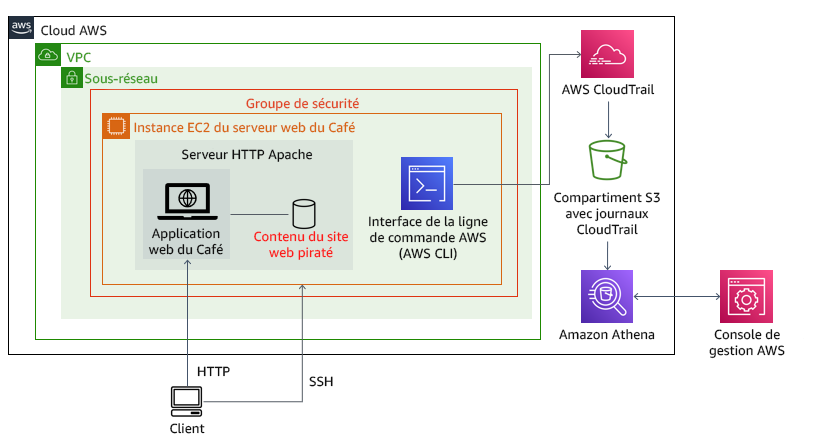

---

## Objectifs de l'activité
À la fin de cette activité, vous serez en mesure d'effectuer les tâches suivantes :
* Configurer un journal d'activité CloudTrail
* Analyser les journaux CloudTrail à l'aide de diverses méthodes pour découvrir des informations pertinentes
* Importer des données de journal CloudTrail dans Athena
* Exécuter des requêtes dans Athena pour filtrer les entrées des journaux CloudTrail
* Résoudre les problèmes de sécurité au sein du compte AWS et sur une instance EC2 Linux

---

## Durée
Cet atelier dure environ **75 minutes**.

---

## Pertinence de l'étude de cas
### L'équipe de direction du Café a adressé une nouvelle demande
Martha et Frank sont inquiets parce que le site web a été piraté. Ils comptent sur vous pour découvrir qui a fait cela et pour veiller à ce que cela ne se reproduise pas.

Faythe, Frank, Martha et d'autres personnes apportent régulièrement des modifications au site web et, parfois, ces modifications entraînent des problèmes. De plus, ce matin, il semble que le site web ait été piraté. Martha et Frank demandent à Sofîa s'il existe un moyen de savoir ce qui a été modifié et qui a effectué les modifications.

> **Rôle :** Jouez le rôle de Sofîa, devenez détective et découvrez qui est le coupable.

---

## Étapes de l'activité

### Lancement de l'environnement d'activité
1. En haut de ces instructions, sélectionnez **Start Lab** (Démarrer l'atelier) pour lancer l'atelier.
2. Un volet **Start Lab** (Démarrer l'atelier) s'ouvre et affiche le statut de l'atelier.
3. Attendez que le message **Lab status: ready** (Statut de l'atelier : prêt) s'affiche, puis cliquez sur **X** pour fermer le volet **Start Lab** (Démarrer l'atelier).
4. En haut de ces instructions, sélectionnez **AWS**. La console de gestion AWS s'ouvre alors dans un nouvel onglet. Le système vous y connecte automatiquement.
   > **Conseil :** Si le nouvel onglet ne s'affiche pas, une bannière ou une icône située en haut du navigateur indique généralement que votre navigateur bloque l'ouverture des fenêtres contextuelles. Cliquez sur la bannière ou sur l'icône, puis sélectionnez **Allow pop-ups** (Autoriser les fenêtres contextuelles).
5. Disposez l'onglet Console de gestion AWS de façon à l'afficher à côté de ces instructions. Dans l'idéal, vous devez pouvoir visualiser les deux onglets en même temps pour suivre plus facilement les étapes de l'atelier.

---

## Tâche 1 : Modification d'un groupe de sécurité et observation du site web
1. Dans le menu **Services**, sélectionnez **Calcul**, puis le service **EC2**.
2. Choisissez **Instances**, puis recherchez et sélectionnez l'instance **Café Web Server (WebSecurityGroup)**.

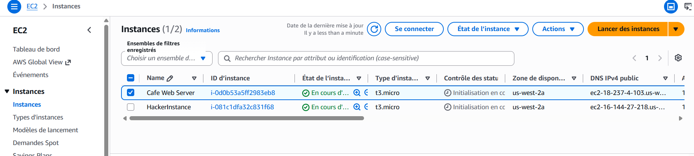

3. Dans l'onglet **Sécurité**, sélectionnez le groupe de sécurité `sg-xxxxxxxxxx`.

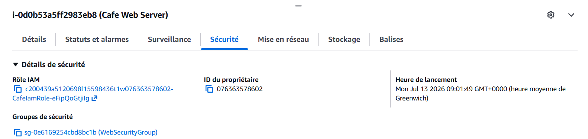

4. Dans l'onglet **Règles entrantes**, notez qu'une seule règle entrante a été définie, pour l'accès HTTP via le port TCP 80.

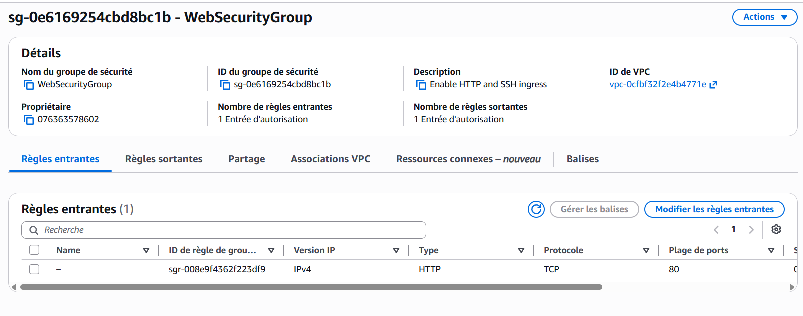

5. Sélectionnez **Modifier les règles entrantes**, puis **Ajouter une règle** et configurez la règle comme suit :
   * **Type :** sélectionnez `SSH`.
   * **Plage de ports :** saisissez `22`.
   * **Source :** saisissez `My IP`.

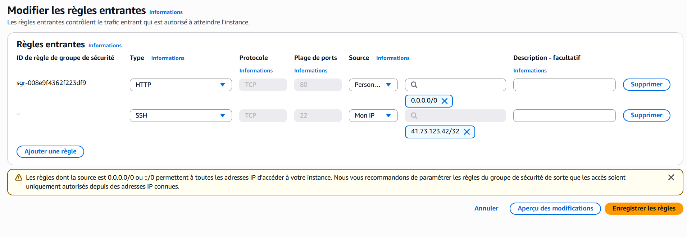
 
   > **Important :** Confirmez que l'accès au port TCP 22 ne sera ouvert qu'à votre adresse IP. L'entrée doit afficher un bloc d'adresse CIDR (Classless Inter-Domain Routing) qui possède une adresse IP particulière suivie de `/32`, et non toutes les adresses IP (qui seraient indiquées par `0.0.0.0/0`).
6. Au bas de la page, sélectionnez **Enregistrer les règles**.

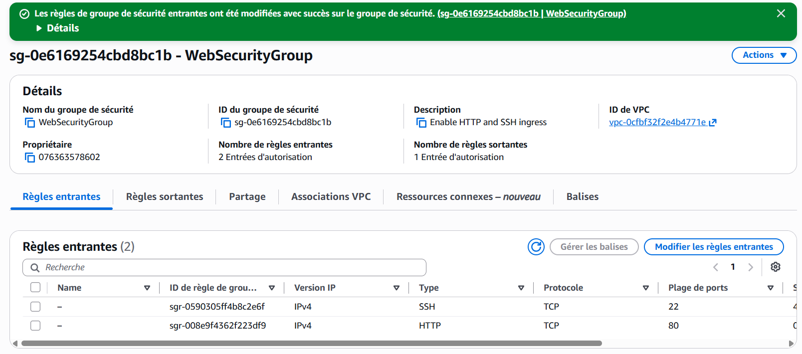


### Observez le site web Café :
1. Choisissez **Instances**, puis sélectionnez l'instance **Café Web Server**. Cliquez sur l'onglet **Détails**, puis copiez la valeur de **Public IPv4 address** (Adresse IPv4 publique). 
2. Ouvrez un nouvel onglet de navigateur et accédez à l'adresse `http://<WebServerIP>/cafe/` (remplacez la valeur `<WebServerIP>`).


3. Notez que le site web semble normal. Par exemple, les photos sont toutes adaptées à un café-pâtisserie.

---

## Tâche 2 : création d'un journal CloudTrail et observation du site web piraté
Au cours de cette tâche, vous créez un journal d'activité CloudTrail dans votre compte AWS. Vous remarquez également que peu après la création de ce journal d'activité, le site web Café est piraté.

### Tâche 2.1 : création d'un journal CloudTrail
1. Dans le menu **Services** de la console de gestion AWS, sélectionnez **Gestion et gouvernance**, puis **CloudTrail**. Ignorez le message d'accès refusé à `AWSOrganizations` en haut de la console.
2. Dans le volet de navigation de gauche, sélectionnez **Journaux d'activité**. Si le volet de navigation n'est pas affiché, sélectionnez l'icône représentant trois lignes horizontales en haut à gauche de l'écran. Si vous voyez le message d'avertissement *The option to create an organization trail is not available for this AWS account*, vous pouvez l'ignorer.

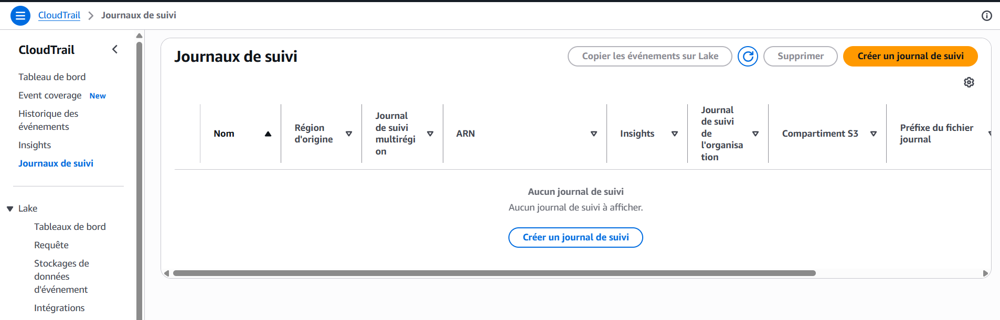

3. Sélectionnez **Créer un journal d'activité**.
4. Configurez le journal d'activité comme suit :
   * Pour **Nom du journal de suivi**, saisissez `monitor`.

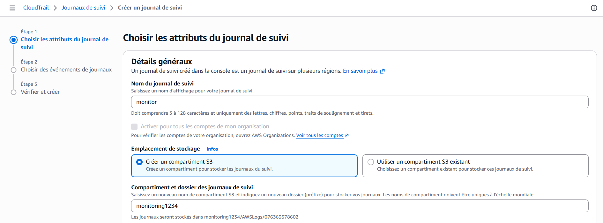

      > **Important :** Veillez à bien affecter au champ Nom du journal de suivi la valeur `monitor`, sinon cette activité ne fonctionnera pas comme prévu.
   * Sélectionnez **Create a new S3 bucket** (Créer un compartiment S3).
   * Pour **Compartiment et dossier des journaux de suivi**, saisissez `monitoring####` (les caractères `####` correspondent à quatre chiffres aléatoires).
   * Pour **Alias AWS KMS**, saisissez vos initiales suivies de `-KMS` (par exemple, `kc-KMS`).
   * Choisissez **Suivant**.

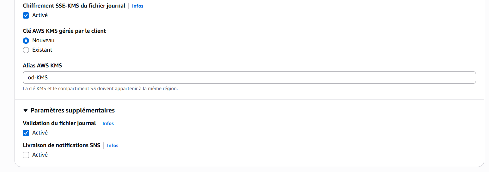

6. Sur la page **Choisir des événements de journaux**, sélectionnez **Suivant**.

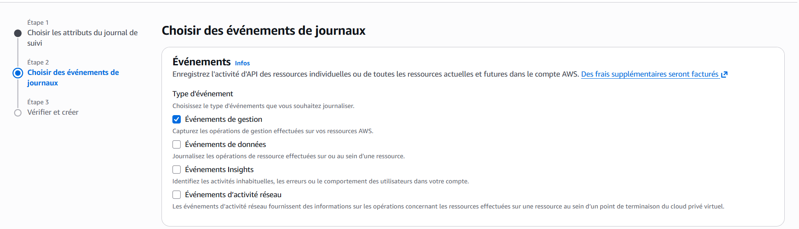

7. Sur la page **Vérifier et créer**, sélectionnez **Créer un journal d'activité**.

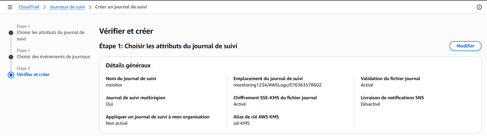
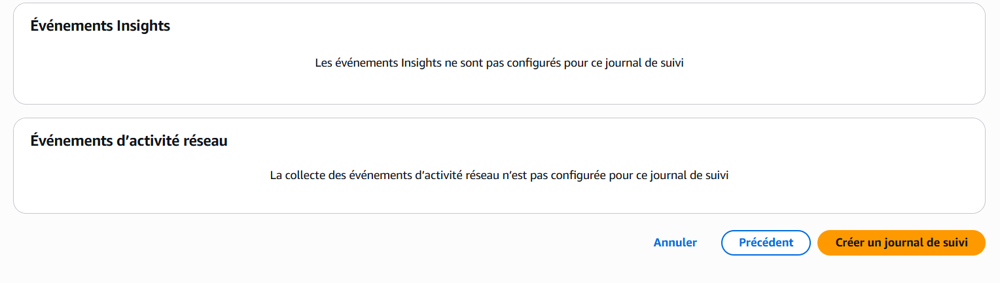

8. Vérifiez que vous voyez votre journal d'activité sur la page **Journaux d'activité**.

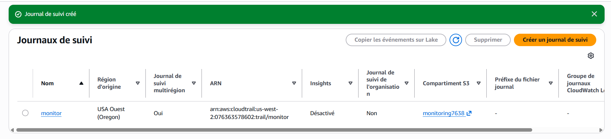


### Tâche 2.2 : observation du site web piraté
1. Revenez à l'onglet du navigateur dans lequel vous avez ouvert le site web Café et actualisez la page.
   > **Important :** Vous devrez peut-être attendre une minute avant que le piratage se produise. De plus, votre navigateur peut mettre en cache les images de ce site web. Appuyez sur la touche Maj et maintenez-la enfoncée pendant que vous sélectionnez le bouton d'actualisation du navigateur afin de voir les dernières modifications apportées au site web.
2. Notez que le site web a été piraté. Qui a placé cette image ici ? L'image ne semble certainement pas correcte. C'est à vous de découvrir qui a piraté le site web.
3. Il est judicieux d'avoir activé CloudTrail avant que cela ne se produise. CloudTrail peut vous fournir des informations précieuses sur l'activité des utilisateurs sur votre compte.
4. Dans la console de gestion AWS, accédez au service **EC2** et observez les détails de l'instance **Café Web Server**. Quelque chose vous paraît-il suspect ?
5. Dans l'onglet **Sécurité**, choisissez à nouveau le groupe de sécurité `sg-xxxxxxxxxx`, puis sélectionnez l'onglet **Règles entrantes**. D'où provient cette entrée supplémentaire ?

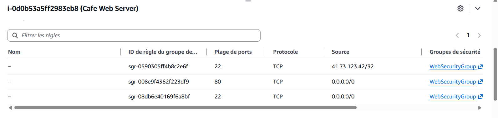

6. Vous pouvez toujours voir l'entrée que vous avez créée précédemment : la règle qui ouvre le port 22 uniquement pour votre adresse IP. Cependant, vous pouvez également voir qu'une autre personne a créé une règle entrante supplémentaire autorisant l'accès à Secure Shell (SSH) depuis n'importe où (`0.0.0.0/0`).
7. Qui a créé cette faille de sécurité ? Vous pouvez rechercher les journaux CloudTrail pour en savoir plus.

---

## Tâche 3 : analyse des journaux CloudTrail à l'aide de grep
Au cours de cette tâche, vous analysez les journaux CloudTrail à l'aide de l'utilitaire `grep` Linux pour voir si vous pouvez déterminer qui a piraté le site web.

### Tâche 3.1 : connexion à l'instance EC2 hôte Café Web Server à l'aide de SSH
Au cours de cette tâche, vous vous connectez à l'instance EC2 Café Web Server en utilisant SSH.

#### Tâche 3.2 pour Windows : SSH
1. Sélectionnez le menu déroulant **Détails** au-dessus des instructions, puis sélectionnez **Afficher**. Une fenêtre Credentials (Autorisations) s'ouvre.
2. Sélectionnez le bouton **Télécharger PPK** et enregistrez le fichier `labsuser.ppk`.
3. Notez l'adresse `PublicIP`.
4. Quittez le volet Détails en cliquant sur **X**.
5. Ouvrez `putty.exe`.
6. Configurez votre session PuTTY pour vous connecter à l'instance Linux.

#### Tâche 3.2 pour macOS/Linux : SSH
1. Choisissez le menu déroulant **Détails**, puis sélectionnez **Afficher**.
2. Cliquez sur le bouton **Télécharger PEM** et enregistrez le fichier `labsuser.pem`.
3. Pour quitter le volet Détails, cliquez sur **X**.
4. Ouvrez une fenêtre de terminal, puis remplacez le répertoire par celui dans lequel le fichier `labsuser.pem` a été téléchargé :
   ```bash
   cd ~/Downloads
   ```
5. Pour modifier les autorisations sur la clé afin qu'elle soit en lecture seule, exécutez la commande suivante :
   ```bash
   chmod 400 labsuser.pem
   ```
6. Revenez à la Console de gestion AWS puis, dans le service **EC2**, choisissez **Instances**. Cochez la case à côté de l'instance **Café Web Server**, puis sélectionnez l'onglet **Description**. Copiez la valeur de IPv4 Public IP.
7. Dans le terminal, exécutez la commande suivante (remplacez `<public-ip>` par l'adresse IP publique réelle) :
   ```bash
   ssh -i labsuser.pem ec2-user@<public-ip>
   ```
8. À l'invite, saisissez `yes` pour autoriser la connexion SSH.

### Tâche 3.3 : téléchargement et extraction des journaux CloudTrail
1. Vérifiez que votre terminal est connecté via SSH à l'instance EC2 Café Web Server.
2. Exécutez la commande suivante pour créer un répertoire local :
   ```bash
   mkdir ctraillogs
   ```
3. Passez dans le nouveau répertoire :
   ```bash
   cd ctraillogs
   ```
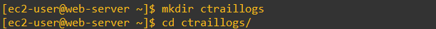

4. Répertoriez les compartiments S3 pour réafficher le nom exact :
   ```bash
   aws s3 ls
   ```
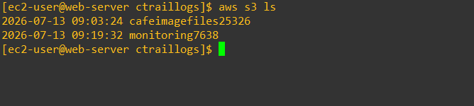

5. Dans la commande ci-dessous, remplacez `<monitoring####>` par le nom de compartiment réel. Exécutez la commande pour télécharger les journaux CloudTrail :
   ```bash
   aws s3 cp s3://<monitoring####>/ . --recursive
   ```

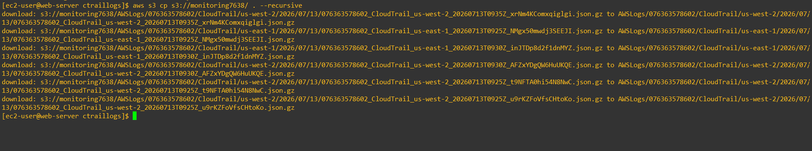
 
   > **Important :** S'il n'y avait aucune sortie en ligne de commande, attendez quelques minutes que CloudTrail publie les premiers journaux dans S3 et réexécutez la commande.
6. Naviguez dans l'arborescence des sous-répertoires jusqu'aux fichiers journaux :
   ```bash
   cd AWSLogs/<account-num>/CloudTrail/<Region>/<aaaa>/<mm>/<jj>
   ```
7. Les fichiers se terminent par `.json.gz`. Extrayez les journaux avec :
   ```bash
   gunzip *.gz
   ```
8. Exécutez à nouveau `ls` pour vérifier que les fichiers `.json` sont extraits.

### Tâche 3.4 : analyse des journaux à l'aide de grep
1. Pour analyser la structure des journaux, affichez le contenu d'un fichier mis en forme en JSON :
   ```bash
   cat <filename.json> | python -m json.tool
   ```
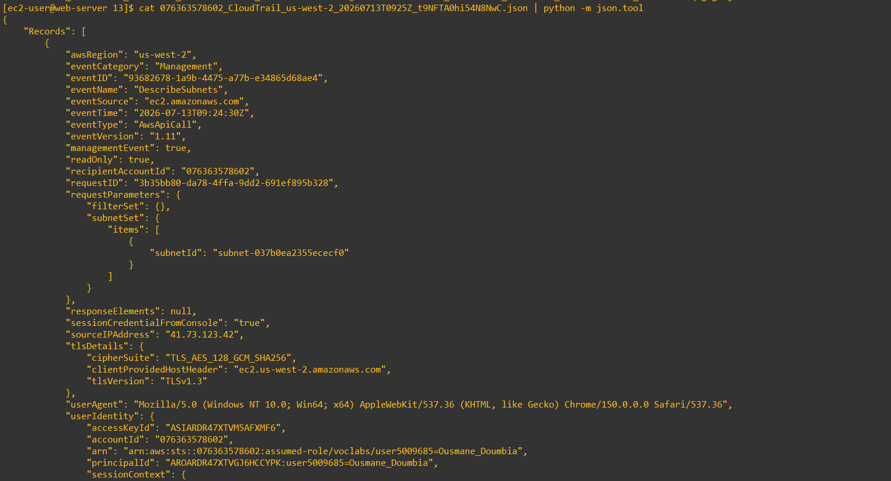

2. Définissez la variable d'adresse IP du serveur web :
   ```bash
   ip=<WebServerIP>
   ```
3. Exécutez une boucle `for` pour afficher les lignes contenant `sourceIPAddress` :
   ```bash
   for i in $(ls); do echo $i && cat $i | python -m json.tool | grep sourceIPAddress ; done
   ```
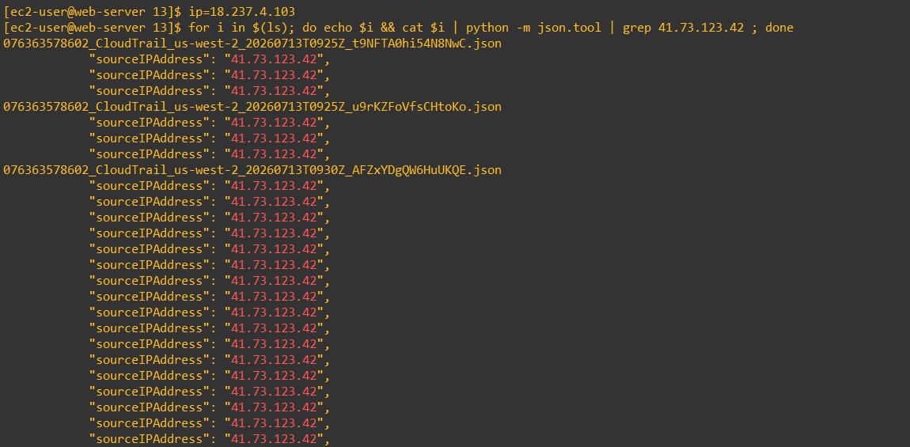

4. Exécutez une commande similaire pour filtrer les entrées sur la valeur `eventName` :
   ```bash
   for i in $(ls); do echo $i && cat $i | python -m json.tool | grep eventName ; done
   ```
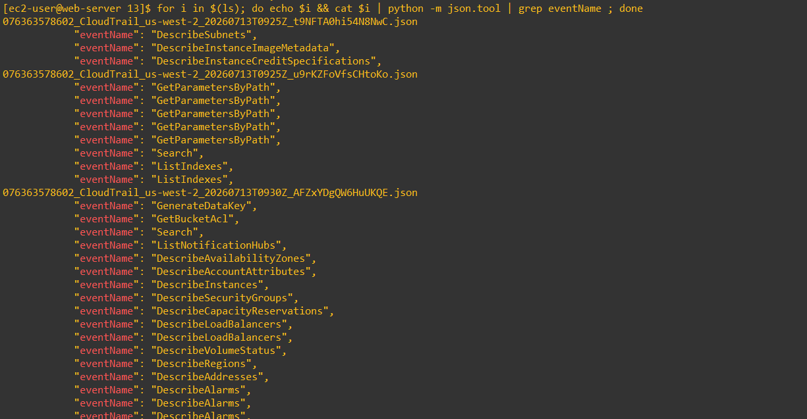


### Tâche 3.5 : analyse des journaux à l'aide des commandes CloudTrail de l'AWS CLI
1. Recherchez les connexions à la console :
   ```bash
   aws cloudtrail lookup-events --lookup-attributes AttributeKey=EventName,AttributeValue=ConsoleLogin
   ```

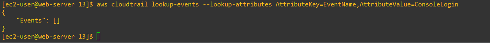

2. Recherchez toutes les actions effectuées sur les groupes de sécurité dans le compte AWS :
   ```bash
   aws cloudtrail lookup-events --lookup-attributes AttributeKey=ResourceType,AttributeValue=AWS::EC2::SecurityGroup --output text
   ```

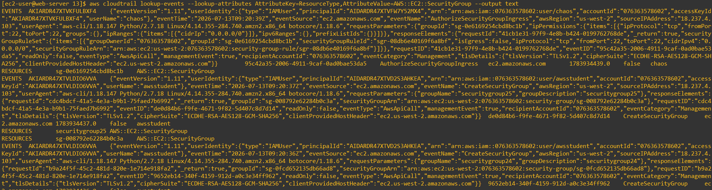

3. Récupérez dynamiquement l'ID du groupe de sécurité de l'instance Café Web Server :
   ```bash
   region=$(curl http://169.254.169.254/latest/dynamic/instance-identity/document|grep region | cut -d '"' -f4)

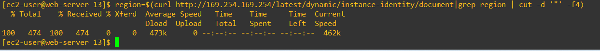

```
   sgId=$(aws ec2 describe-instances --filters "Name=tag:Name,Values='Cafe Web Server'" --query 'Reservations[*].Instances[*].SecurityGroups[*].[GroupId]' --region $region --output text)
   echo $sgId
   ```
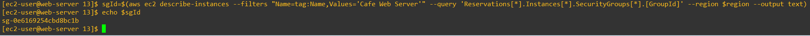

4. Filtrez les événements CloudTrail spécifiques à cet ID de groupe de sécurité :
   ```bash
   aws cloudtrail lookup-events --lookup-attributes AttributeKey=ResourceType,AttributeValue=AWS::EC2::SecurityGroup --region $region --output text | grep $sgId
   ```

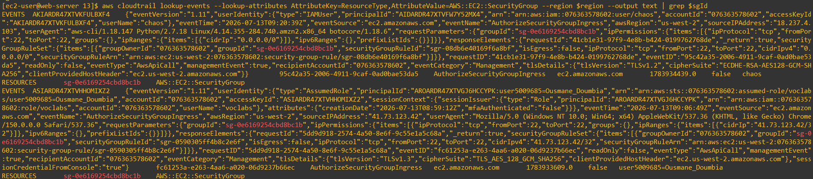


---

## Tâche 4 : analyse des journaux CloudTrail à l'aide d'Athena

### Tâche 4.1 : création de la table Athena
1. Dans la console de gestion AWS, ouvrez le service **CloudTrail**.
2. Dans le volet de navigation, sélectionnez **Historique des événements**.

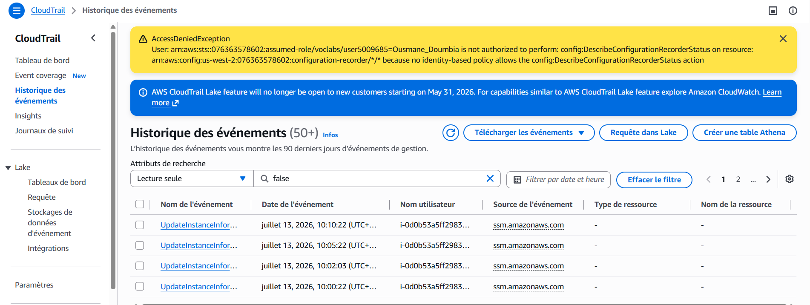

3. Cliquez sur **Créer une table Athena**.
4. **Emplacement de stockage :** choisissez le compartiment S3 `monitoring####`.
5. Analysez l'instruction `CREATE TABLE` d'Athena et sélectionnez **Créer une table**.

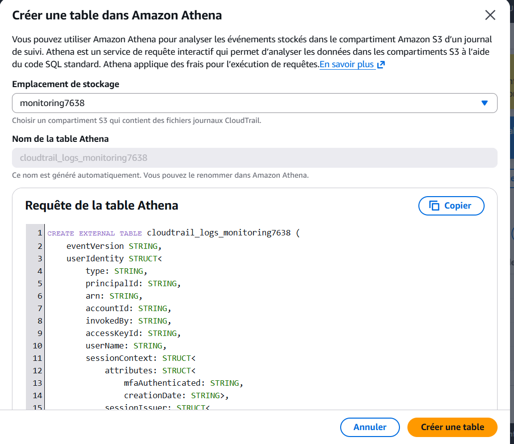
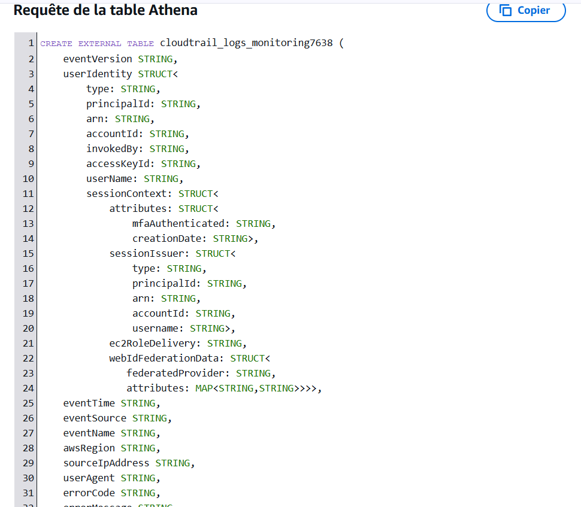
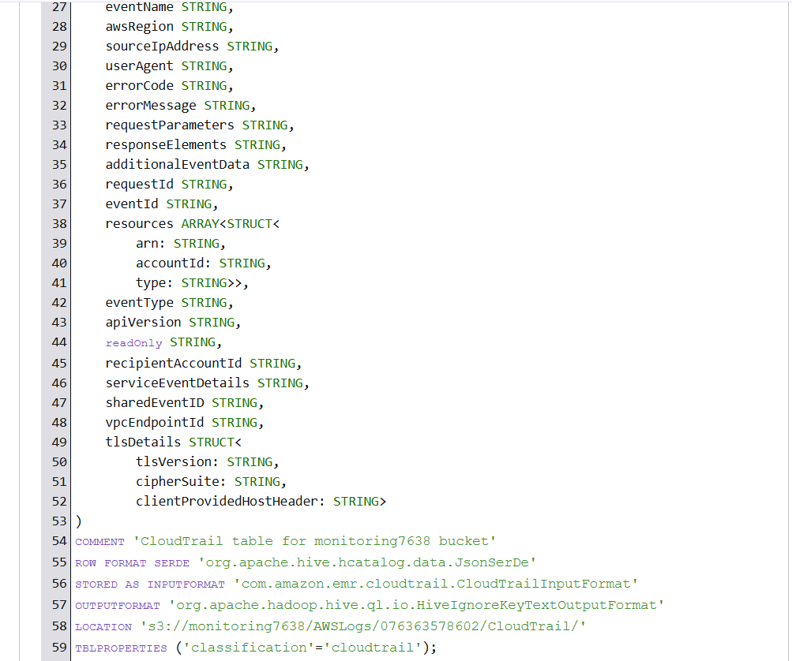

6. Dans le menu **Services**, sélectionnez **Analytique**, puis le service **Athena**.

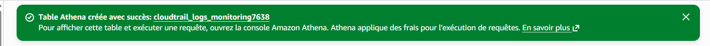


### Tâche 4.2 : analyse des journaux à l'aide d'Athena
1. Dans l'Éditeur de requêtes Athena, configurez l'emplacement des résultats :
   * Sélectionnez **Paramètres**, puis **Gérer**.
   * Affectez au champ **Emplacement du résultat de la requête** la valeur `s3://monitoring####/results/` (remplacez `monitoring####`).
   * Sélectionnez **Enregistrer**.

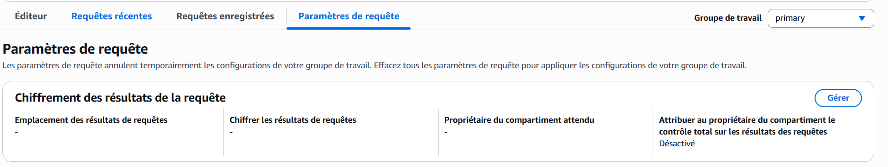
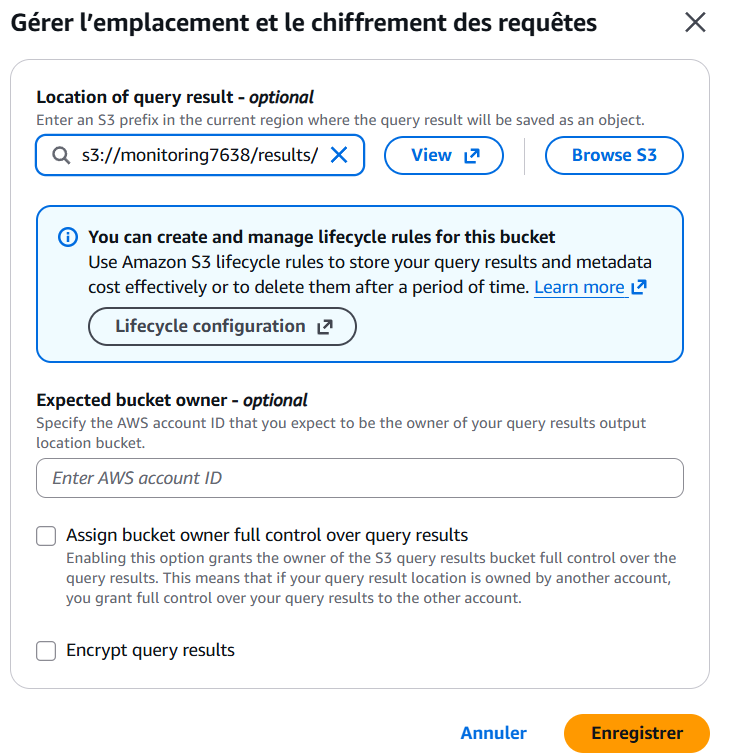
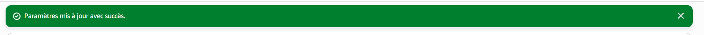

2. Dans l'onglet Éditeur, collez et exécutez la requête SQL suivante (remplacez `####`) :
   ```sql
   SELECT *
   FROM cloudtrail_logs_monitoring####
   LIMIT 5
   ```

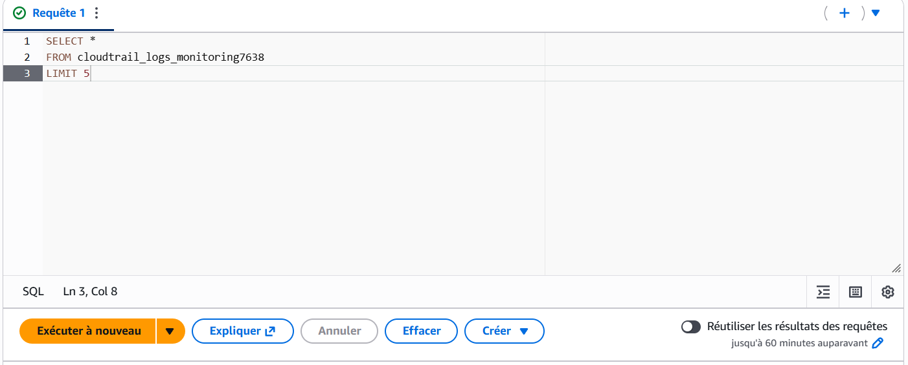
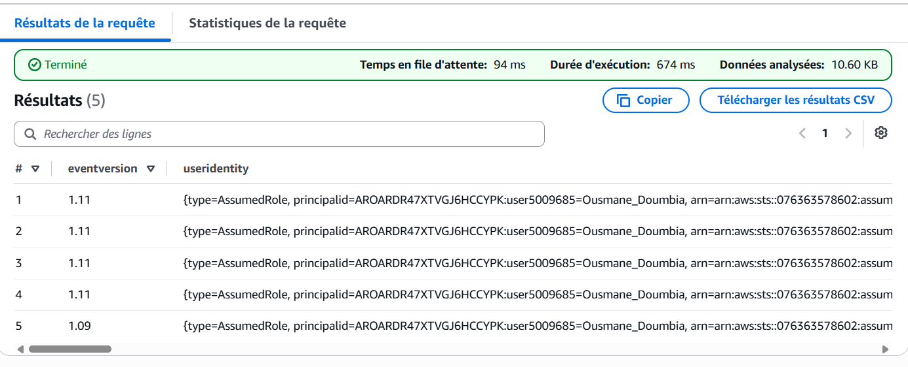
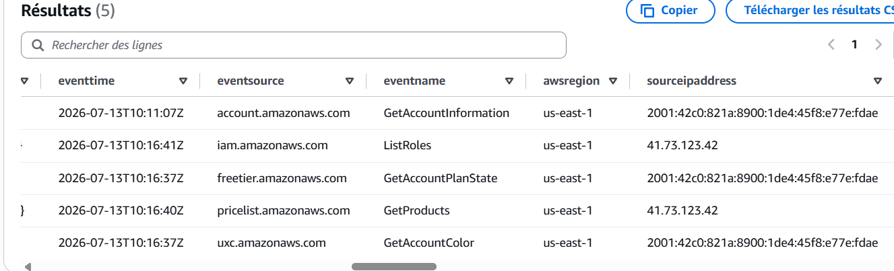

3. Exécutez une nouvelle requête ciblant spécifiquement les colonnes utiles :
   ```sql
   SELECT useridentity.userName, eventtime, eventsource, eventname, requestparameters
   FROM cloudtrail_logs_monitoring####
   LIMIT 30
   ```

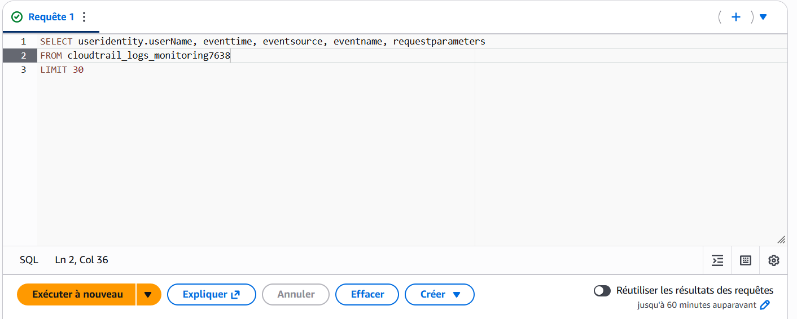
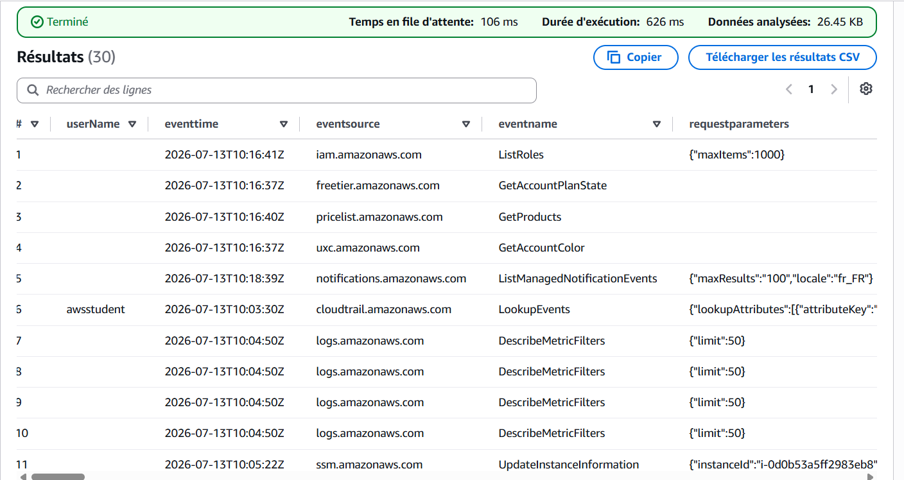
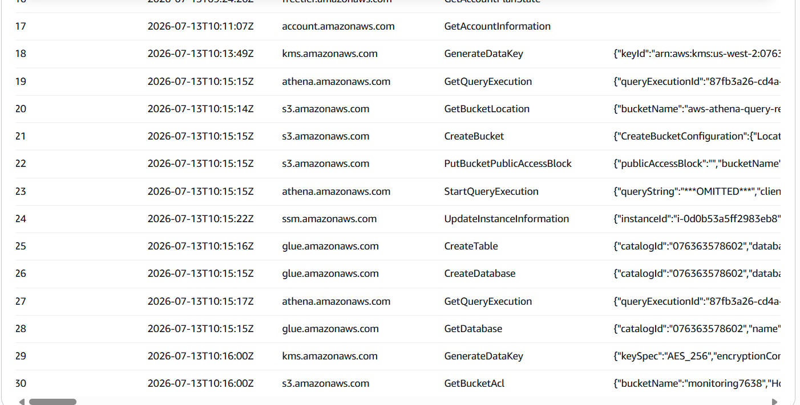
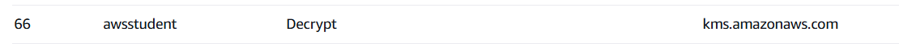

---

### Défi : identifier le pirate
Exécutez différentes requêtes SQL pour trouver les informations clés concernant l'attaque.

#### Conseils :
1. Inspectez les colonnes renvoyées et modifiez vos requêtes.
2. Ajoutez des clauses `WHERE` telles que `WHERE eventsource = 'ec2.amazonaws.com'`.
3. Supprimez la clause `LIMIT` pour interroger l'ensemble complet des journaux.
4. Filtrez sur les événements de sécurité avec `LIKE '%Security%'`.
5. Analysez les `eventName` suspects.
6. Utilisez cette requête pour lister toutes les actions distinctes par utilisateur la veille :
   ```sql
   SELECT DISTINCT useridentity.userName, eventName, eventSource FROM cloudtrail_logs_monitoring#### WHERE from_iso8601_timestamp(eventtime) > date_add('day', -1, now()) ORDER BY eventSource;
   ```

#### Informations à identifier pour réussir le défi :
* Nom de l'utilisateur AWS qui a créé la faille de sécurité.
* Heure exacte de la modification.
* Adresse IP source du pirate.
* Méthode utilisée (console ou accès programmatique).

---

## Tâche 5 : analyse plus approfondie du piratage et amélioration de la sécurité

### Tâche 5.1 : vérification des utilisateurs du système d'exploitation
1. Dans le terminal SSH du serveur web, vérifiez l'historique d'authentification :
   ```bash
   sudo aureport --auth
   ```
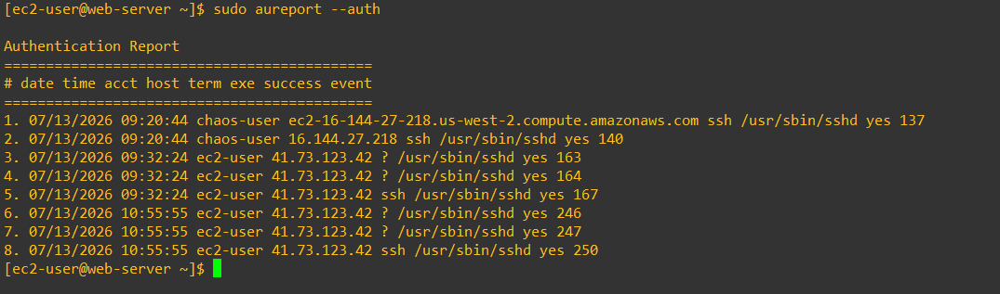

   *(Un utilisateur `chaos-user` apparaît).*
2. Vérifiez qui est actuellement connecté :
   ```bash
   who
   ```

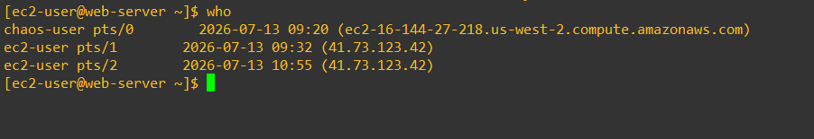

3. Tentez de supprimer l'utilisateur `chaos-user` :
   ```bash
   sudo userdel -r chaos-user
   ```

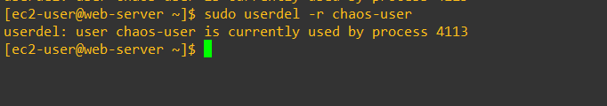

4. Si la commande échoue car il est connecté, arrêtez son processus en remplaçant `ProcNum` par le numéro affiché :
   ```bash
   sudo kill -9 ProcNum
   ```
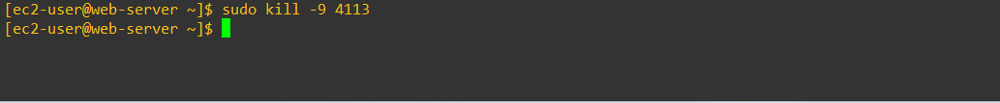

5. Vérifiez qu'il n'est plus connecté avec `who`, puis supprimez-le définitivement :
   ```bash
   sudo userdel -r chaos-user
   ```

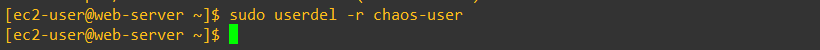

6. Vérifiez les comptes d'utilisateurs actifs :
   ```bash
   sudo cat /etc/passwd | grep -v nologin
   ```
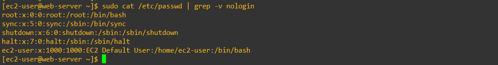


### Tâche 5.2 : mise à jour de la sécurité SSH
1. Vérifiez la date de modification du fichier de configuration SSH :
   ```bash
   sudo ls -l /etc/ssh/sshd_config
   ```
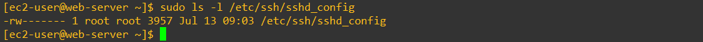

2. Éditez le fichier `/etc/ssh/sshd_config` avec VI :
   ```bash
   sudo vi /etc/ssh/sshd_config
   ```
3. Saisissez `:set number` pour afficher les numéros de ligne :
   * À la ligne 61, passez en mode Édition (`i` ou `a`) et mettez la ligne en commentaire : `#PasswordAuthentication yes`.
   * À la ligne 63, décommentez la ligne : `PasswordAuthentication no`.

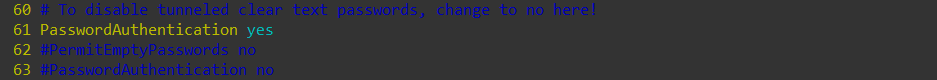
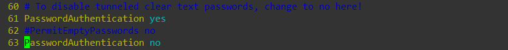

4. Appuyez sur `Échap`, puis enregistrez et quittez avec `:wq`.
5. Redémarrez le service SSH :
   ```bash
   sudo service sshd restart
   ```

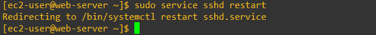

6. Dans la console **EC2**, accédez au groupe de sécurité du serveur web (`sg-xxxxxxxxxx`), sélectionnez l'onglet **Règles entrantes** > **Modifier**, et **supprimez la règle entrante autorisant le port 22 depuis `0.0.0.0/0`**. Enregistrez les modifications.


### Tâche 5.3 : correction du site web
1. Naviguez dans le répertoire des images :
   ```bash
   cd /var/www/html/cafe/images/
   ls -l
   ```


2. Restaurez le fichier image d'origine sauvegardé par le pirate :
   ```bash
   sudo mv Coffee-and-Pastries.backup Coffee-and-Pastries.jpg
   ```


3. Rechargez le site web `http://<WebServerIP>/cafe/` dans votre navigateur (`Maj + Actualiser`) pour vérifier le rétablissement de l'image.


### Tâche 5.4 : suppression de l'utilisateur pirate AWS
1. Dans la console de gestion AWS, sélectionnez **Services**, puis **IAM**.
2. Cliquez sur **Utilisateurs** et cochez la case de l'utilisateur `chaos`.
3. Sélectionnez **Supprimer**, saisissez `chaos` pour confirmer et validez.


---

## Mise à jour du Café
Tout le monde au Café est soulagé de constater que Sofîa a réussi à découvrir l'identité de la personne responsable du piratage et à supprimer son accès au serveur web et au compte AWS.

Au final, les membres de l'équipe ont eu de la chance, car il semble que le pirate voulait simplement s'amuser. Cependant, ils savent tous que le pirate aurait pu provoquer de graves dommages. Tous les membres de l'équipe du Café qui participent à la mise à jour et à la maintenance du site web savent désormais à quel point il est important de préserver la sécurité du site. Ils vont également continuer à utiliser CloudTrail comme outil clé pour l'activité d'audit sur leur compte AWS.
