#  🔐 Protection des Données à l’Aide du Chiffrement (AWS KMS & CLI Encryption)

> **Type d'atelier :** TP Pratique AWS / Sécurité & Cryptographie  
> **Durée estimée :** ⏱️ 45 minutes  
> **Services AWS utilisés :** AWS KMS (Key Management Service), Amazon EC2, AWS Systems Manager (Session Manager), AWS IAM  

---

## 📌 Présentation de l'atelier

La **cryptographie** désigne la conversion d’informations communiquées en code secret pour conserver les données confidentielles et privées. Les fonctions comprennent l’authentification, l’intégrité des données et la non-répudiation. La fonction principale de la cryptographie est le chiffrement qui transforme les données en chaînes de caractères non lisibles.

Le **chiffrement** garantit la confidentialité en masquant les informations aux individus qui ne sont pas les destinataires. Le **déchiffrement**, par opposition au chiffrement, transforme les données chiffrées en données lisibles ; elles n’ont aucun sens tant qu’elles n’ont pas été correctement déchiffrées.

Dans cet atelier, vous allez vous connecter à un serveur de fichiers hébergé sur une instance **Amazon Elastic Compute Cloud (Amazon EC2)**. Vous allez configurer l’interface de ligne de commande (CLI) **AWS Encryption** sur l’instance. Vous allez créer une clé de chiffrement avec le service **AWS KMS (AWS Key Management Service)**. La clé sera utilisée pour chiffrer et déchiffrer les données. Ensuite, vous créerez plusieurs fichiers texte qui ne sont pas chiffrés par défaut. Vous utiliserez ensuite la clé AWS KMS pour chiffrer les fichiers et vous les ouvrirez pour les découvrir dans leur forme chiffrée. Vous terminerez l’atelier en déchiffrant les mêmes fichiers et en affichant leur contenu.

---

### 🎯 Objectifs
À la fin de cet atelier, vous serez en mesure d'effectuer les opérations suivantes :
- [x] Créer une clé de chiffrement AWS KMS
- [x] Installer l’interface de ligne de commande (CLI) AWS Encryption
- [x] Chiffrer un texte brut
- [x] Déchiffrer un texte

---

### ⌛ Durée
Cet atelier dure environ **45 minutes**.

---

### 🏗️ Environnement de l'atelier
L’environnement de l'atelier comprend une instance EC2 pré-configurée nommée **File Server** (Serveur de fichiers). Un rôle AWS IAM (*Identity and Access Management*) y est associé, ce qui permet de se connecter à l’instance à l’aide d’AWS Systems Manager Session Manager.

Tous les composants backend, comme les instances EC2, les rôles IAM et certains services AWS, ont déjà été intégrés à l’atelier.

---

### 🔑 Accès à AWS Management Console

1. En haut à droite de ces instructions, choisissez **Démarrer l’atelier**.
   > 💡 **Conseil de dépannage :** Si vous recevez le message d’erreur *Access Denied (Accès refusé)*, fermez la fenêtre d’erreur, et choisissez de nouveau **Démarrer l’atelier**.
2. Les informations suivantes décrivent les différents états de l’atelier :
   * 🔴 **Cercle rouge** à côté d'AWS (coin supérieur gauche) : L'atelier n'a pas démarré.
   * 🟡 **Cercle jaune** à côté d'AWS (coin supérieur gauche) : L'atelier est en cours de démarrage.
   * 🟢 **Cercle vert** à côté d'AWS (coin supérieur gauche) : L'atelier est prêt.
3. Attendez que l’atelier soit prêt avant de continuer.
4. En haut de ces instructions, choisissez le cercle vert en regard d'AWS.
   * Cette option permet d’accéder à AWS Management Console dans un nouvel onglet du navigateur. Le système s’y connecte automatiquement.
   > 💡 **Conseil :** Si le nouvel onglet ne s'affiche pas, une bannière ou une icône située en haut du navigateur peut indiquer que votre navigateur bloque l'ouverture des fenêtres contextuelles. Cliquez sur la bannière ou l'icône, puis sélectionnez **Allow pop-ups (Autoriser les fenêtres contextuelles)**.
5. Si un message vous invite à basculer vers la nouvelle page d’accueil de la console, choisissez **Switch to the new Console Home (Basculer vers la nouvelle page d’accueil de la console)**.
6. Placez l'onglet AWS Management Console et ces instructions côte à côte. L’idéal est de pouvoir afficher les deux onglets du navigateur en même temps pour suivre plus facilement les étapes de l'atelier.
7. Ne modifiez pas la région de l'atelier, sauf si vous y êtes invité.

---

## 🔑 Tâche 1 : Créer une clé AWS KMS

Au cours de cette tâche, vous allez créer une clé AWS KMS que vous utiliserez ultérieurement pour chiffrer et déchiffrer les données.

> **Qu'est-ce qu'AWS KMS ?**  
> AWS KMS vous permet de créer et de gérer les clés de chiffrement et de contrôler leur utilisation sur une large gamme de services AWS et dans vos applications. AWS KMS est un service sécurisé et résilient qui utilise des modules de sécurité matériels (HSM) validés (ou en cours de validation) selon la norme FIPS 140-2 pour protéger vos clés.

### Étapes d'exécution :
1. Dans la console, saisissez `KMS` dans la barre de recherche, puis sélectionnez **Key Management Service**.
2. Sélectionnez **Create a key (Créer une clé)**.
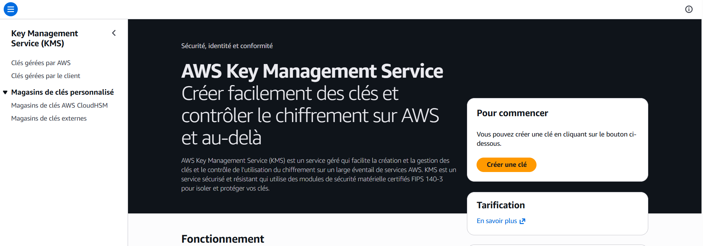
3. Sous **Key type (Type de clé)**, sélectionnez **Symmetric (Symétrique)**, puis cliquez sur **Suivant**.
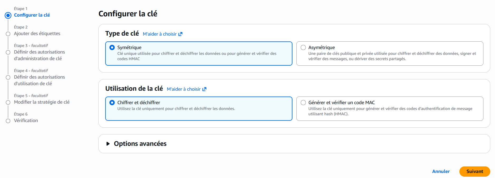
   > ℹ️ Le chiffrement *Symmetric (Symétrique)* utilise la même clé pour chiffrer et déchiffrer les données, ce qui rend son utilisation rapide et efficace. Le chiffrement *Asymmetric (Asymétrique)* utilise une clé publique pour chiffrer les données et une clé privée pour les déchiffrer.
4. Sur la page **Add labels (Ajouter des étiquettes)**, configurez les options suivantes :
   * **Alias :** `MyKMSKey`
   * **Description :** `Key used to encrypt and decrypt data files.` *(Clé utilisée pour chiffrer et déchiffrer les fichiers de données)*
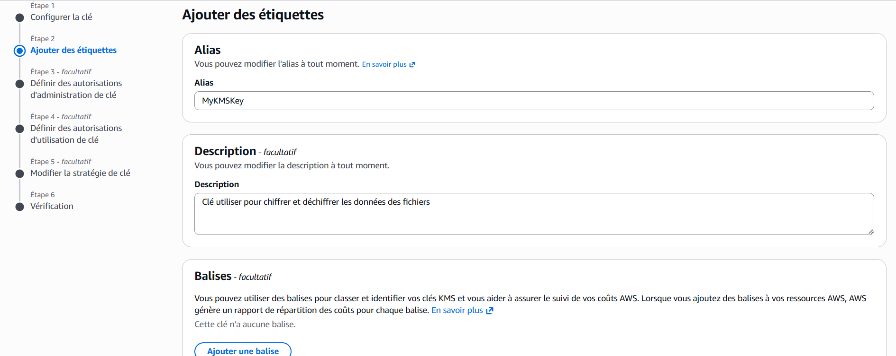
5. Cliquez sur **Next (Suivant)**.
6. Sur la page **Define key administrative permissions (Définir les autorisations d’administration des clés)**, dans la section **Key administrators (Administrateurs de clés)**, cochez la case **voclabs**, puis cliquez sur **Next (Suivant)**.
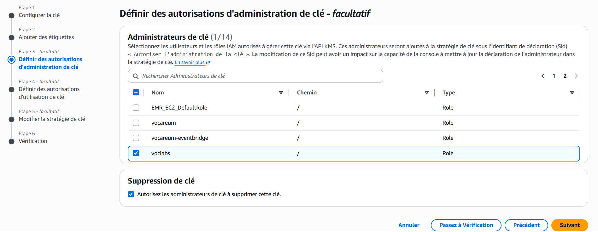
7. Sur la page **Define key usage permissions (Définir les autorisations d’utilisation des clés)**, dans la section **This account (Ce compte)**, cochez la case **voclabs**, puis cliquez sur **Next (Suivant)**.
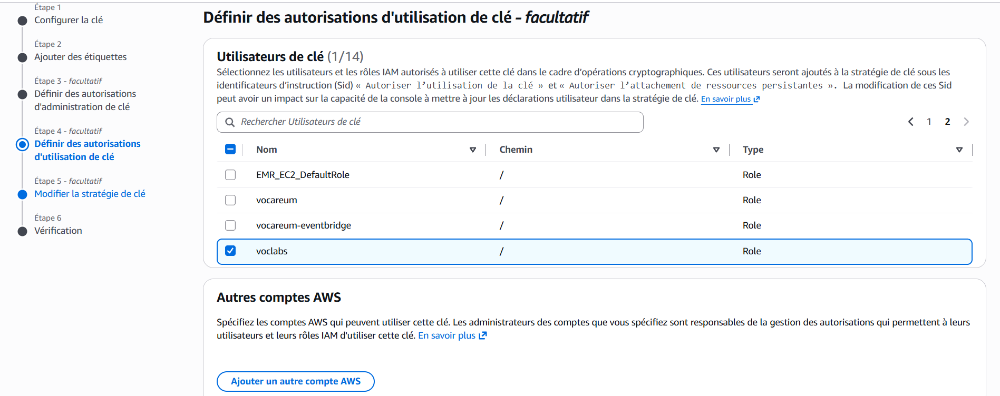
8. Vérifiez les paramètres, puis sélectionnez **Finish (Terminer)**.
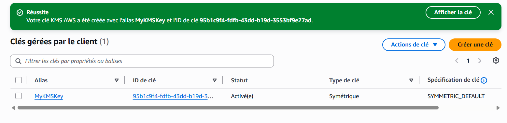
9. Sélectionnez le lien **MyKMSKey**, que vous venez de créer, et copiez-collez la valeur **ARN** (*Amazon Resource Name*) dans un éditeur de texte.
 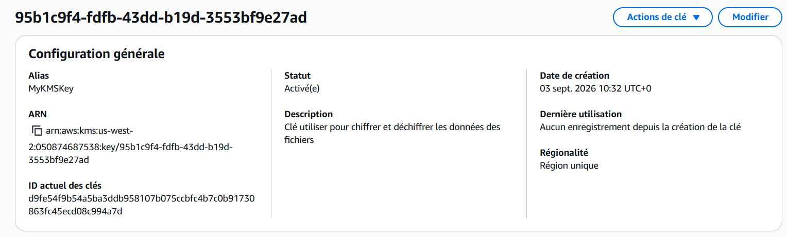
   > 💡 Vous utiliserez cette valeur ARN copiée par la suite dans l'atelier.

#### 📝 Résumé de la tâche 1
Au cours de cette tâche, vous avez créé une clé AWS KMS symétrique et vous avez accordé la propriété de cette clé au rôle IAM `voclabs` qui a été créé initialement pour cet atelier.

---

## 🖥️ Tâche 2 : Configurer l’instance du serveur de fichiers

Avant de commencer à chiffrer et déchiffrer les données, vous devez procéder à un certain nombre de configurations. Pour utiliser votre clé AWS KMS, vous devez configurer les informations d’identification AWS sur l’instance EC2 **File Server (Serveur de fichiers)**. Ensuite, vous allez installer l’interface de ligne de commande (CLI) AWS (`aws-encryption-cli`), qui vous permettra d’exécuter les commandes de chiffrement et de déchiffrement.

1. Dans la console, saisissez `EC2` dans la barre de recherche, puis sélectionnez **EC2**.
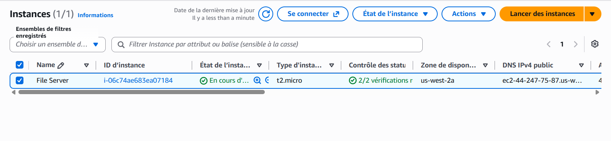
2. Dans la liste **Instances**, cochez la case en regard de l’instance **File Server (Serveur de fichiers)**, puis choisissez **Connect (Se connecter)**.
3. Cliquez sur l’onglet **Session Manager (Gestionnaire de session)**, puis choisissez **Connect (Se connecter)**.
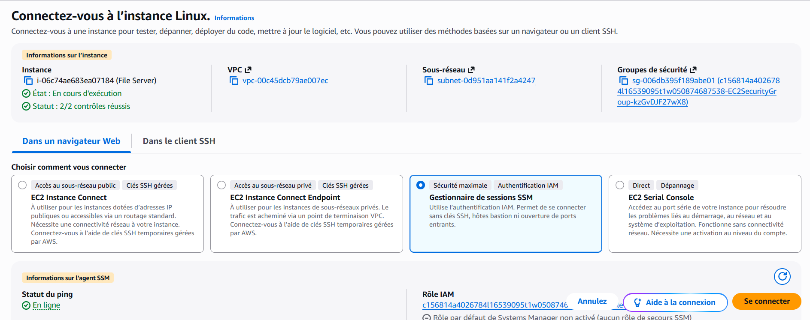
4. Pour passer dans le répertoire racine et créer un fichier d’informations d’identification AWS, exécutez les commandes suivantes :
   ```bash
   cd ~
   aws configure
   ```
5. Lorsqu’un message vous y invite, configurez les éléments suivants :
   * **AWS Access Key ID (Identifiant de la clé d'accès AWS) :** Saisissez `1`, puis appuyez sur Entrée.
   * **AWS Secret Access Key (Clé d'accès secrète AWS) :** Saisissez `1`, puis appuyez sur Entrée.
   * **Default region name (Nom de la région par défaut) :** Copiez et collez la région désignée sur la page **AWS Details (Détails AWS)** Vocareum.
     > 💡 **Conseil :** Vous devrez peut-être appuyer sur `Ctrl+Maj+V` pour coller le contenu dans Session Manager (Gestionnaire de session).
   * **Default output format (Format de sortie par défaut) :** Appuyez sur Entrée.
 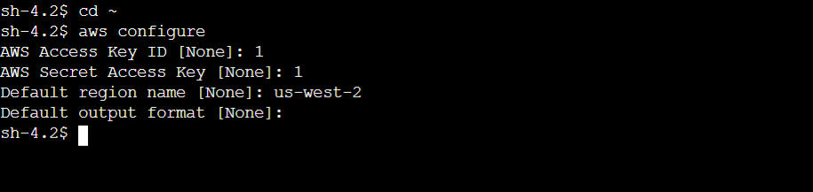
   > ℹ️ Le fichier de configuration AWS est créé, et vous le mettrez à jour à une étape ultérieure. Les entrées précédentes de `1` sont des emplacements réservés temporaires.
6. Naviguez vers la page de la console Vocareum, et cliquez sur le bouton **AWS Details (Détails AWS)**.
7. En regard d’**AWS CLI**, sélectionnez **Show (Afficher)**.
8. Copiez-collez le bloc de code qui commence par `[default]` (par défaut) dans un éditeur de texte.
9. Revenez sur l'onglet du navigateur dans lequel vous avez ouvert une session sur le serveur de fichiers.
10. Pour ouvrir le fichier d’informations d’identification AWS, exécutez la commande suivante :
    ```bash
    vi ~/.aws/credentials
    ```
11. Dans le fichier `~/.aws/credentials`, saisissez plusieurs fois `dd` pour supprimer le contenu du fichier.
12. Collez le bloc de code que vous avez copié depuis Vocareum.
    * Le fichier d’informations d’identification AWS doit maintenant contenir les identifiants mis à jour.
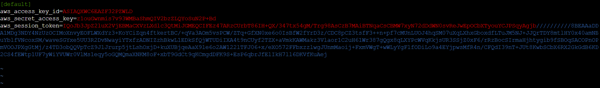
13. Pour enregistrer et fermer le fichier, appuyez sur la touche `Échap`, saisissez `:wq`, puis appuyez sur `Entrée`.
14. Pour afficher le contenu mis à jour du fichier, exécutez la commande suivante :
    ```bash
    cat ~/.aws/credentials
    ```
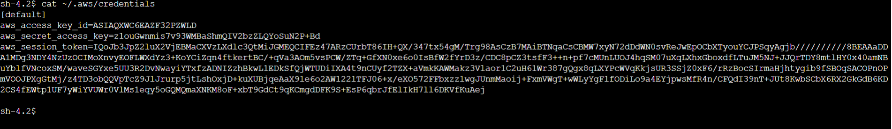
15. Maintenant, vous allez installer l’interface de ligne de commande (CLI) AWS Encryption et exporter le chemin d’accès. Ainsi, vous serez en mesure d’exécuter les commandes pour chiffrer et déchiffrer les données.
16. Pour installer l’interface de ligne de commande (CLI) AWS Encryption et définir le chemin d’accès, exécutez les commandes suivantes :
    ```bash
    pip3 install aws-encryption-sdk-cli
    export PATH=$PATH:/home/ssm-user/.local/bin
    ```
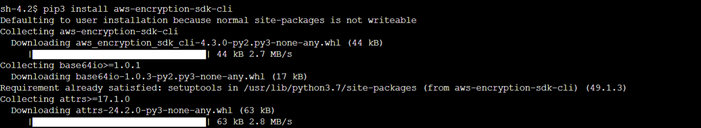

#### 📝 Résumé de la tâche 2
Au cours de cette tâche, vous avez configuré le fichier d’informations d’identification AWS qui permet d’utiliser la clé AWS KMS que vous avez créée précédemment. Vous avez ensuite installé l’interface de ligne de commande AWS Encryption pour exécuter les commandes de chiffrement.

---

## 🔒 Tâche 3 : Chiffrement et déchiffrement des données

Au cours de cette tâche, vous allez créer un fichier texte qui contient des données sensibles fictives. Vous utiliserez ensuite le chiffrement pour sécuriser le contenu du fichier. Enfin, vous déchiffrerez les données et afficherez le contenu lisible du fichier.

### Étapes d'exécution :
1. Pour créer le fichier texte, exécutez les commandes suivantes :
   ```bash
   touch secret1.txt secret2.txt secret3.txt
   echo 'TOP SECRET 1!!!' > secret1.txt
   ```
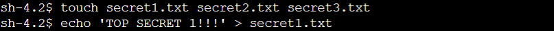
2. Pour afficher le contenu du fichier `secret1.txt`, exécutez la commande suivante :
   ```bash
   cat secret1.txt
   ```
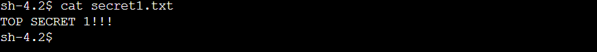
3. Pour créer un répertoire pour le fichier chiffré, exécutez la commande suivante :
   ```bash
   mkdir output
   ```
4. Copiez et collez la commande suivante dans un éditeur de texte :
   ```bash
   keyArn=(KMS ARN)
   ```
   * Dans l’éditeur de texte, remplacez `(KMS ARN)` par la valeur AWS KMS ARN que vous avez copiée au cours de la tâche 1.
5. Exécutez la commande mise à jour dans le terminal **File Server (Serveur de fichiers)**.
   > ℹ️ Cette commande enregistre la valeur ARN d’une clé AWS KMS dans la variable `$keyArn`. Lorsque vous procédez au chiffrement à l’aide d’une clé AWS KMS, vous pouvez l’identifier avec un identifiant de clé, une valeur ARN de clé, un nom d’alias ou une valeur ARN d’alias.
6. Pour chiffrer le fichier `secret1.txt`, exécutez la commande suivante :
   ```bash
   aws-encryption-cli --encrypt                       --input secret1.txt                       --wrapping-keys key=$keyArn                       --metadata-output ~/metadata                       --encryption-context purpose=test                       --commitment-policy require-encrypt-require-decrypt                       --output ~/output/.
   ```
 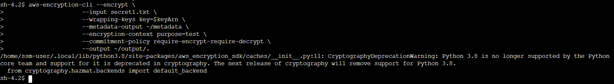
   > **Détails des paramètres de la commande :**  
   > * La première ligne chiffre le contenu du fichier. La commande utilise le paramètre `--encrypt` pour spécifier l’opération et le paramètre `--input` pour désigner le fichier à chiffrer.  
   > * Le paramètre `--wrapping-keys`, et son attribut de `key` requis, indique à la commande d’utiliser la clé AWS KMS représentée par la valeur ARN de la clé.  
   > * Le paramètre `--metadata-output` sert à désigner le fichier texte des métadonnées de l’opération de chiffrement.  
   > * À titre de bonne pratique, la commande utilise le paramètre `--encryption-context` pour définir un contexte de chiffrement.  
   > * Le paramètre `--commitment-policy` est utilisé pour indiquer la fonction de sécurité d’engagement de clés à utiliser pour chiffrer et déchiffrer.  
   > * La valeur du paramètre `--output`, `~/output/.`, indique à la commande de créer le fichier de sortie dans le répertoire de sortie.  
   >  
   > *Lorsque la commande de chiffrement aboutit, elle ne renvoie aucun résultat.*
7. Pour savoir si la commande a abouti, exécutez la commande suivante :
   ```bash
   echo $?
   ```
  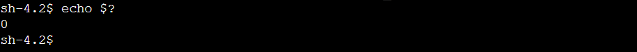
   * Si la commande a abouti, la valeur de `$?` est `0`. Si la commande a échoué, la valeur n’est pas nulle.
8. Pour afficher l’emplacement du nouveau fichier chiffré, exécutez la commande suivante :
   ```bash
   ls output
   ```
   * La sortie doit ressembler à ce qui suit :
     ```text
     secret1.txt.encrypted
     ```
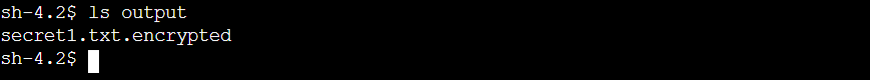
9. Pour afficher le contenu du nouveau fichier chiffré, exécutez les commandes suivantes :
   ```bash
   cd output
   cat secret1.txt.encrypted
   ```
  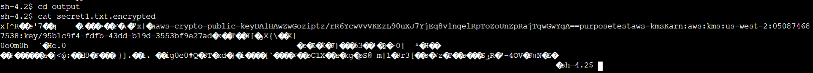
   > ℹ️ Le processus de chiffrement et de déchiffrement traite les données en texte brut, qui sont lisibles et compréhensibles, et les transforme pour créer un texte chiffré qui est ce que nous voyons actuellement.  
   > Lorsque les données ont été transformées en texte chiffré, le texte brut devient inaccessible jusqu’au processus de déchiffrement.  
   > *Le diagramme de fonctionnement illustre le mode de fonctionnement du chiffrement avec des clés symétriques et des algorithmes. Une clé symétrique et un algorithme sont utilisés pour convertir un message en clair en message chiffré.*
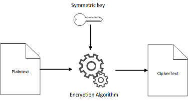
10. Appuyez sur **Enter (Entrée)**.
11. Ensuite, vous allez déchiffrer le fichier `secret1.txt.encrypted`.
12. Pour déchiffrer le fichier, exécutez la commande suivante :
    ```bash
    aws-encryption-cli --decrypt                        --input secret1.txt.encrypted                        --wrapping-keys key=$keyArn                        --commitment-policy require-encrypt-require-decrypt                        --encryption-context purpose=test                        --metadata-output ~/metadata                        --max-encrypted-data-keys 1                        --buffer                        --output .
    ```
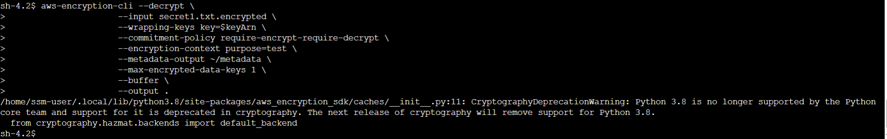
13. Pour afficher le nouvel emplacement du nouveau fichier, exécutez la commande suivante :
    ```bash
    ls
    ```
  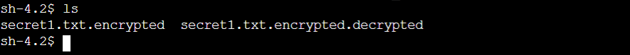
    * Le fichier `secret1.txt.encrypted.decrypted` contient le contenu déchiffré du fichier `secret1.txt.encrypted`.
14. Pour afficher le contenu du fichier déchiffré, exécutez la commande suivante :
    ```bash
    cat secret1.txt.encrypted.decrypted
    ```
 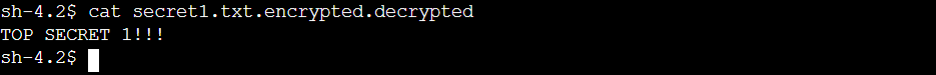
    > ℹ️ Une fois que le processus de déchiffrement a abouti, vous pouvez visualiser le contenu d’origine du texte brut dans le fichier `secret1.txt`.  
    > *Le diagramme illustre le mode d’utilisation de la même clé secrète et de l’algorithme symétrique du processus de chiffrement dans la transformation du texte chiffré en texte brut.*

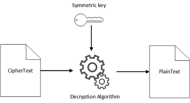

#### 📝 Résumé de la tâche 3
Au cours de cette tâche, vous avez appris à chiffrer des données en texte clair en texte chiffré à l’aide de la commande `--encrypt`. Vous avez ensuite réussi à déchiffrer le texte et à le transformer en données d’origine à la fois claires et lisibles.

---

## 🏆 Conclusion

**Félicitations ! Vous avez réussi à :**
- [x] **Créer une clé de chiffrement AWS KMS**
- [x] **Installer l’interface de ligne de commande (CLI) AWS Encryption**
- [x] **Chiffrer un texte brut**
- [x] **Déchiffrer un texte**
