# Protection contre les logiciels malveillants avec AWS Network Firewall

---

## Présentation de l'atelier

Malware est la dénomination commune des logiciels malveillants et espions développés par les cybercriminels (souvent appelés pirates informatiques) qui ont pour but de voler des données et d’endommager ou détruire les ordinateurs et les systèmes informatiques. Parmi les logiciels malveillants courants, citons les virus, les vers informatiques, les chevaux de Troie, les logiciels espions, les logiciels publicitaires et les rançongiciels.

Les pare-feu fonctionnent comme un mur de sécurité physique qui sépare le réseau interne d’une organisation et n’importe quel réseau public externe, comme Internet. Le pare-feu protège un réseau interne pour empêcher des utilisateurs non autorisés d'avoir accès au système à partir d’un réseau externe.

Les utilisateurs ont besoin d’accéder à Internet pour des raisons professionnelles, mais ils peuvent être amenés à télécharger par accident des logiciels malveillants qui peuvent nuire à la sécurité du réseau et des données.

Le risque posé par les logiciels malveillants est réel et les organisations peuvent avoir recours à différentes techniques et services pour réduire ces menaces (par exemple, des pare-feu, des logiciels antivirus et la mise en place de bonnes pratiques en matière de contrôle utilisateur). Cet atelier se concentre sur ces mesures de lutte, notamment les pare-feu.

---

### Scénario

> **Contextualisation :**  
> AnyCompany a engagé un nouvel ingénieur en sécurité et vous demande de renforcer le périmètre de sécurité de la société. Certains utilisateurs ont signalé avoir télécharger malencontreusement des logiciels malveillants sur certains sites Web. L’équipe informatique d’AnyCompany vous a communiqué les URL des sites hébergeant les logiciels malveillants. Votre tâche consiste à trouver une solution pour limiter l’accès à ces fichiers malveillants.

---

### Objectifs

À la fin de cet atelier, vous serez en mesure d'effectuer les opérations suivantes :
- [x] Mettre à jour un pare-feu réseau
- [x] Créer un groupe de règles pour le pare-feu
- [x] Tester et vérifier que l’accès aux sites malveillants est bloqué

---

### Durée

⏱️ **Cet atelier dure environ 45 minutes.**

---

### Environnement de l'atelier

Au cours de cet atelier, vous utiliserez l’instance **TestInstance** (Amazon Elastic Compute Cloud [Amazon EC2]) pré-configurée pour tester l’accès au site web hébergeant les fichiers malveillants. Elle est confinée dans un périmètre et séparée du reste des serveurs importants d’AnyCompany. Vous allez mettre à jour le pare-feu du réseau d’AnyCompany, créer un groupe de règles et l’associer à une politique de pare-feu et au pare-feu lui-même. Ensuite, vous vous connecterez à **TestInstance** pour tester la solution mise en place.

Tous les composants backend, comme Amazon EC2, les rôles AWS IAM (AWS Identity and Access Management) et certains services AWS, sont déjà intégrés à l’atelier.

---

### Accès à AWS Management Console

1. En haut à droite de ces instructions, choisissez **Démarrer l’atelier**.
   > **Conseil de dépannage :** Si vous recevez le message d’erreur *Access Denied (Accès refusé)*, fermez la fenêtre d’erreur, et choisissez de nouveau **Démarrer l’atelier**.
2. Les informations suivantes décrivent les différents états de l’atelier :
   * 🔴 Un cercle rouge à côté d'AWS dans le coin supérieur gauche de cette page indique que l'atelier n'a pas démarré.
   * 🟡 Un cercle jaune à côté d'AWS dans le coin supérieur gauche de cette page indique que l'atelier est en cours de démarrage.
   * 🟢 Un cercle vert à côté d'AWS dans le coin supérieur gauche de cette page indique que l'atelier est prêt.
3. Attendez que l’atelier soit prêt avant de continuer.
4. En haut de ces instructions, choisissez le cercle vert en regard d'AWS.
   * Cette option permet d’accéder à AWS Management Console dans un nouvel onglet du navigateur. Le système s’y connecte automatiquement.
   > **Conseil :** Si le nouvel onglet ne s'affiche pas, une bannière ou une icône située en haut du navigateur peut indiquer que votre navigateur bloque l'ouverture des fenêtres contextuelles. Cliquez sur la bannière ou l'icône, puis sélectionnez **Allow pop-ups (Autoriser les fenêtres contextuelles)**.
5. Si un message vous invite à basculer vers la nouvelle page d’accueil de la console, choisissez **Switch to the new Console Home (Basculer vers la nouvelle page d’accueil de la console)**.
6. Placez l'onglet AWS Management Console et ces instructions côte à côte. L’idéal est de pouvoir afficher les deux onglets du navigateur en même temps pour suivre plus facilement les étapes de l'atelier.
7. Ne modifiez pas la région de l'atelier, sauf si vous y êtes invité.

---

## Tâche 1 : Confirmation de l’accessibilité

Au cours de cette tâche, vous devez vous connecter à l’instance EC2 **TestInstance** qui a déjà été pré-configurée au cours de la configuration de l’atelier. Ensuite, vous allez lancer une commande `wget` sur les fichiers malveillants que l’équipe informatique vous a fournis afin de confirmer l’accessibilité.

`wget` est un utilitaire de ligne de commande gratuit qui fonctionne comme un gestionnaire de téléchargement de fichiers réseau.

1. Sur la page de la console Vocareum, cliquez sur le bouton **AWS Details (Détails AWS)**.
2. En regard de **TestInstanceURL** figure un lien. Copiez-collez le lien dans un nouvel onglet du navigateur web.
   * Ce lien permet de vous connecter directement au serveur EC2 **TestInstance** via le gestionnaire de session (*Session Manager*) d’AWS Systems Manager.
3. Pour changer de répertoire et afficher le répertoire de travail en cours, exécutez les commandes suivantes :
   ```bash
   cd ~
   pwd
   ```
4. L’étape suivante permet de répliquer la manière dont un utilisateur télécharge un fichier malveillant à partir d’un navigateur web. Cette action est simulated à l’aide de la commande `wget` exécutée sur les fichiers malveillants sur la ligne de commande.
5. Dans cet environnement d’atelier protégé, entrez le code suivant et appuyez sur **Entrée** pour télécharger une partie du logiciel malveillant :
   ```bash
   wget http://malware.wicar.org/data/js_crypto_miner.html
   ```
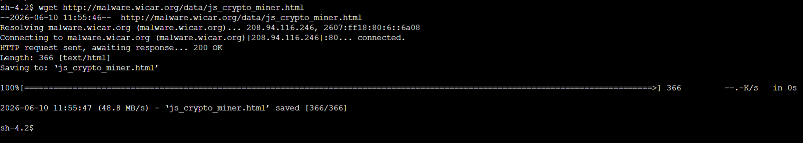
6. Dans cet environnement d’atelier protégé, entrez le code suivant et appuyez sur **Entrée** pour télécharger le reste du logiciel malveillant :
   ```bash
   wget http://malware.wicar.org/data/java_jre17_exec.html
   ```
 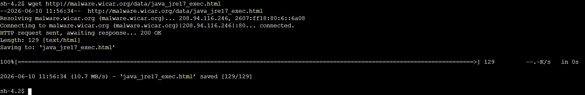
   > **Conseil :** Appuyez sur **Entrée** après avoir copié-collé chaque ligne de code pour garantir l’exécution des deux lignes de code.  
   >  
   > ⚠️ **Avertissement :** Ces fichiers sont créés spécifiquement à des fins de test et d’apprentissage sur les programmes anti-malware. Ne les utilisez pas en dehors du cadre de cet environnement d’atelier protégé.

7. Le résultat devrait ressembler à l’exemple suivant :
8. Pour afficher les fichiers téléchargés, exécutez la commande suivante :
   ```bash
   ls
   ```
   * La sortie devrait ressembler à l’exemple suivant :

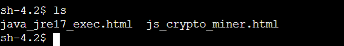

### Résumé de la tâche 1
Au cours de cet atelier, vous avez confirmé que l’URL du site hébergeant les fichiers malveillants était accessible sur le réseau actuel et le pare-feu du réseau utilisé par AnyCompany. Vous avez utilisé une instance EC2 **TestInstance** isolée pour exécuter des commandes et télécharger les mêmes fichiers malveillants que ceux téléchargés par les utilisateurs. Maintenant, vous devez corriger le problème du pare-feu du réseau d’AnyCompany pour bloquer l’accès à ce site.

---

## Tâche 2 : Inspection du pare-feu réseau

Au cours de cette tâche, vous allez examiner le pare-feu AWS Network Firewall qui a été pré-configuré au cours de la configuration de l’atelier. La mise à jour de ce pare-feu est la priorité n° 1 que vous a confiée AnyCompany en qualité de nouvel ingénieur de la sécurité.

1. Dans **AWS Management Console**, saisissez `VPC` dans la barre de recherche, puis sélectionnez **VPC**.
2. Dans le volet de navigation de gauche, sous **NETWORK FIREWALL (PARE-FEU RÉSEAU)**, choisissez **Firewalls (Pare-feu)**.
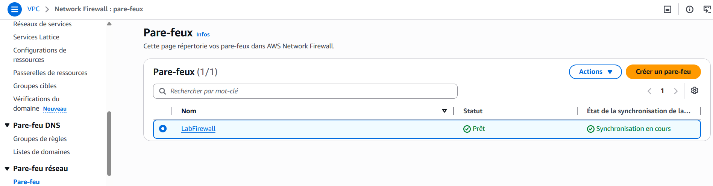
3. Sélectionnez **LabFirewall**, puis lisez les trois étapes de la section **Overview (Présentation)**.
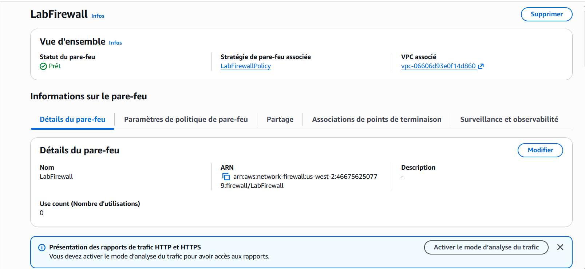
4. Dans la section **Step 2: Configure the firewall policy (Étape 2 : Configurer la politique de pare-feu)**, cliquez sur le lien **LabFirewallPolicy** pour accéder à la politique associée.
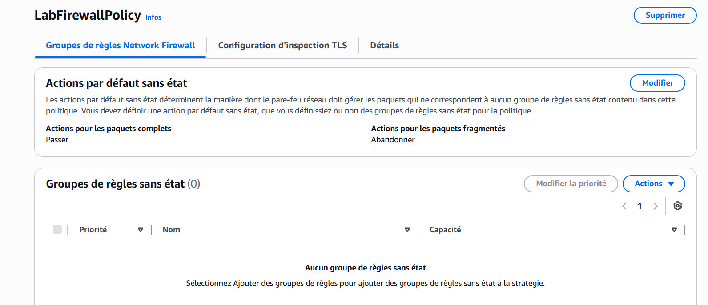
   * Une politique de pare-feu définit le fonctionnement du pare-feu dans un ensemble de groupes de règles avec et sans état et d’autres paramètres.
5. Dans la section **Stateless default actions (Actions par défaut sans état)**, choisissez **Edit (Modifier)**.
6. Pour **Stateless default actions (Actions par défaut sans état)**, configurez les options suivantes :
   * **Choose how to treat fragmented packets (Choisir le mode de traitement des paquets fragmentés) :** Choisissez **Use the same actions for all packets (Utiliser les mêmes actions pour tous les paquets)**.
   * **Action :** Choisissez **Forward to stateful rule groups (Transmettre aux groupes de règles avec état)**.
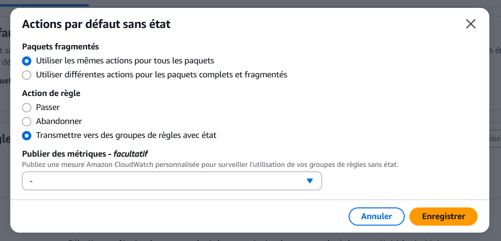
7. Sélectionnez **Save (Enregistrer)**.

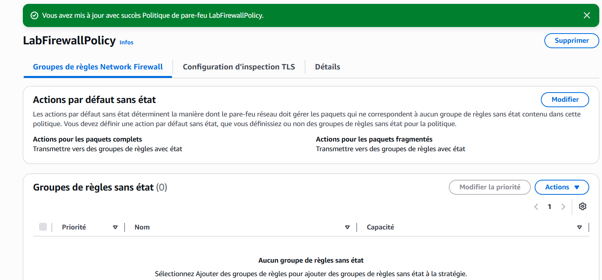
Ces paramètres permettent maintenant de transmettre tous les paquets à un groupe de règles avec état pour un examen plus approfondi.

Un moteur de règles avec état examine les paquets dans le contexte de leur flux de trafic. Il offre la possibilité d’utiliser des règles plus complexes et consigner le trafic réseau et les alertes de trafic du pare-feu d’AWS Network Firewall. Les règles avec état prennent en compte le sens du trafic. Le moteur de règles avec état peut retarder la livraison des paquets du groupe en cas d’inspection.

Un moteur de règles sans état examine chaque paquet séparément sans tenir compte de facteurs, tels que le sens du trafic ou l’appartenance du paquet à une connexion existante approuvée. Ce moteur priorise la rapidité de l’évaluation.

### Résumé de la tâche 2
Au cours de cette tâche vous avez examiné le pare-feu du réseau et mis à jour la politique du pare-feu. Vous avez ensuite mis à jour la politique du pare-feu pour transmettre tous les paquets pour un examen le moteur de règles avec état.

---

## Tâche 3 : Création d’un groupe de règles pour le pare-feu

Au cours de cette tâche, vous allez créer un groupe de règles pour le pare-feu du réseau avec des règles permettant de bloquer l’accès aux URL de sites malveillants. Par la suite, vous associerez ce groupe de règles à votre politique de pare-feu.

Un groupe de règles pour le pare-feu du réseau est un ensemble de critères réutilisables pour inspecter et gérer le trafic réseau. Vous ajouterez un ou plusieurs groupes de règles à une politique de pare-feu dans le cadre de la configuration des politiques. Ce groupe de règles bloque l’accès aux URL de sites malveillants.

1. Dans le volet de navigation de gauche, sous **NETWORK FIREWALL (PARE-FEU RÉSEAU)**, choisissez **Network Firewall Rule Groups (Groupes de règles de pare-feu réseau)**.
2. Sélectionnez **Create Network Firewall rule group (Créer un groupe de règles de pare-feu réseau)**.
3. Sur la page **Create Network Firewall rule group (Créer un groupe de règles de pare-feu réseau)**, configurez les options suivantes :
   * Pour **Rule group type (Type de groupe de règles)**, choisissez **Stateful rule group (Groupe de règles avec état)**.
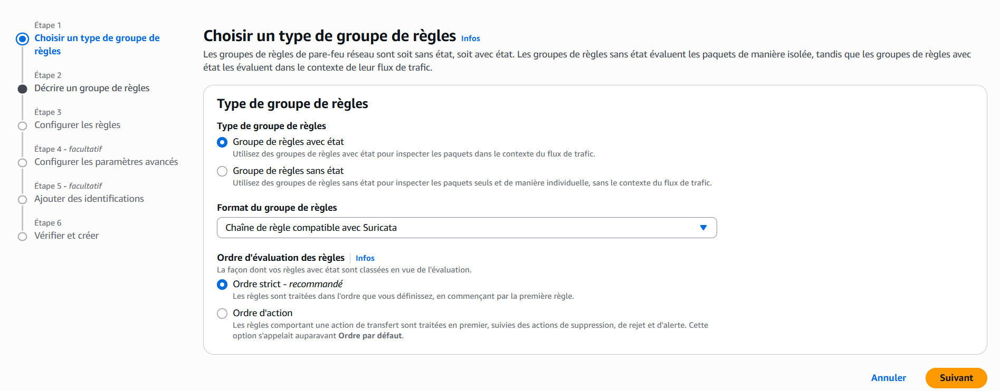
4. Dans la section **Stateful rule group (Groupe de règles avec état)**, configurez les options suivantes :
   * **Name (Nom) :** Saisissez `StatefulRuleGroup`
   * **Capacity (Capacité) :** Saisissez `100`
   * **Stateful rule group options (Options du groupe de règles avec état) :** Choisissez **Suricata compatible IPS rules (Règles IPS compatibles avec Suricata)**.
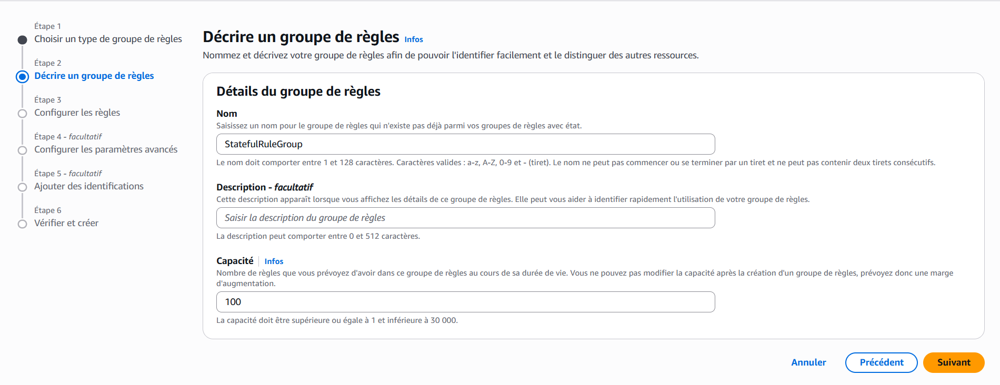
   * *Les règles d’un système de prévention des intrusions (IPS) offrent des règles de pare-feu avancées qui utilisent la syntaxe Suricata. Suricata est un système IPS réseau open source qui comprend un langage standard basée sur des règles concernant l’inspection des paquets.*
5. Dans la section **Suricata compatible IPS rules (Règles IPS compatibles avec Suricata)**, entrez le code suivant dans la zone de texte :
   ```suricata
   drop http $HOME_NET any -> $EXTERNAL_NET 80 (msg:"MALWARE custom solution"; flow: to_server,established; classtype:trojan-activity; sid:2002001; content:"/data/js_crypto_miner.html";http_uri; rev:1;)
   drop http $HOME_NET any -> $EXTERNAL_NET 80 (msg:"MALWARE custom solution"; flow: to_server,established; classtype:trojan-activity; sid:2002002; content:"/data/java_jre17_exec.html";http_uri; rev:1;)
   ```
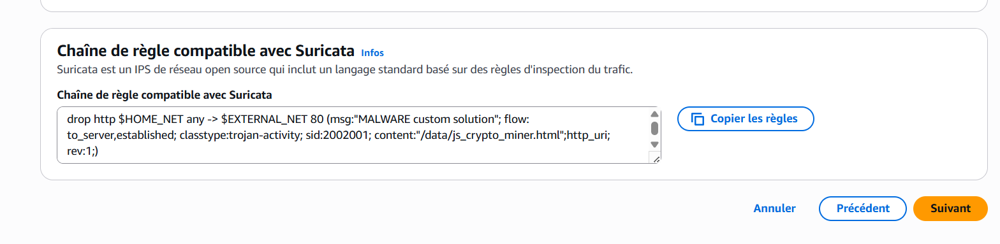
   * Les deux règles Suricata que vous venez d’ajouter bloquent le trafic correspondant aux URL `http_uri contents /data/js_crypto_miner.html` et `http_uri contents /data/js_crypto_miner.html` lorsque le trafic provient de LabVPC à destination du réseau public.
6. Choisissez **Create stateful rule group (Créer un groupe de règles avec état)**.
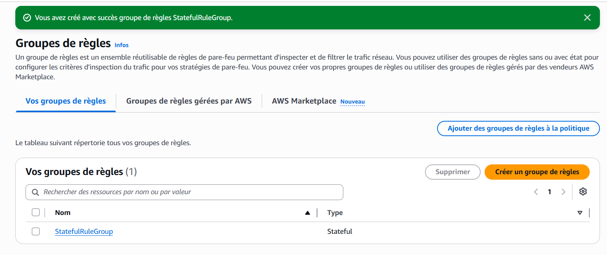

### Résumé de la tâche 3
Au cours de cette tâche, vous avez créé un groupe de règles pour le pare-feu du réseau avec état qui fait appel aux règles Suricata. Une fois que vous associez ce groupe de règles au pare-feu réseau, il bloque les sites web malveillants auxquels ont accès les utilisateurs AnyCompany.

---

## Tâche 4 : Association d’un groupe de règles au pare-feu réseau

Au cours de cette tâche, vous allez associer le groupe de règles pour le pare-feu du réseau que vous avez créé au pare-feu du réseau.

1. Dans le volet de navigation de gauche, sous **NETWORK FIREWALL (PARE-FEU RÉSEAU)**, choisissez **Firewalls (Pare-feu)**.
2. Sélectionnez **LabFirewall**.
3. Sous **Step 2 (Étape 2)**, cliquez dans la liste déroulante **Add rule groups (Ajouter des groupes de règles)**, puis choisissez **Add from existing stateful rule groups (Ajouter à partir des groupes de règles avec état existants)**.
4. Cochez la case en regard de **StatefulRuleGroup**, puis choisissez **Add stateful rule group (Ajouter un groupe de règles avec état)**.
5. En haut de la page, une bannière verte *You successfully updated FirewallPolicy (Vous avez mis à jour FirewallPolicy avec succès)* devrait s’afficher.
6. Faites défiler l’écran jusqu’à la section **Stateful rule groups (Groupes de règles avec état)** pour vérifier que le nouveau groupe de règles du pare-feu est bien présent.

### Résumé de la tâche 4
Vous avez associé le groupe de règles au pare-feu, ce qui permet de bloquer l’accès aux fichiers des sites malveillants hébergés à l’intérieur du site web.

---

## Tâche 5 : Validation de la solution

Au cours de cette tâche, vous allez vous connecter de nouveau à **TestInstance** pour vérifier que le pare-feu bloque correctement les tentatives d’accès aux fichiers malveillants du site web.

1. Dans **AWS Management Console**, saisissez `EC2` dans la barre de recherche, puis sélectionnez **EC2**.
2. Dans le volet de navigation de gauche, sélectionnez **Instances**.
3. Cochez la case en regard de **TestInstance**, puis cliquez sur **Connect (Se connecter)**.
4. Cliquez sur l’onglet **Session Manager (Gestionnaire de session)**, puis choisissez **Connect (Se connecter)**.
5. Pour changer de répertoire et afficher le répertoire de travail en cours, exécutez les commandes suivantes :
   ```bash
   cd ~
   pwd
   ```
6. Pour essayer d’accéder au premier fichier malveillant, exécutez la commande `wget`.
   ```bash
   wget http://malware.wicar.org/data/js_crypto_miner.html
   ```
   La sortie suivante doit s’afficher :
   ```text
   HTTP request sent, awaiting response...
   ```
   Cette sortie indique que le site et le fichier des logiciels malveillants ne sont plus accessibles et que le pare-feu du réseau a réussi à bloquer l’accès.
7. Appuyez sur **CTRL+C** pour quitter la commande.
8. Pour tester l’accès à d’autres URL malveillantes, exécutez la commande suivante :
   ```bash
   wget http://malware.wicar.org/data/java_jre17_exec.html
   ```
   La sortie suivante doit s’afficher :
   ```text
   HTTP request sent, awaiting response...
   ```
9. Ensuite, pour supprimer les fichiers des logiciels malveillants, exécutez la commande suivante :
   ```bash
   rm java_jre17_exec.html js_crypto_miner.html
   ```
10. Pour confirmer que les fichiers ont été supprimés, exécutez la commande `ls` :
    ```bash
    ls
    ```
    Le résultat doit être vide, ce qui confirme que les fichiers ont été supprimés.

### Résumé de la tâche 5
Au cours de cette tâche, vous avez vérifié que le pare-feu du réseau a été mis à jour et configuré correctement pour bloquer l’accès aux sites web malveillants. Vous avez confirmé que l’accès est bloqué en vous connectant à l’instance EC2 **TestInstance** et en exécutant la commande `wget` sur ces fichiers. Les utilisateurs n’ont maintenant plus accès à ces fichiers de logiciels malveillants de ce site web.

### 🏆 Conclusion
Félicitations ! Vous avez réussi à :

- [x] Mettre à jour un pare-feu réseau

- [x] Créer un groupe de règles pour le pare-feu

- [x] Tester et vérifier que l’accès aux sites malveillants est bloqué
