# 🛡️ Présentation d'AWS Identity and Access Management (IAM)

> **Type d'atelier :** TP Pratique AWS / Sécurité & Gestion des Identités  
> **Services AWS utilisés :** AWS IAM (Identity and Access Management), Amazon EC2, Amazon S3  

---

## 📌 Présentation de l'atelier

Dans de nombreux milieux professionnels, l’accès passe par une seule ouverture de session sur un ordinateur ou un réseau de systèmes informatiques pour accéder à toutes les ressources du réseau. Cet accès comprend les dossiers personnels et partagés sur un serveur réseau, l’intranet des sociétés, les imprimantes et autres ressources et périphériques en réseau. Ainsi, les utilisateurs non autorisés peuvent exploiter rapidement ces mêmes ressources si le contrôle d’accès et les procédures d’authentification associées ne sont pas configurés correctement.

Dans cet atelier, vous allez explorer les utilisateurs, les groupes d’utilisateurs et les politiques au sein du service **AWS IAM (Identity and Access Management)**.

---

### 🎯 Objectifs
À la fin de cet atelier, vous serez en mesure d'effectuer les opérations suivantes :
- [x] Créer et appliquer une politique en matière de mot de passe IAM.
- [x] Explorer les utilisateurs et les groupes d’utilisateurs IAM préalablement créés.
- [x] Examiner les politiques IAM appliquées aux groupes d’utilisateurs préalablement créés.
- [x] Ajouter des utilisateurs aux groupes d’utilisateurs avec certaines fonctionnalités actives.
- [x] Localiser et utiliser l'URL de connexion IAM.
- [x] Tester les effets des politiques sur l'accès aux services.

> Voici le diagramme de l’environnement en cours avec les utilisateurs IAM et les groupes IAM répertoriés.
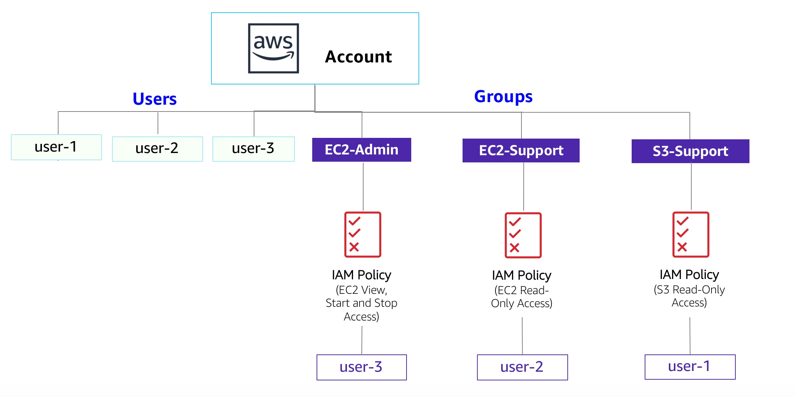

---

### ℹ️ Autres services AWS
Au cours de cet atelier, vous pouvez recevoir des messages d'erreur si vous réalisez des opérations qui dépassent le cadre de cet atelier. Ces messages n'ont aucun impact sur la réalisation de cet atelier.

### 🔑 IAM
IAM peut être utilisé dans les cas suivants :
* **Gestion des utilisateurs IAM et de leur accès :** Vous pouvez créer des utilisateurs et leur assigner des identifiants de sécurité individuels (clés d'accès, mots de passe et dispositifs d'authentification multifacteur). Vous pouvez gérer les autorisations pour contrôler les opérations qu'un utilisateur peut effectuer.
* **Gestion des rôles IAM et de leurs autorisations :** Un rôle IAM est semblable à un utilisateur, dans le sens où il s'agit d'une identité AWS associée à des politiques d'autorisations qui déterminent ce que l'identité peut et ne peut pas faire dans AWS (Amazon Web Services). Cependant, au lieu d'être associé à une seule personne, un rôle peut être endossé par tous ceux qui en ont besoin.
* **Gestion des utilisateurs fédérés et de leurs autorisations :** Vous pouvez activer la fédération d'identité pour autoriser les utilisateurs existants de votre entreprise à accéder à AWS Management Console, à appeler des API AWS et à accéder à des ressources, sans avoir à créer un utilisateur IAM pour chaque identité.

---

### ⏱️ Durée
Cet atelier dure environ **60 minutes**.

---

### 🖥️ Accès à AWS Management Console

1. En haut à droite de ces instructions, choisissez **Démarrer l’atelier**.
   > 💡 **Conseil de dépannage :** Si vous recevez le message d’erreur *Access Denied (Accès refusé)*, fermez la fenêtre d’erreur, et choisissez de nouveau **Démarrer l’atelier**.
2. Les informations suivantes décrivent les différents états de l’atelier :
   * 🔴 **Cercle rouge** à côté d'AWS (coin supérieur gauche) : L'atelier n'a pas démarré.
   * 🟡 **Cercle jaune** à côté d'AWS (coin supérieur gauche) : L'atelier est en cours de démarrage.
   * 🟢 **Cercle vert** à côté d'AWS (coin supérieur gauche) : L'atelier est prêt.
3. Attendez que l’atelier soit prêt avant de continuer.
4. En haut de ces instructions, choisissez le cercle vert en regard d'AWS.
   * Cette option permet d’accéder à **AWS Management Console** dans un nouvel onglet du navigateur. Le système s’y connecte automatiquement.
   > 💡 **Conseil :** Si le nouvel onglet ne s'affiche pas, une bannière ou une icône située en haut du navigateur peut indiquer que votre navigateur bloque l'ouverture des fenêtres contextuelles. Cliquez sur la bannière ou l'icône, puis sélectionnez **Allow pop-ups (Autoriser les fenêtres contextuelles)**.
5. Si un message vous invite à basculer vers la nouvelle page d’accueil de la console, choisissez **Switch to the new Console Home (Basculer vers la nouvelle page d’accueil de la console)**.
6. Placez l'onglet AWS Management Console et ces instructions côte à côte. L’idéal est de pouvoir afficher les deux onglets du navigateur en même temps pour suivre plus facilement les étapes de l'atelier.
7. Ne modifiez pas la région de l'atelier, sauf si vous y êtes invité.

---

## 🛠️ Tâche 1 : Création d’une politique en matière de mot de passe de compte

Au cours de cette tâche, vous allez créer un politique des gestion des mots de passe pour votre compte AWS. Cette politique affecte tous les utilisateurs associés au compte.

1. Tout d'abord, notez la région dans laquelle vous vous trouvez, par exemple Oregon. La région est affichée dans le coin supérieur droit de la page de la console.
2. Dans **AWS Management Console**, dans la zone de recherche, saisissez `IAM` et sélectionnez-le.
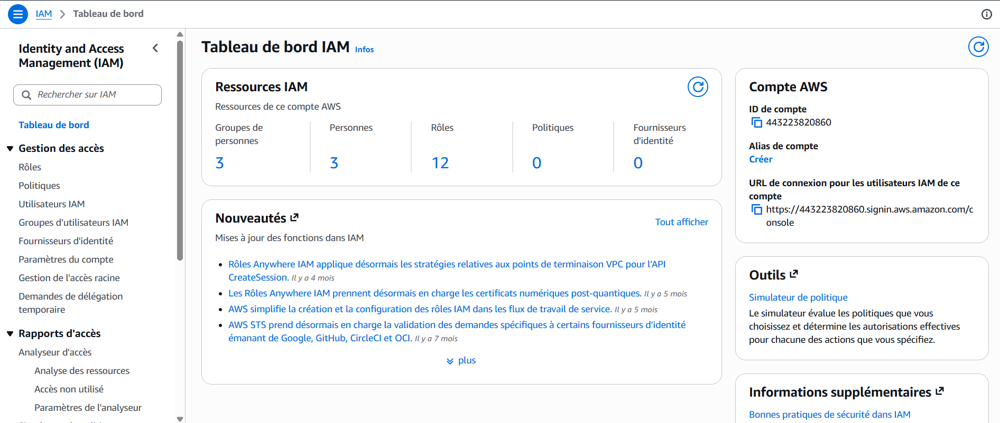
3. Dans le volet de navigation de gauche, choisissez **Account settings (Paramètres de compte)**.
4. Vous pouvez consulter ici la politique en matière de mot de passe par défaut actuellement active. La société dans laquelle vous travaillez impose des exigences beaucoup plus rigoureuses et vous devez mettre à jour cette politique.
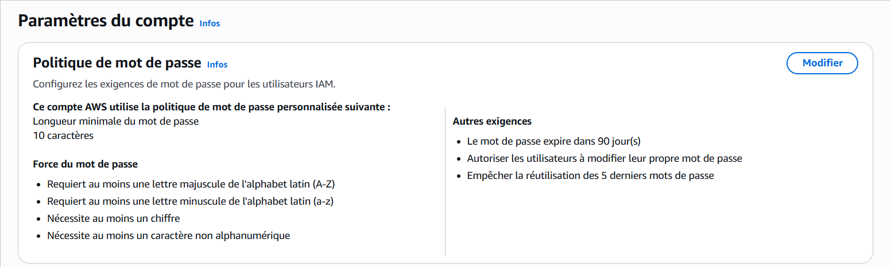
5. Choisissez **Change password policy (Modifier la politique en matière de mot de passe)**.
6. Sous **Select your account password policy requirements (Sélectionner les conditions de la politique en matière de mot de passe des comptes)**, configurez les options suivantes :
   * Sous **Enforce minimum password length (Imposer une longueur de mot de passe minimum)**, remplacez `8` par `10` caractères.
   * Cochez chaque case, à l’exception de **Password expiration requires administrator reset (L’expiration du mot de passe nécessite la réinitialisation par un administrateur)**.
   * Sous **Enable password expiration (Activer l’expiration des mots de passe)**, laissez l’option par défaut correspondant à **90 jours**.
   * Pour l’option **Prevent password reuse (Interdire la réutilisation des mots de passe)**, laissez l’option par défaut correspondant à **5 mots de passe**.
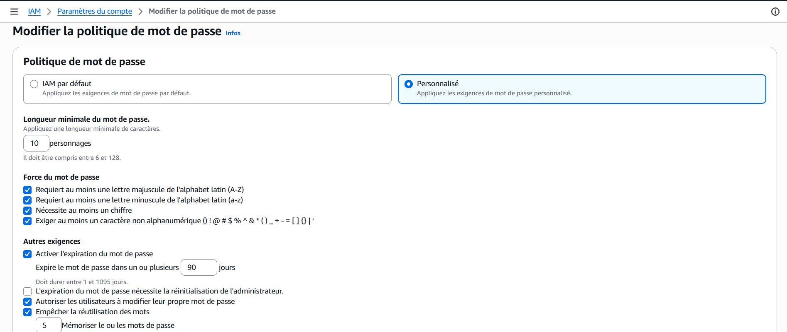
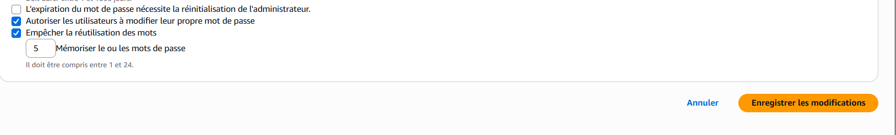
7. Sélectionnez **Save changes (Enregistrer les modifications)**.

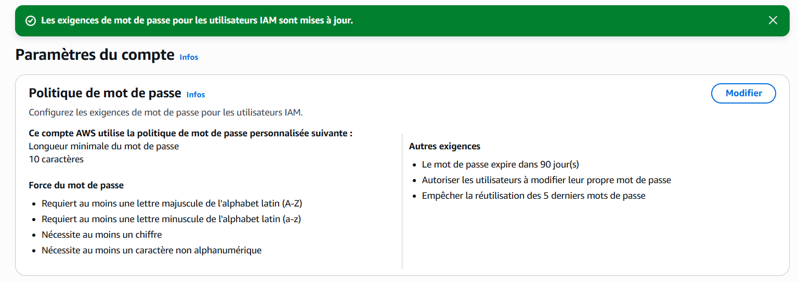
> ℹ️ Ces modifications s’appliquent au niveau du compte AWS et pour chaque utilisateur associé au compte.

#### 📝 Résumé de la tâche 1
Au cours de cette tâche, vous avez renforcé les exigences en matière de mot de passe en créant une politique en matière de mot de passe personnalisée. Les différentes options de la politique en matière de mot de passe que vous avez sélectionnées rendent les mots de passe créés par les utilisateurs plus difficiles à pirater.

---

## 🔍 Tâche 2 : Exploration des utilisateurs et des groupes d’utilisateurs

Au cours de cette tâche, vous allez explorer les utilisateurs et les groupes d’utilisateurs qui ont déjà été créés pour vous dans le service IAM.

1. Dans le volet de navigation de gauche, choisissez **Users (Utilisateurs)**.
2. Les utilisateurs IAM suivants ont déjà été créés pour vous :
   * `user-1`
   * `user-2`
   * `user-3`
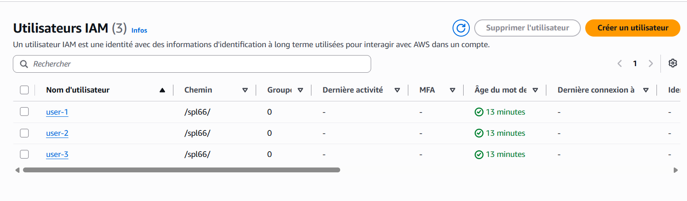
3. Choisissez **user-1**.
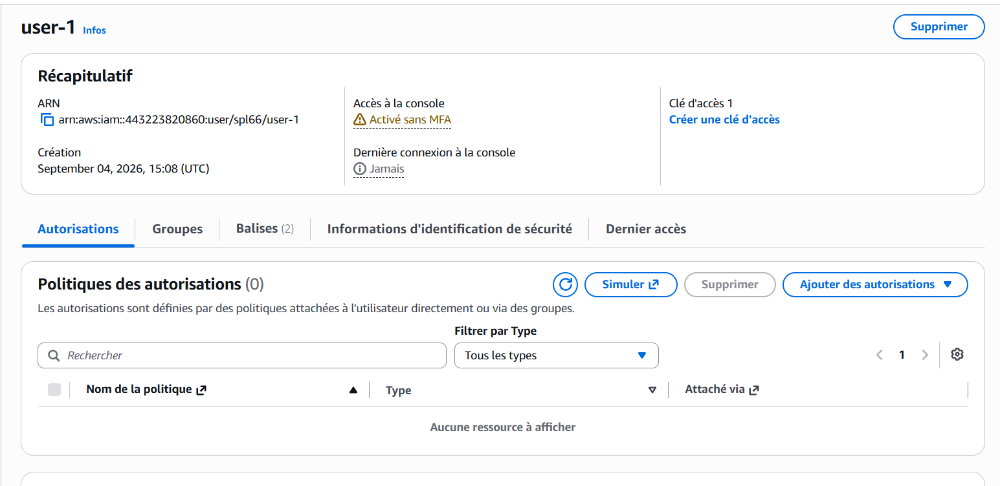
   * La page **Summary (Résumé)** de `user-1` s’affiche. L'onglet **Permissions (Autorisations)** s'affiche.
   * Notez que l'utilisateur `user-1` ne dispose d'aucun droit d'accès.
4. Choisissez l'onglet **Groups (Groupes)**.
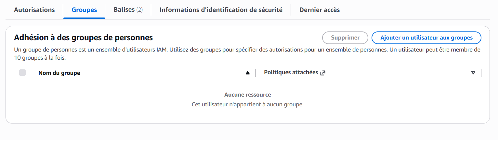
   * L'utilisateur `user-1` n'est membre d'aucun groupe.
   > ℹ️ Un groupe d’utilisateurs est composé de plusieurs utilisateurs disposant d’un accès aux mêmes données. Les privilèges peuvent être distribués au groupe entier d’utilisateurs plutôt que de manière individuelle. Cette option est plus efficace pour définir les autorisations et offre un meilleur contrôle général de l’accès aux ressources que la configuration des autorisations de manière individuelle.
5. Sélectionnez l'onglet **Security credentials (Informations d'identification de sécurité)**.
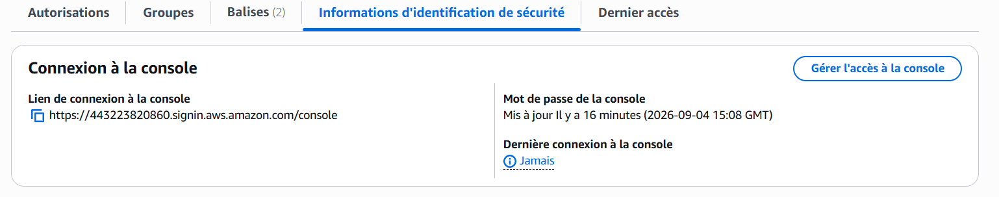
   * Un mot de passe de console est attribué à l'utilisateur `user-1`.
6. Dans le volet de navigation de gauche, choisissez **User groups (Groupes d'utilisateurs)**.
7. Les groupes d’utilisateurs suivants ont déjà été créés pour vous :
   * `EC2-Admin`
   * `EC2-Support`
   * `S3-Support`
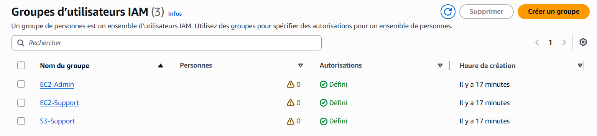
8. Choisissez le groupe **EC2-Support**.
   * Vous accédez alors à la page Summary (Résumé) du groupe `EC2-Support`.
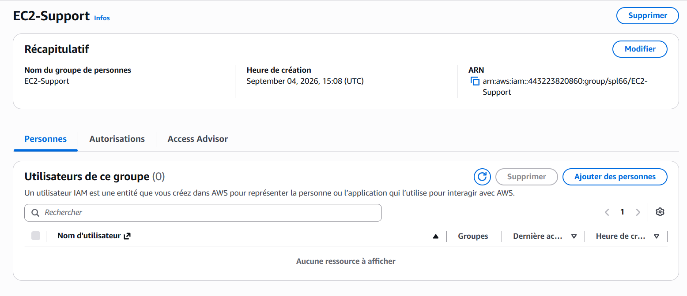
9. Choisissez l'onglet **Permissions (Autorisations)**.
   * Une politique gérée appelée `AmazonEC2ReadOnlyAccess` est associée à ce groupe. Les politiques gérées sont des politiques préconçues (par AWS ou par vos administrateurs) qui peuvent être attachées aux utilisateurs et aux groupes d’utilisateurs IAM. Lorsque la politique est mise à jour, les changements s'appliquent immédiatement à tous les utilisateurs et groupes d’utilisateurs qui lui sont associés.
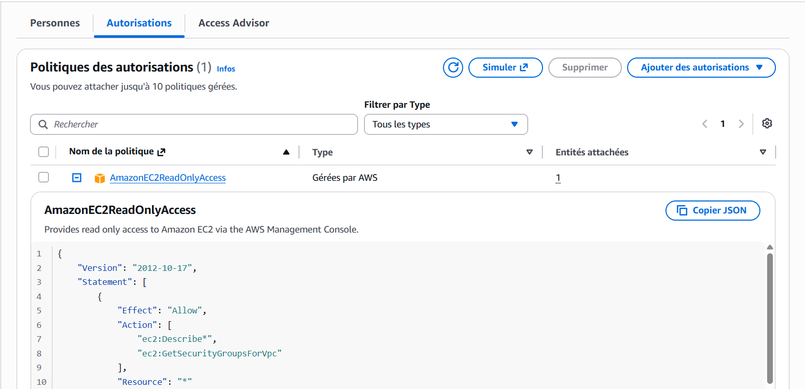
10. Cliquez sur l'icône plus (**+**) en regard de la politique `AmazonEC2ReadOnlyAccess` pour en afficher les détails.
    * Une politique définit les actions autorisées ou refusées pour des ressources AWS spécifiques. Cette politique accorde des autorisations permettant de répertorier et de décrire les informations relatives à Amazon Elastic Compute Cloud (EC2), Elastic Load Balancing (ELB), Amazon CloudWatch et Amazon Auto Scaling EC2. La possibilité d'afficher les ressources sans les modifier est idéale pour un rôle de support.
    * La structure de base des déclarations dans une politique IAM est la suivante :
      * **Effect (Effet)** propose l'option `Allow` (Autoriser) ou `Deny` (Refuser) pour autoriser ou refuser les autorisations.
      * **Action** indique les appels d'API qui peuvent être effectués par rapport à un service AWS (par exemple, `cloudwatch:ListMetrics`).
      * **Resource (Ressource)** définit la portée des entités concernées par la règle de politique (par exemple, un compartiment Amazon Simple Storage Service [Amazon S3], une instance EC2 en particulier ou bien un astérisque `*` qui correspond à n'importe quelle ressource).
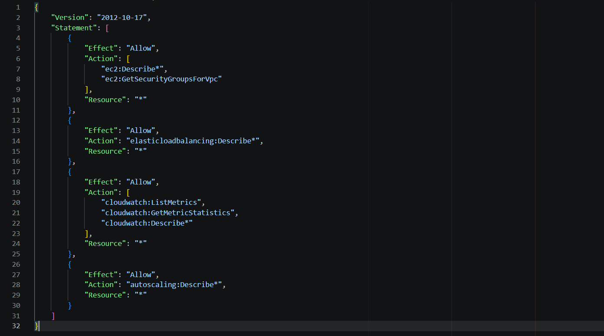
11. Dans le volet de navigation de gauche, choisissez **User groups (Groupes d'utilisateurs)**.
12. Choisissez le groupe **S3-Support**.
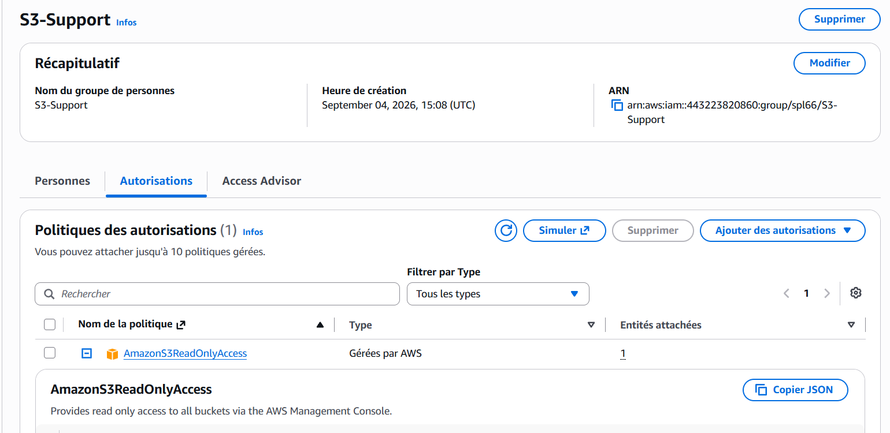
13. Choisissez l'onglet **Permissions (Autorisations)**.
    * Le groupe `S3-Support` est associé à la politique `AmazonS3ReadOnlyAccess`.
14. Cliquez sur l'icône plus (**+**) en regard de la politique `AmazonS3ReadOnlyAccess` pour en afficher les détails.
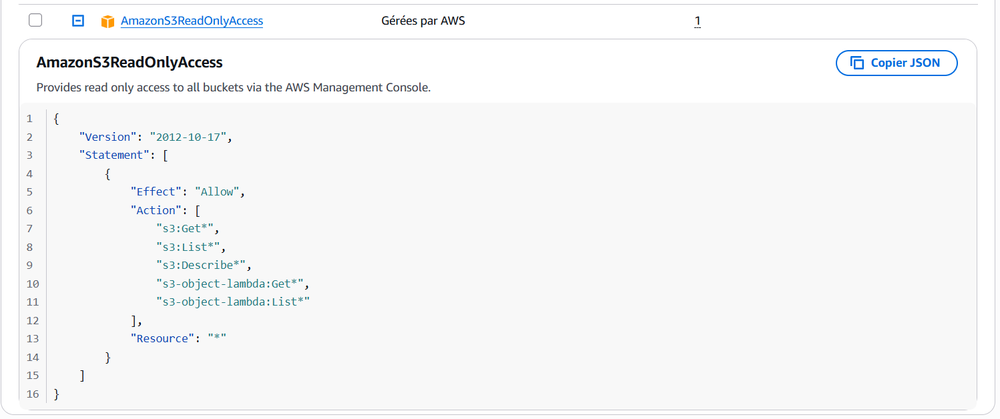
    * Cette politique accorde l'autorisation d'exécuter des commandes Get et List sur les ressources dans Amazon S3.
15. Dans le volet de navigation de gauche, choisissez **User groups (Groupes d'utilisateurs)**.
16. Sélectionnez le groupe **EC2-Admin**.
17. Choisissez l'onglet **Permissions (Autorisations)**.
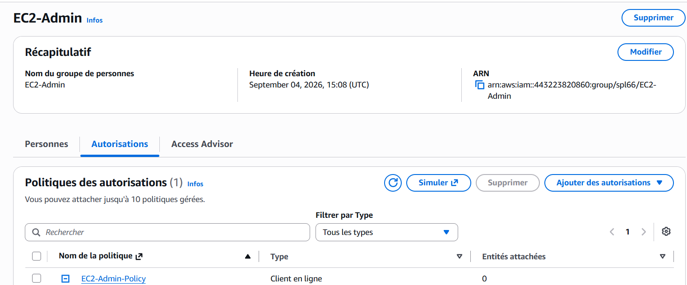
    * Ce groupe est légèrement différent des deux autres. Plutôt que d'être associé à une politique gérée, il utilise une politique intégrée, laquelle est affectée à un seul utilisateur ou groupe. Les politiques intégrées sont généralement utilisées pour appliquer des autorisations à des situations exceptionnelles.
18. Cliquez sur l'icône plus (**+**) en regard de la politique `EC2-Admin-Policy` pour en afficher les détails.
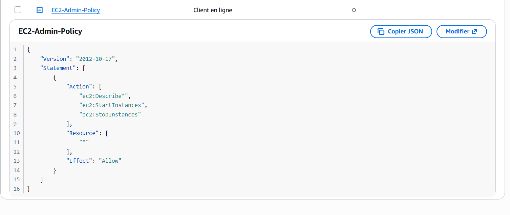
    * Cette politique accorde l'autorisation de voir (Describe) les informations à propos d'Amazon EC2. Elle offre également la possibilité de lancer et d'arrêter les instances.

#### Étapes complémentaires de révision de politique :
* Dans **Actions**, cliquez sur le lien **Show Policy (Afficher la politique)**.
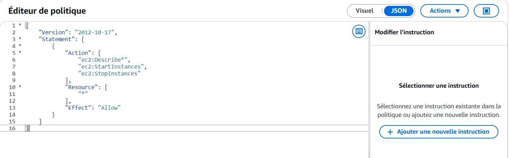
  * Une politique définit les actions autorisées ou refusées pour des ressources AWS spécifiques. Cette politique accorde des autorisations permettant de répertorier et de décrire les informations relatives à Amazon Elastic Compute Cloud (EC2), Elastic Load Balancing (ELB), Amazon CloudWatch et Amazon Auto Scaling EC2. La possibilité d'afficher les ressources sans les modifier est idéale pour un rôle de support.
  * La structure de base des déclarations dans une politique IAM est la suivante :
    * **Effect (Effet)** propose l'option `Allow` (Autoriser) ou `Deny` (Refuser) pour autoriser ou refuser les autorisations.
    * **Action** indique les appels d'API qui peuvent être effectués par rapport à un service AWS (par exemple, `cloudwatch:ListMetrics`).
    * **Resource (Ressource)** définit la portée des entités concernées par la règle de politique (par exemple, un compartiment Amazon Simple Storage Service [Amazon S3], une instance EC2 en particulier ou bien un astérisque `*` qui correspond à n'importe quelle ressource).
* Pour fermer la fenêtre **Show Policy (Afficher la politique)**, sélectionnez-la.
* Dans le volet de navigation de gauche, choisissez **User groups (Groupes d'utilisateurs)**.
* Choisissez le groupe **S3-Support**.
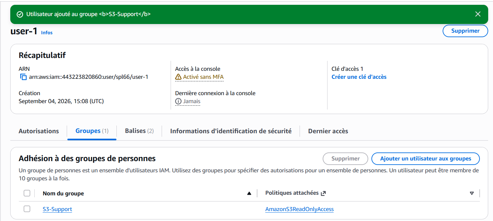
  * Le groupe `S3-Support` est associé à la politique `AmazonS3ReadOnlyAccess`.
* Dans le menu **Actions**, cliquez sur le lien **Show Policy (Afficher la politique)**.
  * Cette politique accorde l'autorisation d'exécuter des commandes Get et List sur les ressources dans Amazon S3.
* Pour fermer la fenêtre **Show Policy (Afficher la politique)**, sélectionnez-la.
* Dans le volet de navigation de gauche, choisissez **User groups (Groupes d'utilisateurs)**.
* Sélectionnez le groupe **EC2-Admin**.
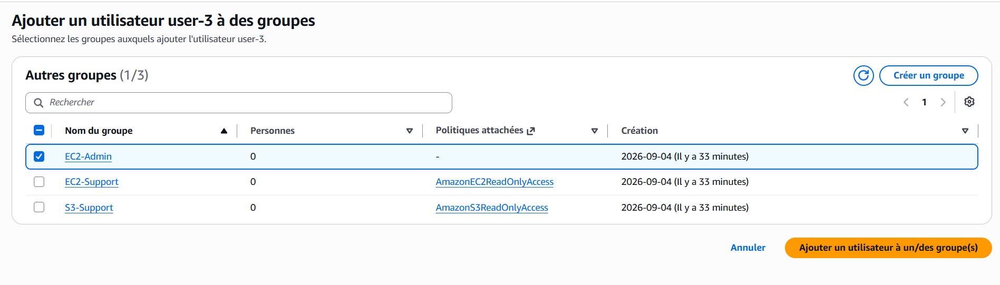
  * Ce groupe est légèrement différent des deux autres. Plutôt que d'être associé à une politique gérée, il utilise une politique intégrée, laquelle est affectée à un seul utilisateur ou groupe. Les politiques intégrées sont généralement utilisées pour appliquer des autorisations à des situations exceptionnelles.
* Dans **Actions**, sélectionnez **Show Policy (Afficher la politique)** pour l'afficher.
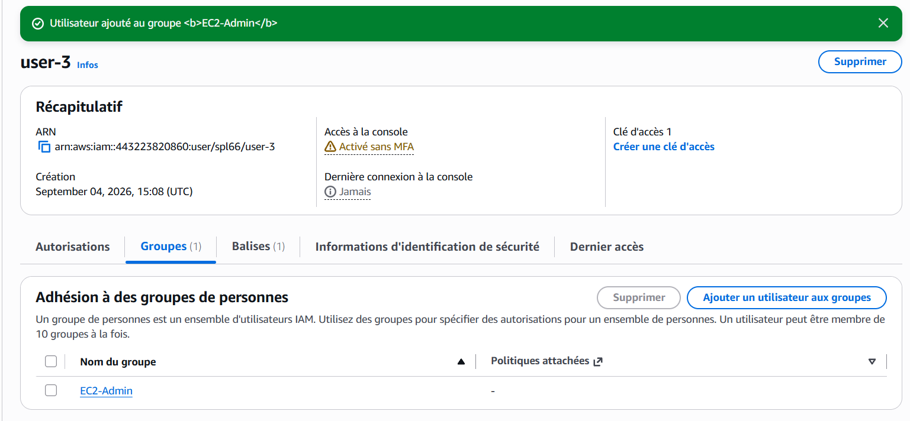
  * Cette politique accorde l'autorisation de voir (Describe) les informations à propos d'Amazon EC2. Elle offre également la possibilité de lancer et d'arrêter les instances.
* En bas de l'écran, choisissez **Cancel (Annuler)** pour fermer la politique.

#### 📝 Résumé de la tâche 2
Au cours de cette tâche, vous avez affiché les utilisateurs et les groupes d’utilisateurs préalablement créés. Vous vous êtes familiarisé avec les politiques associées aux groupes d’utilisateurs et les différences entre les groupes d’utilisateurs et leurs autorisations.

---

## 📋 Scénario métier

Pendant le reste de cet atelier, vous allez travailler avec ces utilisateurs et ces groupes d’utilisateurs pour activer les autorisations soutenant le scénario métier suivant :

> Votre entreprise a de plus en plus recours à AWS et utilise de nombreuses instances EC2 ainsi qu'une grande capacité de stockage Amazon S3. Vous souhaitez y autoriser l'accès à de nouveaux membres du personnel selon leurs fonctions professionnelles.

| Utilisateur | Dans le groupe | Autorisations |
| :--- | :--- | :--- |
| `user-1` | `S3-Support` | Accès en lecture seule à Amazon S3 |
| `user-2` | `EC2-Support` | Accès en lecture seule à Amazon EC2 |
| `user-3` | `EC2-Admin` | Affichage, démarrage et arrêt des instances EC2 |

---

## ➕ Tâche 3 : Ajout d'utilisateurs aux groupes

Vous avez récemment attribué à `user-1` un rôle qui lui permet de fournir du support pour Amazon S3. Vous l'ajouterez au groupe `S3-Support` afin qu'il hérite des autorisations nécessaires grâce à la politique `AmazonS3ReadOnlyAccess` associée.

> ℹ️ Vous pouvez ignorer toutes les erreurs `not authorized` (Non autorisé) qui apparaissent durant cette tâche. Elles sont liées au fait que votre compte d'atelier dispose d'autorisations limitées, mais cela ne devrait pas vous empêcher de mener à bien cet atelier.

### Ajout de l'utilisateur `user-1` au groupe `S3-Support`
1. Dans le volet de navigation de gauche, choisissez **User groups (Groupes d'utilisateurs)**.

2. Choisissez le groupe **S3-Support**.
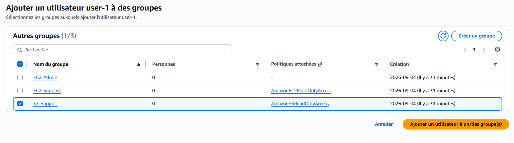
3. Cliquez sur l'onglet **Users (Utilisateurs)**.
4. Dans l'onglet **Users (Utilisateurs)**, choisissez **Add Users (Ajouter des utilisateurs)**.
5. Dans la fenêtre **Add users to S3-Support (Ajouter des utilisateurs au groupe S3-Support)**, configurez les éléments suivants :
   * Cochez la case correspondant à `user-1`.
   * Sélectionnez **Add Users (Ajouter des utilisateurs)**.

6. Dans l'onglet **Users (Utilisateurs)**, notez que l'utilisateur `user-1` a été ajouté au groupe.

### Ajout de l'utilisateur `user-2` au groupe `EC2-Support`
* Vous avez attribué à `user-2` un rôle qui lui permet de fournir du support pour Amazon EC2.
* Suivez les étapes précédentes de cette tâche pour ajouter `user-2` au groupe `EC2-Support`.
* L'utilisateur `user-2` doit désormais faire partie du groupe `EC2-Support`.
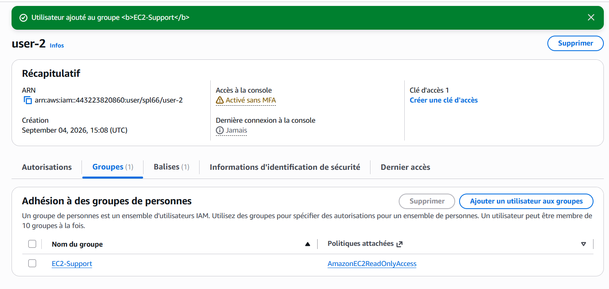

### Ajout de l'utilisateur `user-3` au groupe `EC2-Admin`
* Vous avez attribué à `user-3` un rôle d'administrateur Amazon EC2 pour qu'il gère vos instances EC2.
* Suivez les étapes précédentes de cette tâche pour ajouter `user-3` au groupe `EC2-Admin`.
* L'utilisateur `user-3` doit désormais faire partie du groupe `EC2-Admin`.

### Vérification finale
1. Dans le volet de navigation de gauche, choisissez **User groups (Groupes d'utilisateurs)**.
2. Chaque groupe devrait afficher le nombre **1** dans la colonne **Users (Utilisateurs)**, correspondant au nombre d'utilisateurs de chaque groupe.
3. Si **1** n'apparaît pas à côté de chaque groupe, consultez les instructions de cette tâche pour vous assurer que chaque utilisateur est attribué à un groupe, comme l’illustre le tableau au début de la section *Scénario métier*.
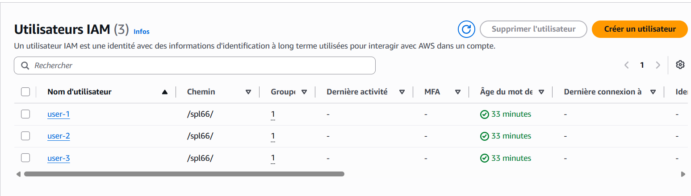

#### 📝 Résumé de la tâche 3
Au cours de cette tâche, vous avez ajouté tous les utilisateurs associés aux groupes d’utilisateurs.

---

## 🧪 Tâche 4 : Connexion et test des autorisations d’utilisateurs

Au cours de cette tâche, vous allez tester les autorisations de chaque utilisateur IAM.

1. Dans le volet de navigation de gauche, sélectionnez **Dashboard (Tableau de bord)**.
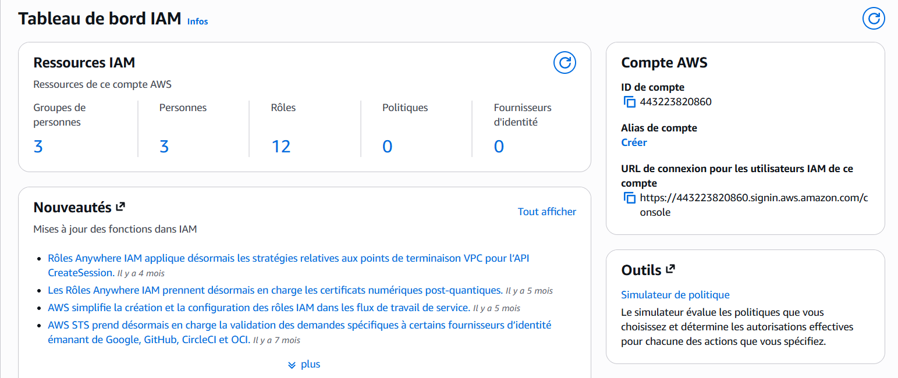
2. La section **AWS Account (Compte AWS)** comprend l’URL de connexion pour les utilisateurs IAM de ce compte. Ce lien ressemble à : `https://123456789012.signin.aws.amazon.com/console`
3. Utilisez ce lien pour vous connecter au compte AWS que vous utilisez actuellement.
4. Copiez l’URL de connexion pour les utilisateurs IAM de ce compte dans un éditeur de texte.
5. Ouvrez une fenêtre privée à l’aide des instructions suivantes dans votre navigateur web :
   * **Mozilla Firefox :** Choisissez les barres de menu dans l’angle supérieur droit de l’écran $\rightarrow$ Sélectionnez **Nouvelle fenêtre privée**.
   * **Google Chrome :** Cliquez sur les points de suspension dans l’angle supérieur droit de l’écran $\rightarrow$ Sélectionnez **Nouvelle fenêtre de navigation privée**.
   * **Microsoft Edge :** Cliquez sur les points de suspension dans l’angle supérieur droit de l’écran $\rightarrow$ Sélectionnez **New InPrivate window (Nouvelle fenêtre InPrivate)**.
   * **Microsoft Internet Explorer :** Choisissez l'option de menu **Outils** $\rightarrow$ Choisissez **Navigation InPrivate**.
6. Collez l’URL de connexion pour les utilisateurs IAM de ce compte dans la fenêtre privée, puis appuyez sur **Entrée**.

---

### Connexion et test en tant que `user-1` (Support S3)
1. Connectez-vous maintenant avec le profil `user-1`, auquel a été attribué un rôle au sein de votre équipe de support pour le stockage Amazon S3.
2. Connectez-vous à l'aide des informations d’identification suivantes :
   * **IAM user name:** Saisissez `user-1`
   * **Password:** Saisissez `Lab-Password1`
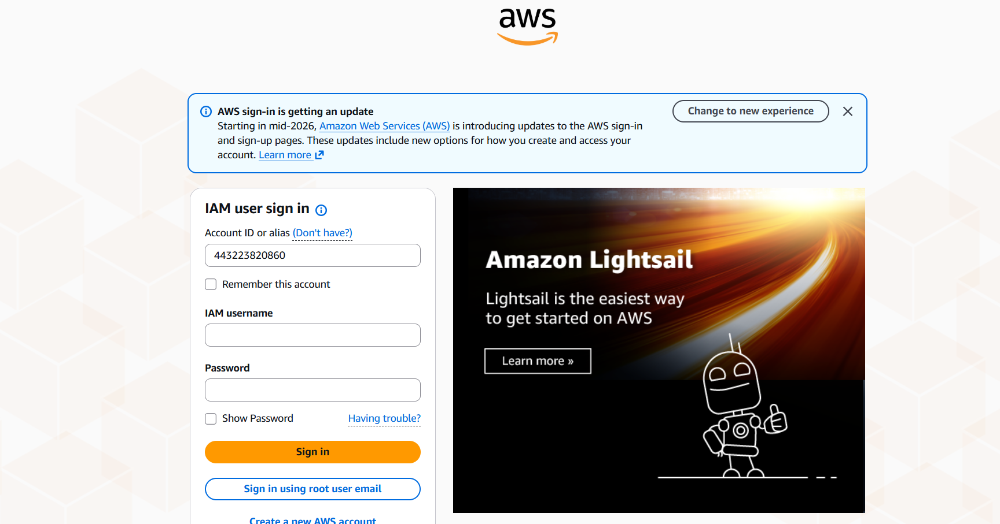
3. Sélectionnez **Sign in (Connexion)**.
4. Si un message vous invite à basculer vers la nouvelle page d’accueil de la console, choisissez **Switch to the new Console Home (Basculer vers la nouvelle page d’accueil de la console)**.
5. Dans le menu **Services**, choisissez **S3**.
6. Choisissez le nom de l'un de vos compartiments et explorez-en le contenu.
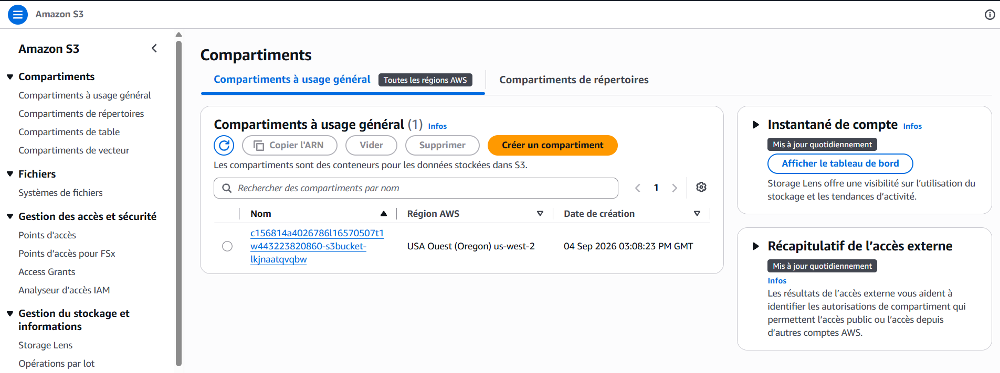
    * *Comme votre utilisateur fait partie du groupe S3-Support dans IAM, il a l'autorisation d’afficher la liste des compartiments S3 et leur contenu.*
8. À présent, vérifiez s'il a accès à Amazon EC2 :
   * Dans le menu **Services**, sélectionnez **EC2**.
   * Dans le volet de navigation de gauche, sélectionnez **Instances**.
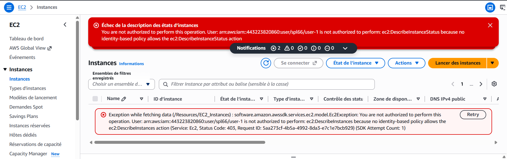
   * *Vous ne pouvez voir aucune instance. En revanche, un message s’affiche indiquant : `You are not authorized to perform this operation.` (Vous n'êtes pas autorisé à effectuer cette opération). Ce message s’affiche, car aucune autorisation n'a été attribuée à votre utilisateur pour l'utilisation d'Amazon EC2.*

---

### Connexion et test en tant que `user-2` (Support EC2)
Vous allez vous connecter en tant que `user-2`, qui s'est vu assigné un rôle au sein de votre équipe de support Amazon EC2.

1. Déconnectez l'utilisateur `user-1` dans AWS Management Console en effectuant les opérations suivantes :
   * En haut de l'écran, choisissez `user-1`.
   * Choisissez **Sign out (Se déconnecter)**.
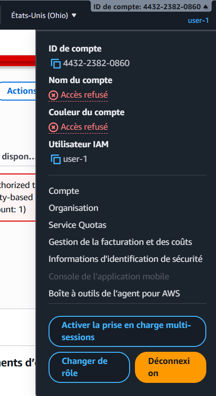
2. Collez l’URL de connexion pour les utilisateurs IAM de ce compte dans la fenêtre privée, puis appuyez sur **Entrée**. *(Ce lien doit se trouver dans votre éditeur de texte).*
3. Connectez-vous à l'aide des informations d’identification suivantes :
   * **IAM user name:** Saisissez `user-2`
   * **Password:** Saisissez `Lab-Password2`
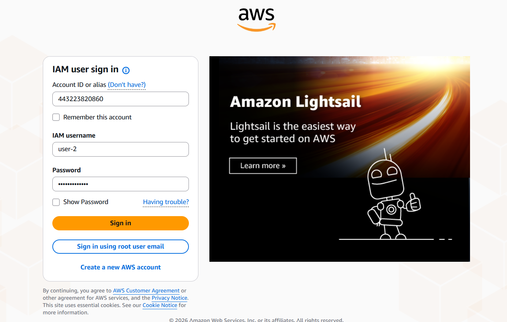
4. Sélectionnez **Sign in (Connexion)**.
5. Si un message vous invite à basculer vers la nouvelle page d’accueil de la console, choisissez **Switch to the new Console Home (Basculer vers la nouvelle page d’accueil de la console)**.
6. Dans le menu **Services**, sélectionnez **EC2**.
7. Dans le volet de navigation de gauche, sélectionnez **Instances**.
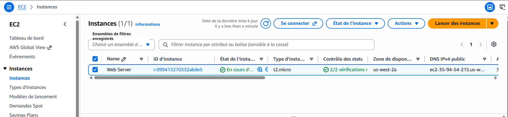
   * *Vous pouvez désormais afficher une instance EC2, car vous bénéficiez d'autorisations en lecture seule. Cependant, vous ne pouvez pas modifier les ressources Amazon EC2.*
   * *Si vous ne pouvez toujours pas afficher d’instance EC2, cela signifie que votre région est probablement incorrecte. Dans l’angle supérieur droit de l'écran, déroulez le menu **Region (Région)** et sélectionnez la région que vous avez notée au début de l'atelier (par exemple, Oregon).*
8. Votre instance EC2 doit être sélectionnée. Si ce n’est pas le cas, sélectionnez-la.
9. Cliquez ensuite dans la liste déroulante **Instance state (État de l'instance)** et choisissez **Stop instance (Arrêter l'instance)**.
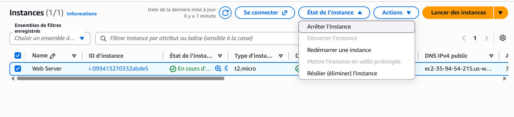
10. Dans la fenêtre **Stop instance? (Arrêter l'instance ?)**, choisissez **Stop (Arrêter)**.
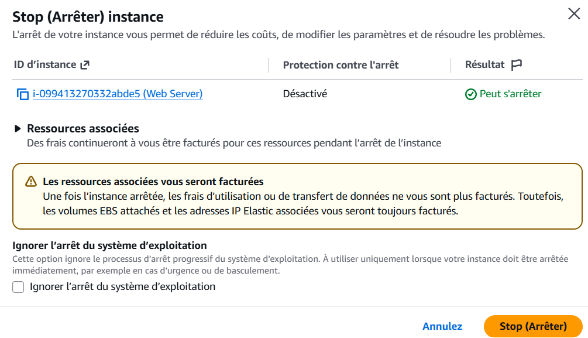
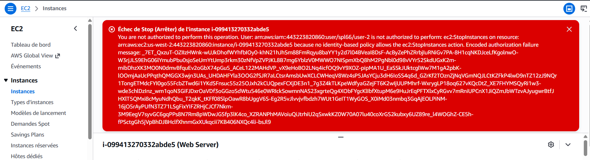
    * *Un message d’erreur s’affiche indiquant `Failed to stop the instance. You are not authorized to perform this operation` (Impossible d’arrêter l’instance. Vous n'êtes pas autorisé à effectuer cette opération.) Ce message indique que la politique vous autorise uniquement à afficher les informations, mais ne vous autorise pas à effectuer des modifications.*
12. Dans la fenêtre **Stop Instances (Arrêter les instances)**, cliquez sur **Cancel (Annuler)**.
13. Vérifiez ensuite si l'utilisateur `user-2` peut accéder à Amazon S3 :
    * Dans le menu **Services**, choisissez **S3**.
  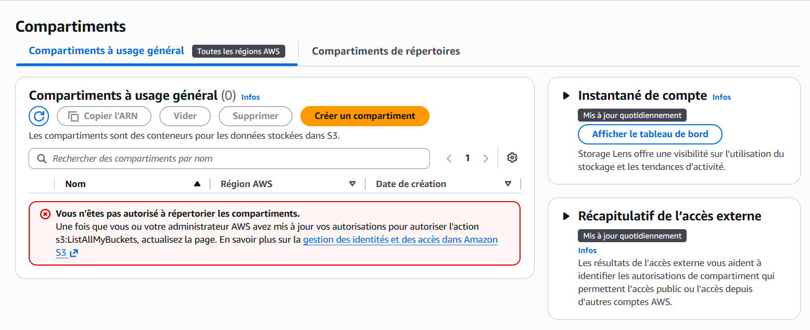
    * *Le message d'erreur `You don't have permissions to list buckets` (Vous n'êtes pas autorisé à afficher les compartiments) s'affiche, car `user-2` n'a pas les autorisations nécessaires pour utiliser Amazon S3.*

---

### Connexion et test en tant que `user-3` (Administrateur EC2)
Connectez-vous maintenant sous le profil `user-3`, qui s'est vu attribuer un rôle d'administrateur pour Amazon EC2.

1. Déconnectez l'utilisateur `user-2` dans AWS Management Console en effectuant les opérations suivantes :
   * En haut de l'écran, choisissez `user-2`.
   * Choisissez **Sign out (Se déconnecter)**.
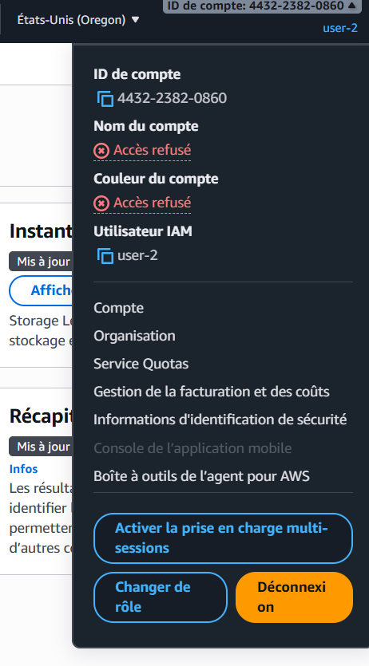
2. Collez l’URL de connexion pour les utilisateurs IAM de ce compte dans la fenêtre privée, puis appuyez sur **Entrée**. *(S'il ne figure pas dans le presse-papier, récupérez-le dans l'éditeur de texte où vous l'avez collé auparavant).*
3. Connectez-vous à l'aide des informations d’identification suivantes :
   * **IAM user name:** Saisissez `user-3`
   * **Password:** Saisissez `Lab-Password3`
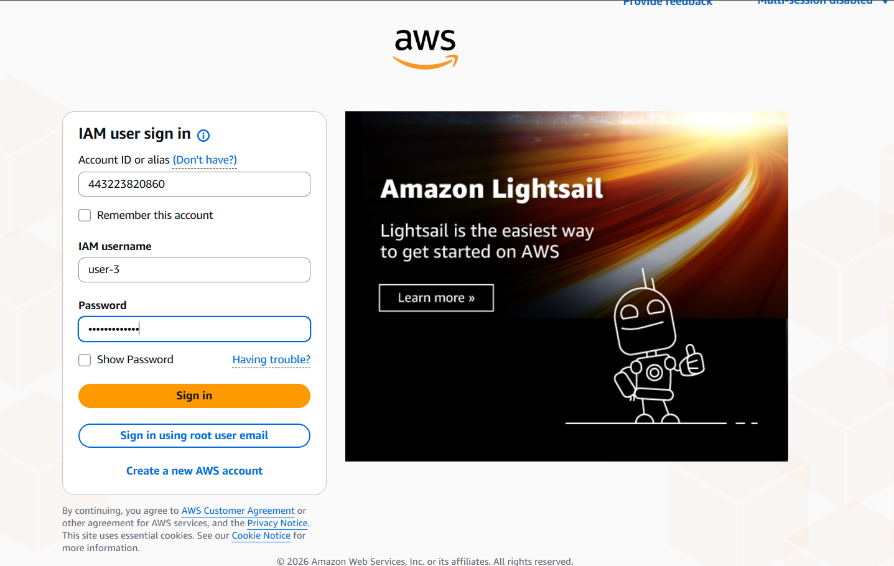
4. Sélectionnez **Sign in (Connexion)**.
5. Si un message vous invite à basculer vers la nouvelle page d’accueil de la console, choisissez **Switch to the new Console Home (Basculer vers la nouvelle page d’accueil de la console)**.
6. Dans le menu **Services**, sélectionnez **EC2**.
7. Dans le volet de navigation de gauche, sélectionnez **Instances**.
 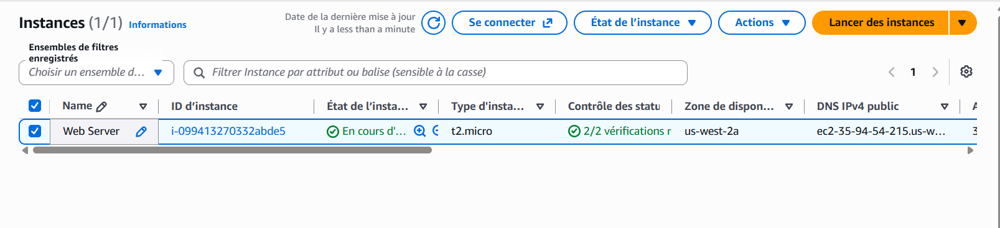
   * *En tant qu'administrateur EC2, vous devez avoir maintenant l'autorisation d'arrêter l'instance EC2.*
8. Votre instance EC2 doit être sélectionnée. Si ce n’est pas le cas, sélectionnez-la.
   * *Si vous ne pouvez toujours pas afficher d’instance EC2, cela signifie que votre région est probablement incorrecte. Dans l’angle supérieur droit de l'écran, déroulez le menu **Region (Région)** et sélectionnez la région que vous avez notée au début de l'atelier (par exemple, Oregon).*
9. Cliquez ensuite dans la liste déroulante **Instance state (État de l'instance)** et choisissez **Stop instance (Arrêter l'instance)**.
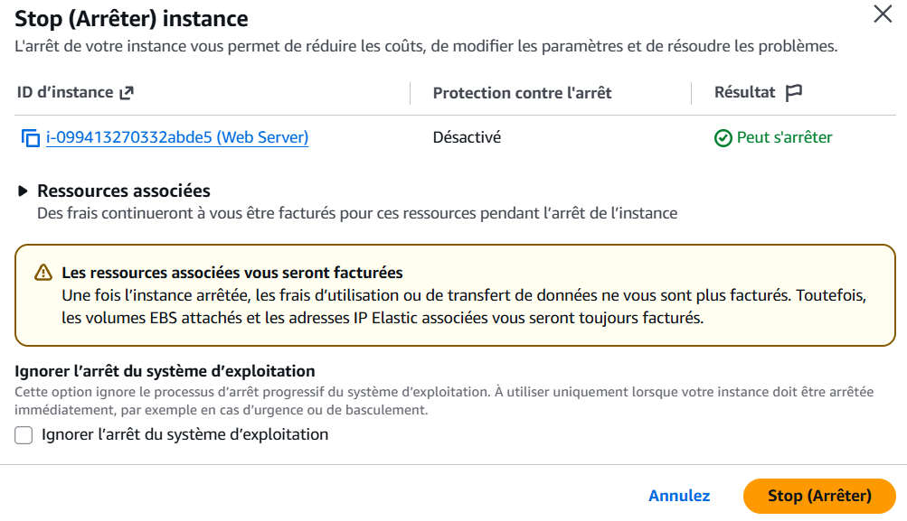
10. Dans la fenêtre **Stop instance? (Arrêter l'instance ?)**, choisissez **Stop (Arrêter)**.
 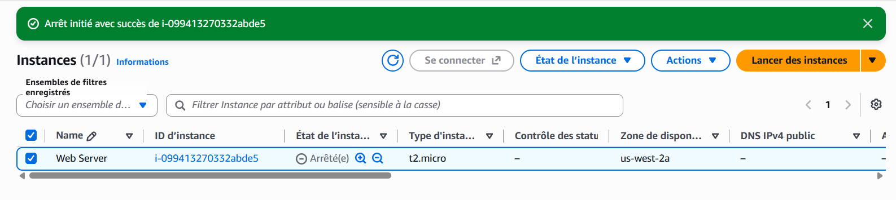
    * *L'état de l'instance devient **Stopping (En cours d'arrêt)** et l'instance s'arrête.*
11. Fermez votre fenêtre de navigation privée.

#### 📝 Résumé de la tâche 4
Au cours de cette tâche, vous vous êtes connecté avec le profil des trois utilisateurs. Vous avez vérifié que l’utilisateur `user-1` pouvait afficher les compartiments S3, mais pas les instances EC2. Vous avez ensuite ouvert une session avec le profil `user-2` et vérifié qu’il pouvait afficher les instances EC2, mais pas arrêter l’instance. `user-2` ne pouvait pas non plus afficher les compartiments S3. Après avoir ouvert une session sous le profil `user-3`, vous avez pu afficher les instances EC2 et arrêter l’instance.

---

## 🏆 Conclusion

**Félicitations ! Vous avez réussi à :**
- [x] Créer et appliquer une politique en matière de mot de passe IAM.
- [x] Explorer les utilisateurs et les groupes d’utilisateurs IAM préalablement créés.
- [x] Examiner les politiques IAM appliquées aux groupes d’utilisateurs préalablement créés.
- [x] Ajouter des utilisateurs aux groupes d’utilisateurs avec certaines fonctionnalités actives.
- [x] Localiser et utiliser l'URL de connexion IAM.
- [x] Tester les effets des politiques sur l'accès aux services.
