# 🔍 Utilisation d'Amazon Inspector pour l'Évaluation et la Correction des Vulnérabilités

> **Type d'atelier :** TP Pratique AWS / Sécurité & Audit de Vulnérabilités  
> **Services AWS utilisés :** Amazon Inspector, AWS Lambda, Amazon EC2, Amazon ECR  

---

## 📌 Présentation de l'atelier

Dans cet atelier, vous allez utiliser **Amazon Inspector** pour rechercher des vulnérabilités dans vos ressources AWS, en particulier dans les fonctions **AWS Lambda**. Vous allez apprendre à activer Amazon Inspector, à interpréter les rapports de vulnérabilité et à corriger les résultats.

Les développeurs d'**AnyCompany** en sont aux premières phases de la création d'une application utilisant principalement AWS Lambda. Tout au long du processus de développement, ils ont besoin d'un outil de sécurité automatisé qui non seulement analyse les packages logiciels vulnérables, mais également le code lui-même. Vous décidez d'utiliser Amazon Inspector pour répondre à ce besoin.

Amazon Inspector répond aux exigences relatives à l'analyse des fonctions AWS Lambda en réagissant rapidement aux nouveaux déploiements. Il analyse également automatiquement les ressources supplémentaires telles que les instances EC2 et les ressources Amazon ECR sur le compte AWS d'AnyCompany.

---

### 🎯 Objectifs
À la fin de cet atelier, vous serez en mesure d'effectuer les opérations suivantes :
- [x] Activer Amazon Inspector.
- [x] Analyser et interpréter les résultats des vulnérabilités.
- [x] Corriger les vulnérabilités détectées par Amazon Inspector.

### 🏗️ Environnement de l'atelier
L'environnement comporte des fonctions Lambda présentant des vulnérabilités qui seront ensuite analysées par Amazon Inspector et signalées en fonction de leur gravité.

---

### 🔑 Accès à la console de gestion AWS

1. Dans le coin supérieur droit de ces instructions, choisissez **Start Lab (Démarrer l'atelier)**.
   > 💡 **Conseil de dépannage :** Si vous obtenez une erreur *Access Denied (Accès refusé)*, fermez la fenêtre d'erreur et cliquez à nouveau sur **Start Lab (Démarrer l'atelier)**.
2. Les informations suivantes caractérisent les différents états de l'atelier :
   * 🔴 **Cercle rouge** à côté d'AWS (coin supérieur gauche) : L'atelier n'a pas démarré.
   * 🟡 **Cercle jaune** à côté d'AWS (coin supérieur gauche) : L'atelier est en cours de démarrage.
   * 🟢 **Cercle vert** à côté d'AWS (coin supérieur gauche) : L'atelier est prêt.
3. Attendez que l'atelier soit prêt avant de continuer.
4. En haut de ces instructions, choisissez le cercle vert en ce qui concerne AWS.
   * Cette option ouvre la console de gestion AWS dans un nouvel onglet du navigateur. Le système se connecte automatiquement.
   > 💡 **Conseil :** Si le nouvel onglet ne s'affiche pas, une bannière ou une icône située en haut du navigateur peut indiquer que votre navigateur bloque l'ouverture des fenêtres contextuelles. Cliquez sur la bannière ou l'icône, puis sélectionnez **Autoriser les pop ups (Autoriser les fenêtres contextuelles)**.
5. Si un message vous invite à basculer vers la nouvelle page d'accueil de la console, cliquez sur **Switch to the new Console Home (Basculer vers la nouvelle page d'accueil de la console)**.
6. Placez l'onglet AWS Management Console et ces instructions côte à côte. L'idéal est de pouvoir afficher les deux onglets du navigateur en même temps pour suivre plus facilement les étapes de l'atelier.
7. Ne modifiez pas la région de l'atelier, sauf si vous y êtes invité.

---

## 🛠️ Tâche 1 : Activer Amazon Inspector

Dans le cadre de cette tâche, vous activez et exécutez le service Amazon Inspector pour analyser en permanence les fonctions Lambda.

### Étapes d'exécution :
1. Dans la **Console de gestion AWS**, dans la barre de recherche en haut de la page, tapez et choisissez `Inspector`.
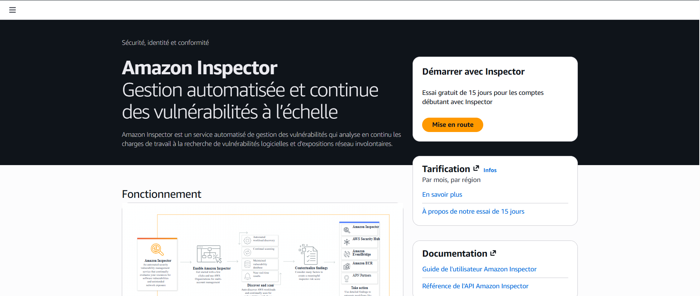
2. Ouvrez le panneau de gauche et choisissez **Activer Inspector** pour l'activer pour votre compte.
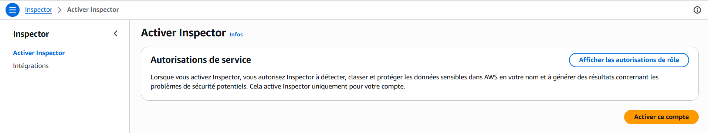
3. Sous **Activer Inspector**, cliquez sur le bouton **Activer Inspector**.
   > ℹ️ **Remarque :** Cela n'est nécessaire que pour la première fois. Après l'activation, un message s'affiche en haut de la page *Bienvenue sur Inspecteur.
Votre première analyse est en cours.* (*Bienvenue dans Inspector. Votre première analyse est en cours.*)
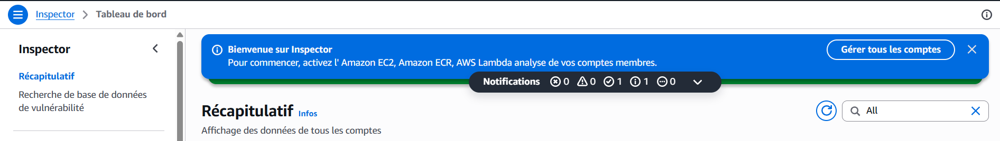
4. Si vous êtes invité à répondre à une enquête intitulée *Feedback for Amazon Inspector (Commentaires sur Amazon Inspector)*, choisissez **Annuler**.
5. Fermez toutes les bannières en haut de la page.
6. Actualisez la page régulièrement jusqu'à ce que vous voyiez apparaître **Tableau de bord > Résumé > Couverture de l'environnement > Fonctions Lambda** (*Tableau de bord > Résumé > Couverture de l'environnement > Fonctions Lambda*) à **100 %**.
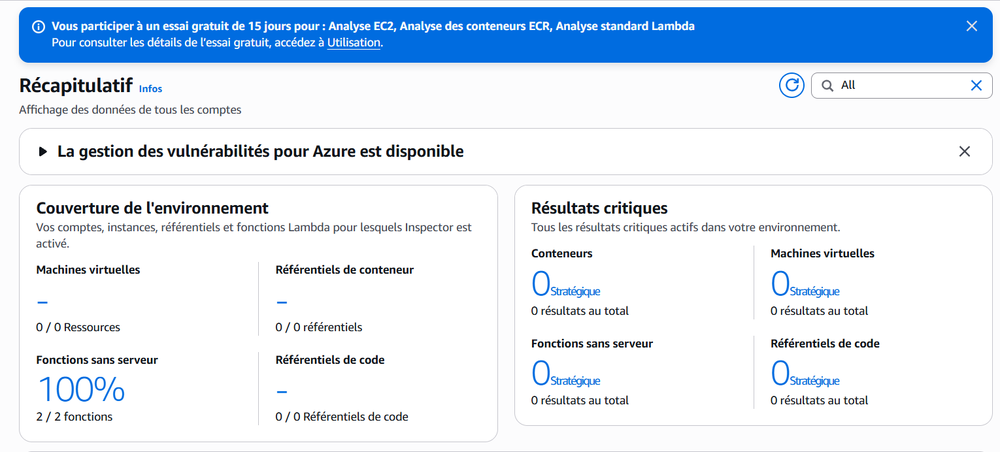
> ℹ️ Le tableau de bord indique votre numéro de compte et l'état d'activation d'AWS Lambda. Par défaut, l'analyse est activée pour l'analyse standard Amazon EC2, Amazon ECR et AWS Lambda.

---

## 🔬 Tâche 2 : Examen des ressources inspectées

Dans le cadre de cette tâche, en attendant la fin de l'analyse, vous passez en revue l'environnement d'atelier actuel (l'instance EC2 et les fonctions Lambda) pour comprendre quelles ressources spécifiques sont analysées par Amazon Inspector.

### Tâche 2.1 : Examen de vos fonctions Lambda
1. Dans les **Résultats** sur la gauche, choisissez **Tous les résultats**.
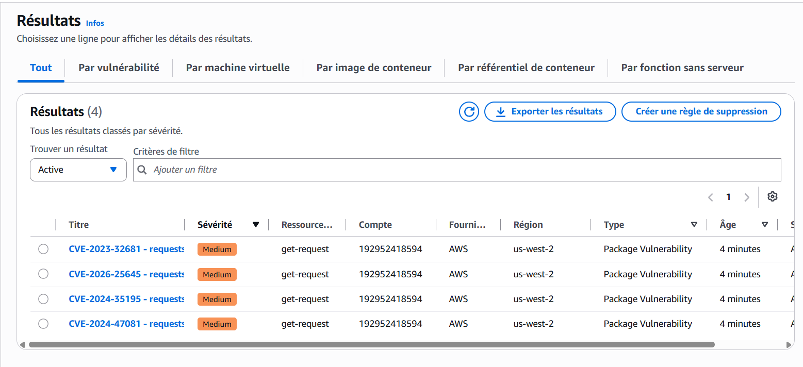
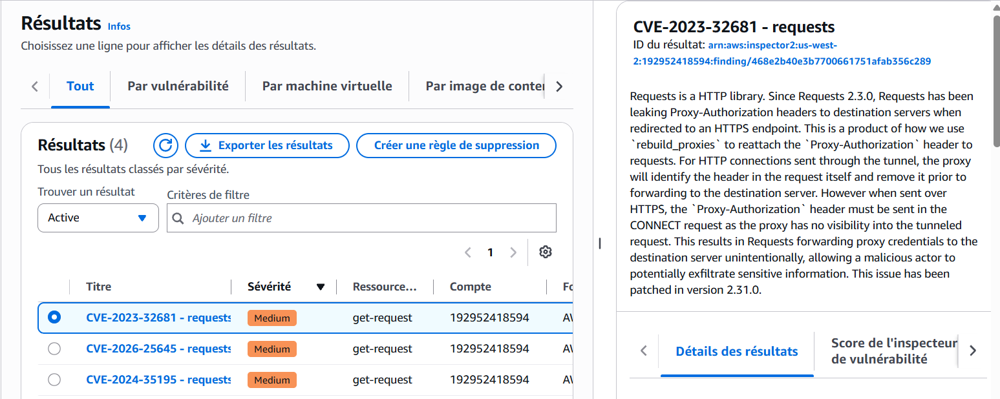
3. Trois lignes sont affichées, une pour chaque vulnérabilité de la fonction Lambda. Vous devriez voir les principaux détails suivants :
   * **Gravité :** moyenne
   * **Ressource affectée :** vous montre la fonction Lambda concernée.
   * **Titre :** indique la raison de la découverte.
4. Cliquez sur le bouton Radio pour **Choisir le résultat CVE-2023-32681 - requêtes**. Cela ouvre un volet contenant les informations sur la vulnérabilité.
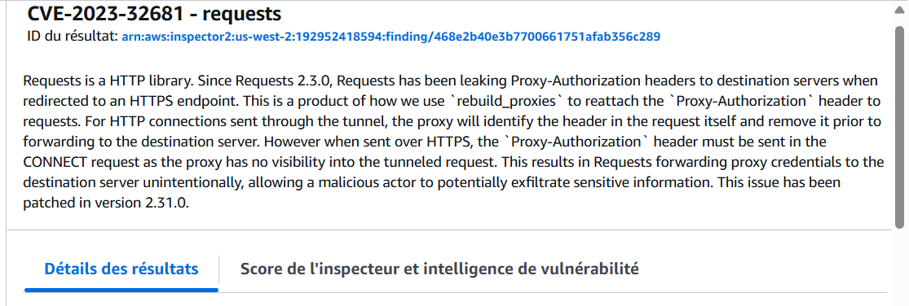
5. Dans le volet d'informations, dans la section **Détails de la vulnérabilité**, choisissez le lien externe à côté du champ **ID de vulnérabilité**.
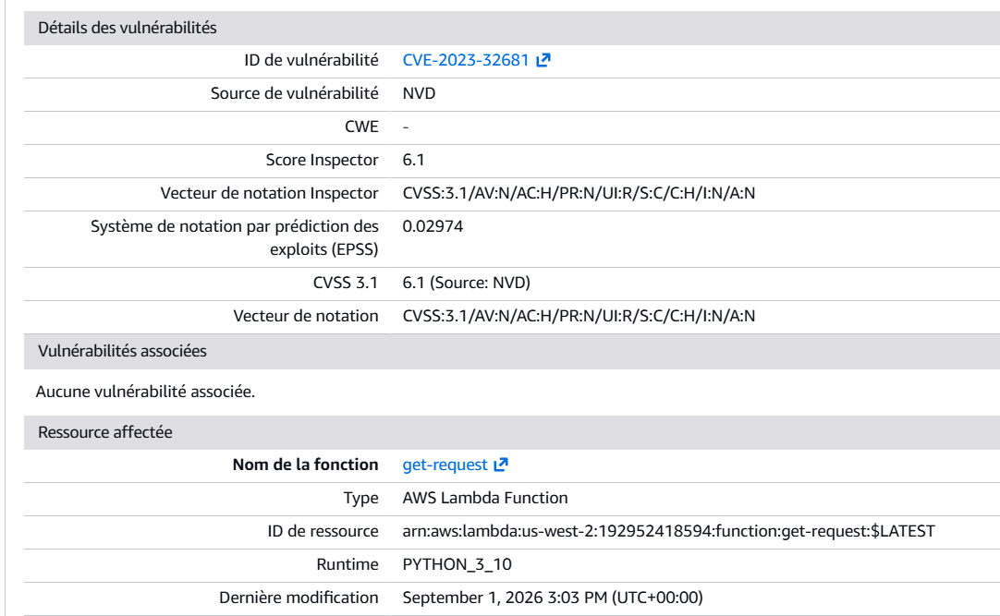
   * Le lien ouvre un nouvel onglet de navigateur vers la page Web détaillée des vulnérabilités de la *National Vulnerability Database (NVD)*, qui est un référentiel de données normalisées de gestion des vulnérabilités gérées par le *National Institute of Standards and Technology (Institut américain des normes et de la technologie, NIST)*. Cette page fournit des informations plus détaillées sur cette vulnérabilité.
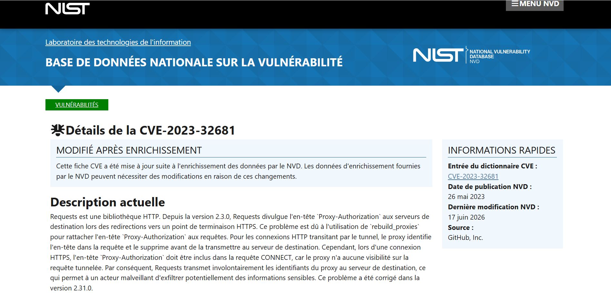
6. Dans le volet d'informations, recherchez la section **Remédiation**.
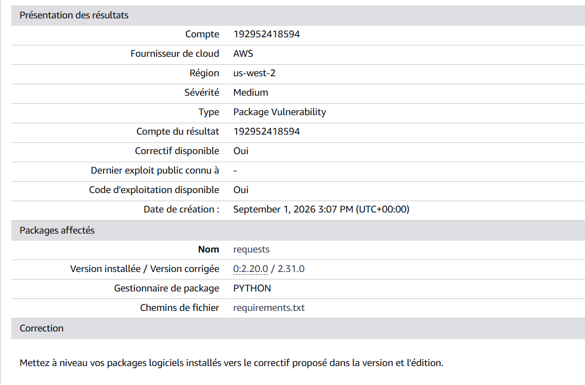
   > ⚠️ Le problème est que le package `requests` est vulnérable et obsolète. Il est recommandé de le mettre à niveau. Ensuite, vous appliquez la correction à votre fonction Lambda.

---

## 🔧 Tâche 3 : Corriger les vulnérabilités détectées

Dans le cadre de cette tâche, vous analysez les résultats signalés par Amazon Inspector et vous interprétez les détails de la vulnérabilité. Vous mettez à jour vos fonctions Lambda pour corriger les vulnérabilités. Après avoir mis à jour les fonctions, vous examinez les résultats d'Amazon Inspector pour vous assurer que la vulnérabilité a été corrigée.

### Tâche 3.1 : Corriger les vulnérabilités des packages de votre fonction Lambda
1. Sur la **Console de gestion AWS**, dans la zone de recherche, recherchez et sélectionnez `Lambda`.
2. Dans la liste des fonctions Lambda, choisissez la fonction `get-request`.
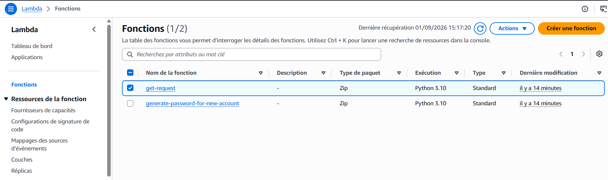
3. Dans le navigateur de fichiers de l'éditeur de code de fonction Lambda, choisissez `exigences.txt` (ou `requirements.txt`).
4. Supprimez le numéro de version et les signes « égal » de `requests==2.20.0` afin que la ligne contienne uniquement `requests`.
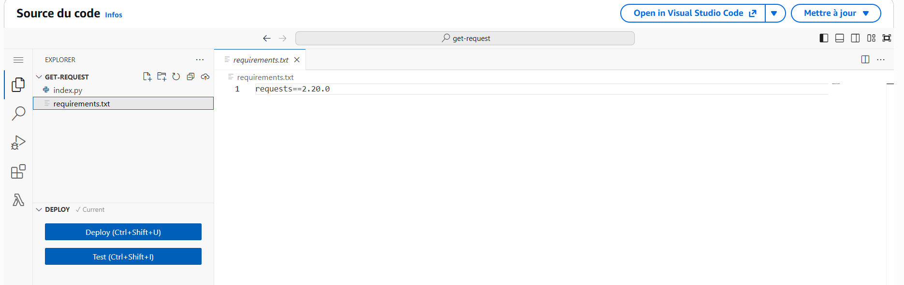
   > ℹ️ Le fichier de dépendances indique à AWS Lambda quels packages Python sont nécessaires pour exécuter votre fonction. Lorsqu'aucun numéro de version n'est spécifié, la dernière version du package est installée par défaut. Cela garantit que votre fonction Lambda utilise la dernière version du package.
5. Cliquez sur le bouton **Déployer** pour déployer la fonction.
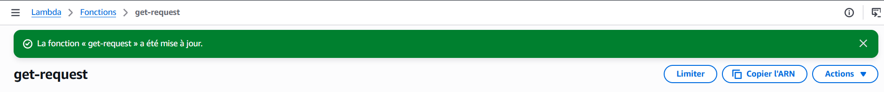
   * Une bannière s'affiche avec le message *« La fonction get-request a été mise à jour avec succès »*.
   * Ce dernier déploiement de votre fonction Lambda incitera Amazon Inspector à lancer une nouvelle analyse de la fonction.
6. Sur la **Console de gestion AWS**, dans la zone de recherche, recherchez et sélectionnez `Amazon Inspector`.
7. Dans le volet de navigation situé à gauche de la page, sous **Résultats**, sélectionnez **Tous les résultats**.
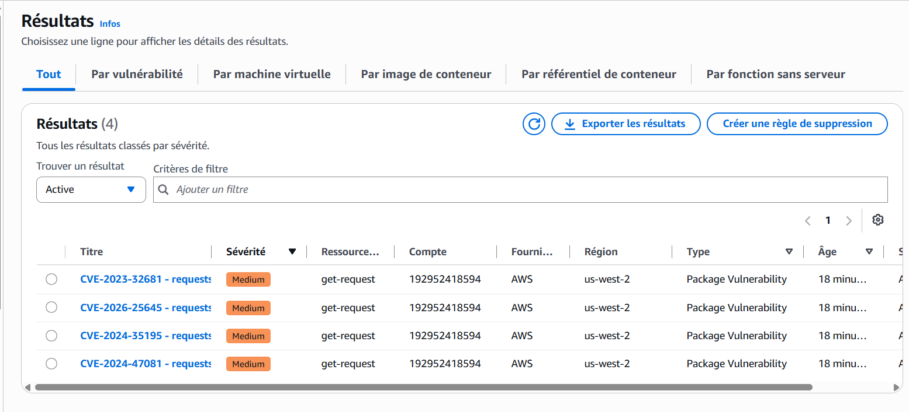
   > 💡 **Remarque :** Si le volet de navigation est réduit, choisissez l'icône du menu.
8. Dans le tableau de bord des résultats, sous **Statut de résultat**, modifiez la sélection de **Actif** à **Fermé**.
9. Dans la liste des résultats fermés, vous voyez `CVE-2023-32681 - requêtes`. Cela confirme le succès de la correction de la vulnérabilité.
   > 💡 **Remarque :** L'analyse peut prendre quelques minutes. Cliquez sur le bouton d'actualisation pour afficher l'état le plus récent de vos ressources analysées.
10. Dans le volet de navigation situé à gauche de la page, sous **Couverture des ressources**, sélectionnez **Fonctions Lambda**.
11. Si nécessaire, augmentez la largeur de la colonne **Dernière analyse** pour afficher l'horodatage complet.
 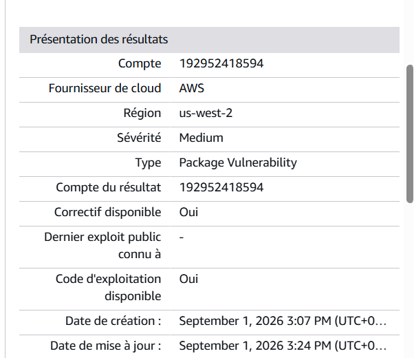
    * Vous pouvez voir que la fonction Lambda analysée la plus récemment possède un horodatage mis à jour.

---

## 🔄 Récapitulatif de l'atelier

Au cours de cet atelier, vous avez activé Amazon Inspector pour effectuer une analyse automatisée de vos ressources AWS. Vous avez identifié une vulnérabilité liée à un package obsolète dans une fonction AWS Lambda, analysé les détails issus de la National Vulnerability Database (NVD), puis corrigé la vulnérabilité en mettant à jour le fichier de dépendances. Enfin, vous avez vérifié que la vulnérabilité a bien été classée comme résolue dans Amazon Inspector.

---

## 🏆 Conclusion

**Félicitations ! Vous avez réussi à :**
- [x] **Activer et configurer Amazon Inspector ;**
- [x] **Analyser et interpréter les résultats des analyses de vulnérabilité ;**
- [x] **Corriger les vulnérabilités détectées par Amazon Inspector.**
