# 🛡️ Renforcement des Systèmes avec Patch Manager (AWS Systems Manager)

> **Type d'atelier :** TP Pratique AWS / SecOps & Patch Management  
> **Durée estimée :** ⏱️ 60 minutes  
> **Services AWS utilisés :** AWS Systems Manager (Patch Manager, Fleet Manager, Run Command, State Manager), Amazon EC2, AWS IAM  

---

## 📌 Présentation de l'atelier

Dans les organisations comptant des centaines, voire souvent des milliers de postes de travail, la mise à jour de tous les systèmes d'exploitation et des logiciels d'application relève du défi sur le plan logistique. La plupart du temps, les mises à jour des systèmes d'exploitation sur les postes de travail peuvent s'effectuer de manière automatique via le réseau. Cependant, les administrateurs doivent respecter des politiques de sécurité claires et un plan de base pour s'assurer que tous les logiciels sur les postes de travail fonctionnent à un niveau de version minimum.

Au cours de cet atelier, vous allez utiliser **Patch Manager** (Gestionnaire de correctifs), une fonctionnalité d'**AWS Systems Manager**, pour créer un référentiel de correctifs. Vous allez ensuite utiliser le référentiel de correctifs que vous avez créé pour analyser les instances **Amazon Elastic Compute Cloud (Amazon EC2)** pour Windows qui ont été créées au préalable pour cet atelier. Vous allez également utiliser le référentiel de correctifs par défaut pour appliquer des correctifs aux instances Linux EC2.

---

### 🎯 Objectifs
À la fin de cet atelier, vous serez en mesure d'effectuer les opérations suivantes :
- [x] Appliquer des correctifs aux instances Linux à l'aide du référentiel par défaut
- [x] Créer un référentiel de correctifs personnalisé pour les correctifs
- [x] Utiliser des groupes de correctifs pour appliquer des correctifs aux instances Windows à l'aide d'un référentiel de correctifs personnalisé
- [x] Vérifier la conformité des correctifs

---

### ⌛ Durée
Cet atelier dure environ **60 minutes**.

---

### 🏗️ Environnement de l'atelier
L'environnement actuel comprend six instances EC2 : **trois instances sous Linux** et **trois autres sous Windows**.

Tous les composants backend, comme les instances EC2, les rôles de Gestion des identités et des accès AWS (AWS IAM) et certains services AWS, sont déjà intégrés à l'atelier.

---

### 🔑 Accès à AWS Management Console

1. En haut à droite de ces instructions, choisissez **Start Lab (Démarrer l'atelier)**.
   > 💡 **Conseil de dépannage :** Si vous recevez le message d'erreur *Accès refusé*, fermez la fenêtre d'erreur et choisissez de nouveau **Start Lab (Démarrer l'atelier)**.
2. Les informations suivantes caractérisent les différents états de l'atelier :
   * 🔴 **Cercle rouge** à côté d'AWS (coin supérieur gauche) : L'atelier n'a pas démarré.
   * 🟡 **Cercle jaune** à côté d'AWS (coin supérieur gauche) : L'atelier est en cours de démarrage.
   * 🟢 **Cercle vert** à côté d'AWS (coin supérieur gauche) : L'atelier est prêt.
3. Attendez que l'atelier soit prêt avant de continuer.
4. En haut de ces instructions, choisissez le cercle vert en ce qui concerne AWS.
   * Cette option permet d'accéder à la console de gestion AWS dans un nouvel onglet du navigateur. Le système se connecte automatiquement.
   > 💡 **Conseil :** Si le nouvel onglet ne s'affiche pas, une bannière ou une icône située en haut du navigateur peut indiquer que votre navigateur bloque l'ouverture des fenêtres contextuelles. Cliquez sur la bannière ou l'icône, puis sélectionnez **Autoriser les fenêtres contextuelles**.
5. Si un message vous invite à basculer vers la nouvelle page d'accueil de la console, choisissez **Basculer vers la nouvelle page d'accueil de la console**.
6. Placez l'onglet AWS Management Console et ces instructions côte à côte. L'idéal est de pouvoir afficher les deux onglets du navigateur en même temps pour suivre plus facilement les étapes de l'atelier.
7. Ne modifiez pas la région de l'atelier, sauf si vous y êtes invité.

---

## 🐧 Tâche 1 : Appliquer des correctifs aux instances Linux à l'aide des référentiels par défaut

Dans cette tâche, vous allez appliquer des correctifs aux instances Linux EC2 en utilisant les référentiels par défaut disponibles pour le système d'exploitation.

> **À propos des référentiels de correctifs :**  
> Le gestionnaire de correctifs fournit des référentiels de correctifs prédéfinis pour chaque système d'exploitation qu'il prend en charge. Vous pouvez utiliser ces référentiels tels qu'ils sont actuellement configurés (vous ne pouvez pas les personnaliser) ou vous pouvez créer vos propres référentiels de correctifs personnalisés. Vous pouvez utiliser des référentiels de correctifs personnalisés pour mieux contrôler les correctifs approuvés ou rejetés pour votre environnement.

### Étapes d'exécution :
1. Dans **AWS Management Console**, dans la zone de recherche, saisissez `Systems Manager` et sélectionnez-le. Cette option vous renvoie sur la page de la console de Systems Manager.
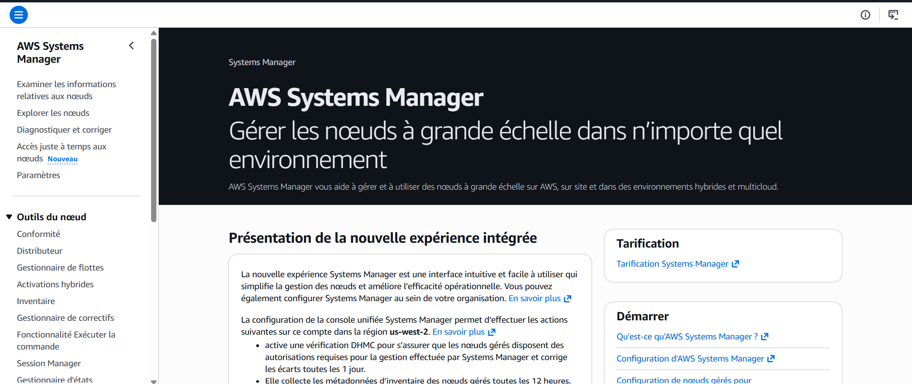
2. Dans le volet de navigation de gauche, sous **Gestion des nœuds**, choisissez **Fleet Manager**. Voici les instances EC2 préconfigurées. Il y a 3 instances Linux et 3 instances Windows. Ces instances EC2 sont associées à un rôle IAM spécifique qui vous permet de les gérer à l'aide de Systems Manager. C'est pourquoi vous pouvez les consulter dans la section Fleet Manager. Cela fait également partie de la configuration de l'atelier.
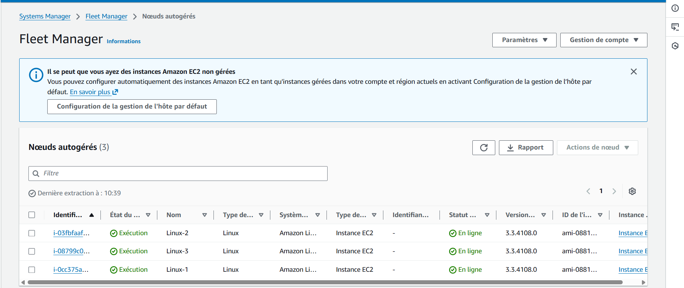
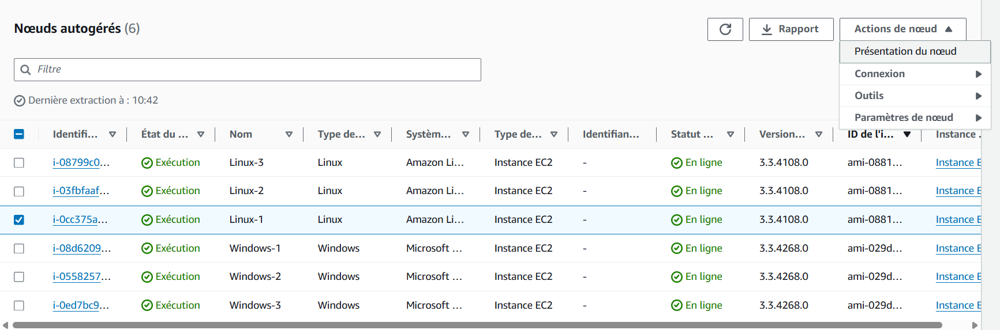
3. Cochez la case concernant **Linux-1**. Cliquez ensuite sur la liste déroulante **Actions du nœud** et choisissez **Afficher les détails**. Vous pouvez consulter ici les détails de l'instance spécifique, tels que le **Type de plateforme**, le **Type de nœud**, le **Nom du système d'exploitation** et le **rôle IAM** qui vous permet d'utiliser Systems Manager pour gérer cette instance.
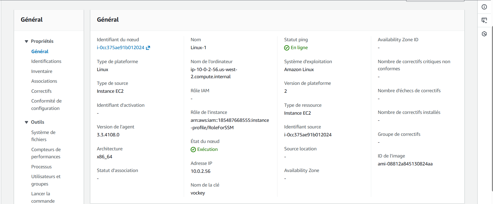
4. En haut de la page, choisissez **Gestionnaire de systèmes AWS** pour retourner sur la page d'accueil de Systems Manager.
5. Dans le volet de navigation de gauche, sous **Gestion des nœuds**, choisissez **Gestionnaire de correctifs**.
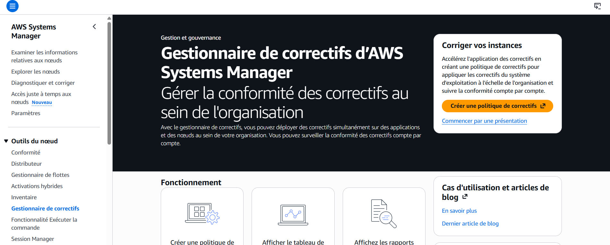
6. Choisissez **Commencer par une présentation** *(passez à l'étape suivante si cette option n'apparaît pas)*.
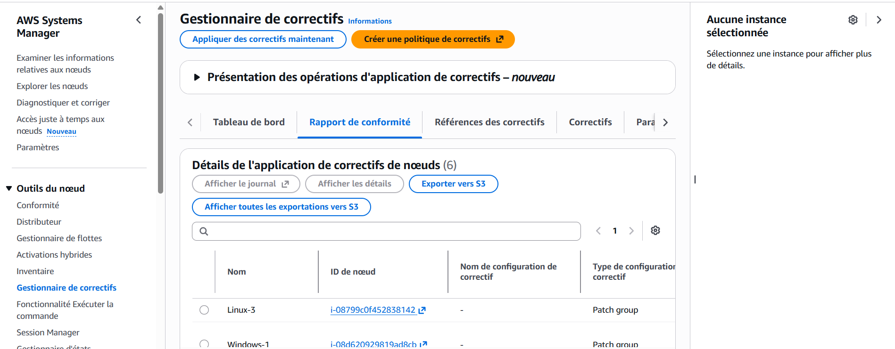
7. Choisissez **Appliquer un correctif maintenant** pour appliquer des correctifs aux instances Linux avec `AWS-AmazonLinux2DefaultPatchBaseline`.
8. Dans **Configuration de base**, configurez comme suit :
   * **Opération d'application de correctifs :** `Analyseur et installateur`
   * **Option de rénovation :** `Redémarrer si nécessaire`
   * **Instances à corriger :** `Appliquer des correctifs uniquement aux instances ciblées spécifiées`
   * **Sélection de la cible :** `Spécifier les balises d'instance`
   * **Clé d'identification :** `Patch Group`
   * **Valeur d'identification :** `LinuxProd`
   * Cliquez sur **Ajouter à la sélection**
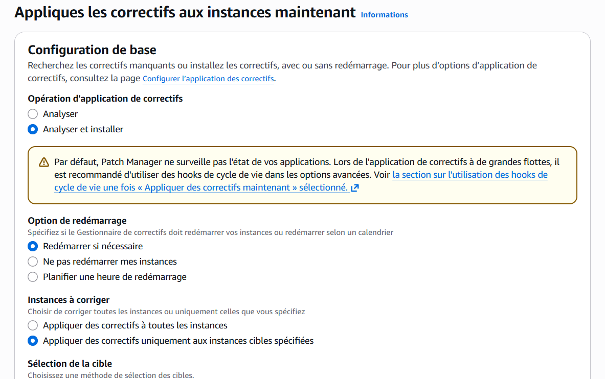
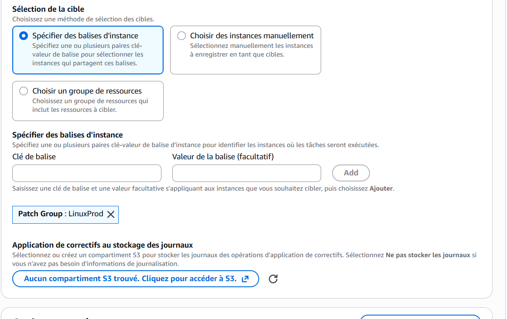
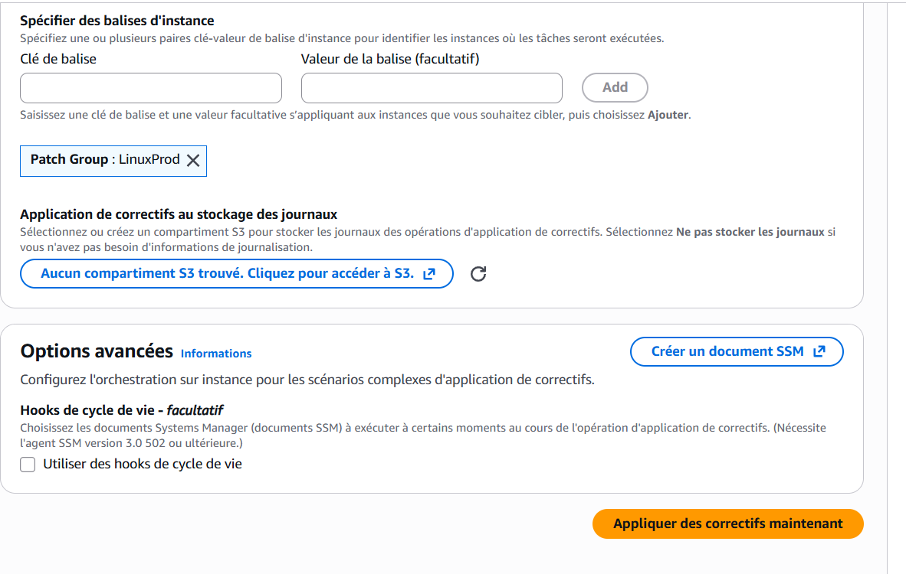
9. Sélectionnez **Appliquer des correctifs maintenant**.
10. Observez le statut de l'application des correctifs.
    * Une nouvelle page s'affiche. Dans **AWS-PatchNowAssociation**, un champ Statut indique que trois instances seront affectées et indique les progrès réalisés.
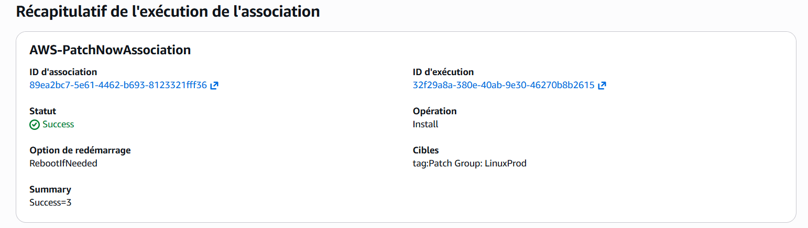
    * Un volet récapitulatif des opérations d'analyse/installation affiche également visuellement le statut des instances EC2 concernées. Surveillez cette page jusqu'à ce que l'opération d'application des correctifs soit terminée sur les trois instances.
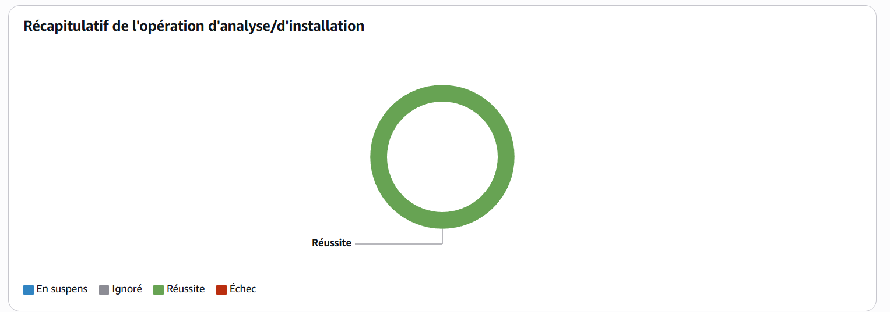
---

## 🪟 Tâche 2 : Créer un référentiel de correctifs personnalisé pour les instances Windows

Dans le cadre de cette tâche, vous allez créer un référentiel de correctifs personnalisé pour les instances Windows. Même si Windows possède des référentiels de correctifs par défaut que vous pouvez utiliser, pour ce cas d'utilisation, vous allez définir un référentiel pour les mises à jour de sécurité Windows.

### Étapes d'exécution :
1. Retournez sur la console Systems Manager. Dans la barre de recherche située en haut, saisissez `Systems Manager`, puis sélectionnez cette entrée.
2. Dans le volet de navigation de gauche, sous **Gestion des nœuds**, choisissez **Gestionnaire de correctifs**.
3. Choisissez **Commencer par une présentation** *(passez à l'étape suivante si cette option n'apparaît pas)*.
4. Cliquez sur l'onglet **Références de correctifs**.
5. Cliquez sur le bouton **Créer une référence de correctif**.
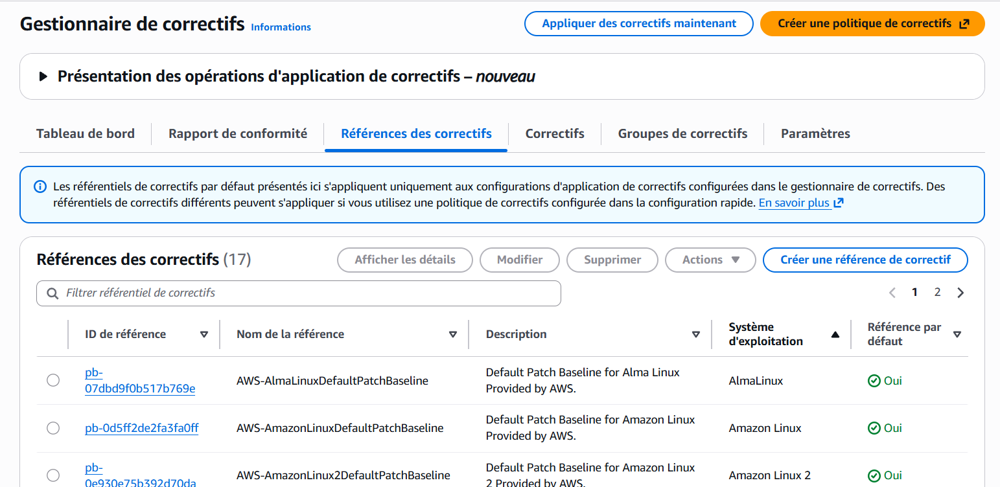
6. Pour **Informations sur la référence de correctifs**, configurez les options suivantes :
   * **Nom :** saisissez `WindowsServerSecurityUpdates`
   * **Description - facultatif :** saisissez `Windows security baseline patch`
   * **Système d'exploitation :** choisissez `Windows`.
   * **Ne cochez pas** la case *Référence de correctifs par défaut*.
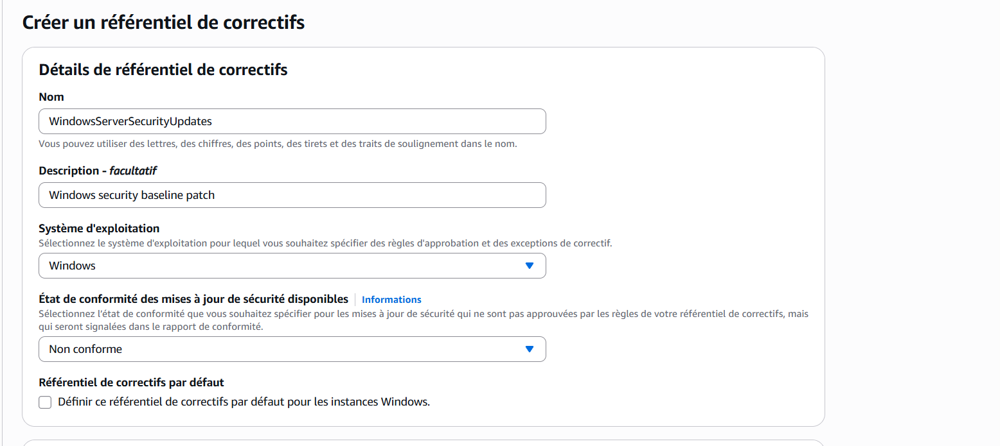
7. Dans la section **Règles d'approbation pour les systèmes d'exploitation**, configurez les options suivantes :
   * **Produits :** dans la liste déroulante, choisissez `WindowsServer2019`. Désélectionnez également *Tout* pour qu'il n'apparaisse plus sous Produits.
   * **Gravité :** cette option indique le niveau de gravité des correctifs liés à la règle qui s'applique. Pour vous assurer que tous les Service Packs sont inclus dans la règle, choisissez `Critique` dans la liste déroulante.
   * **Classification :** dans la liste déroulante, choisissez `SecurityUpdates`.
   * **Approbation automatique :** saisissez `3 jours`.
   * **Rapport de conformité - facultatif :** dans la liste déroulante, choisissez `Critique`.
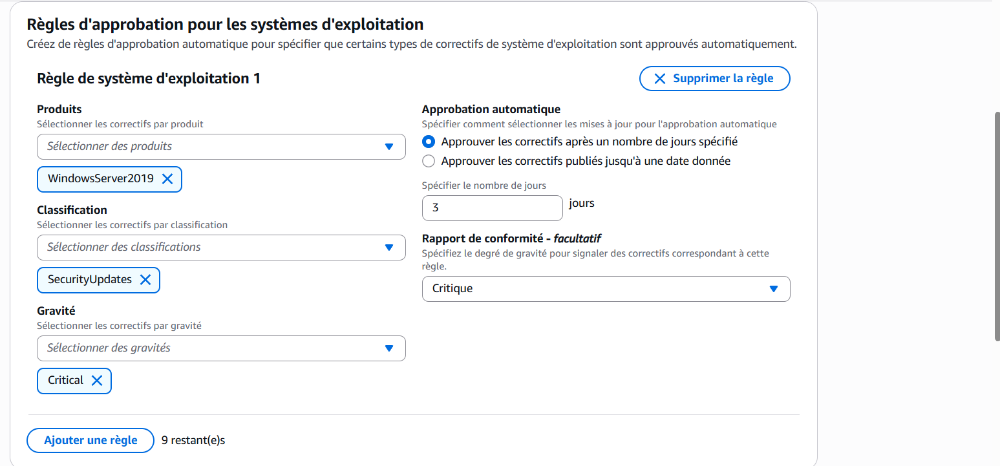
8. Choisissez **Ajout d'une règle** pour ajouter une seconde règle à ce référentiel de correctifs, puis configurez les options suivantes :
   * **Produits :** dans la liste déroulante, choisissez `WindowsServer2019`. Désélectionnez également *Tout* pour qu'il n'apparaisse plus sous Produits.
   * **Gravité :** dans la liste déroulante, choisissez `Important`.
   * **Classification :** dans la liste déroulante, choisissez `SecurityUpdates`.
   * **Approbation automatique :** saisissez `3 jours`.
   * **Rapport de conformité - facultatif :** dans la liste déroulante, choisissez `Élevé`.
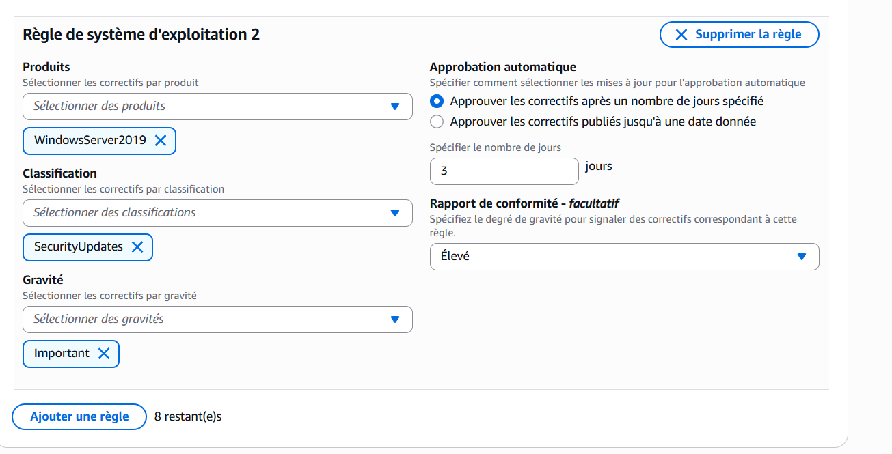
9. Sélectionnez **Créer une référence de correctifs**.
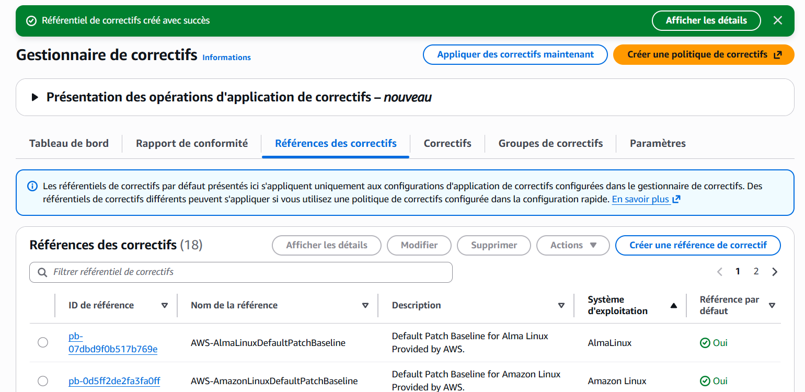
10. Ensuite, modifiez un groupe de correctifs pour le référentiel de correctifs Windows que vous venez de créer, afin de l'associer à un groupe de correctifs :
    * Dans la section **Références de correctifs**, cliquez sur le bouton du référentiel de correctifs `WindowsServerSecurityUpdates` que vous venez de créer.
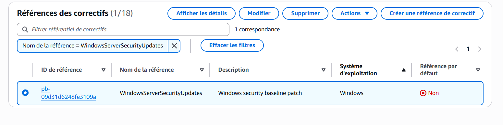
      > 💡 **Remarque :** Le référentiel de correctifs que vous avez créé se trouve peut-être sur la deuxième page de la liste de référentiels. Vous pouvez également utiliser la barre de recherche pour le localiser, puis le sélectionner.
    * Cliquez ensuite sur la liste déroulante **Actions** et choisissez **Modifier les groupes de correctifs**.
    * Dans la section **Modifier les groupes de correctifs**, sous **Groupes de correctifs**, saisissez `WindowsProd`.
    * Cliquez sur le bouton **Ajouter**, puis sélectionnez **Fermer**.
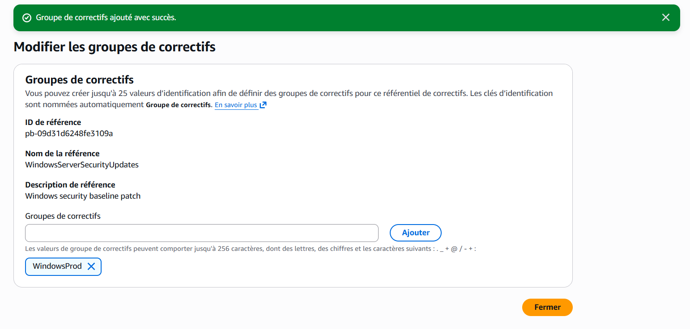
---

## ⚡ Tâche 3 : Appliquer des correctifs aux instances Windows

Dans cette tâche, vous allez appliquer des correctifs aux instances Windows à l'aide de la fonctionnalité **Appliquer des correctifs maintenant** en fonction de l'identification qui leur est associée.

> ℹ️ À l'issue de la configuration, le gestionnaire de correctifs utilise l'option *Exécuter une commande* pour appeler le document `RunPatchBaseline` afin d'évaluer les correctifs à installer sur les instances en fonction du type de système d'exploitation de chaque instance, directement ou selon le calendrier défini (fenêtre de maintenance).

### Tâche 3.1 : Balisage des instances Windows
Au cours de cette tâche, vous allez identifier vos instances Windows. Plus tard dans l'atelier, vous allez créer un groupe de correctifs et l'associer à ces étiquettes.

> 💡 Les instances Linux ont été préconfigurées au cours de la configuration de l'atelier avec des identifications `LinuxProd`. Il est donc inutile de leur ajouter des identifications.

1. Dans la console de gestion AWS, dans la barre de recherche, saisissez `EC2` et sélectionnez cette entrée.
2. Choisissez **Instances**, cochez la case en ce qui concerne l'instance **Windows-1**, puis cliquez sur l'onglet **Balises**.
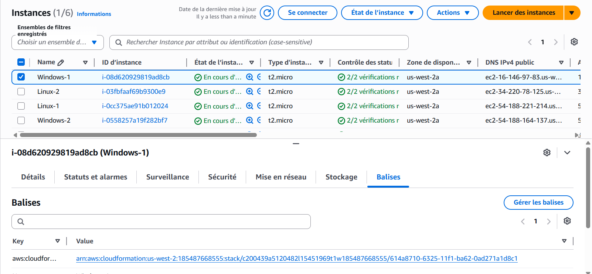
3. Cliquez sur le bouton **Gestion des balises**, choisissez **Ajouter une nouvelle balise** et configurez les options suivantes :
   * **Clé :** saisissez `Patch Group`
   * **Valeur :** saisissez `WindowsProd`
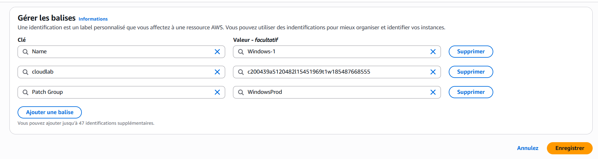
4. Choisissez **Enregistrer**.
5. Répétez les étapes précédentes pour identifier les instances **Windows-2** et **Windows-3** avec les mêmes identifications.

### Tâche 3.2 : Appliquer des correctifs aux instances Windows
1. Retournez sur la console Systems Manager. Dans la barre de recherche située en haut, saisissez `Systems Manager`, puis sélectionnez cette entrée.
2. Pour appliquer des correctifs aux instances Windows, procédez comme suit :
   * Choisissez **Gestionnaire de correctifs**.
   * Choisissez **Commencer par une présentation** *(passez à l'étape suivante si cette option n'apparaît pas)*.
   * Sélectionnez **Appliquer les correctifs maintenant**.
   * **Opération d'application de correctifs :** `Analyseur et installateur`
   * **Option de rénovation :** `Redémarrer si nécessaire`
   * **Instances à corriger :** `Appliquer des correctifs uniquement aux instances ciblées spécifiées`
   * **Sélection de la cible :** `Spécifier les balises d'instance`
   * **Clé d'identification :** `Patch Group`
   * **Valeur d'identification :** `WindowsProd`
   * Cliquez sur **Ajouter à la sélection**
   * Sélectionnez **Appliquer des correctifs maintenant**
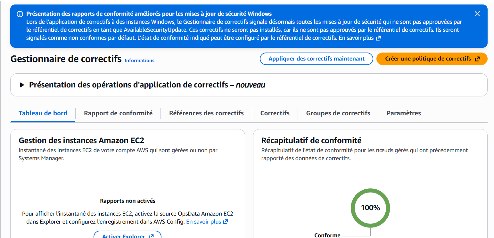
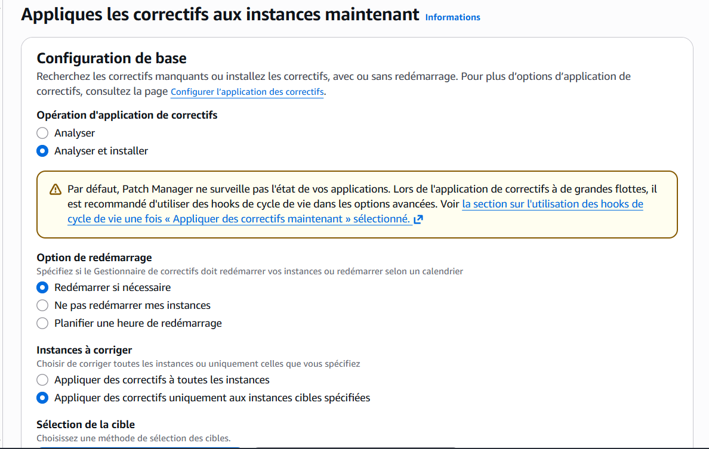
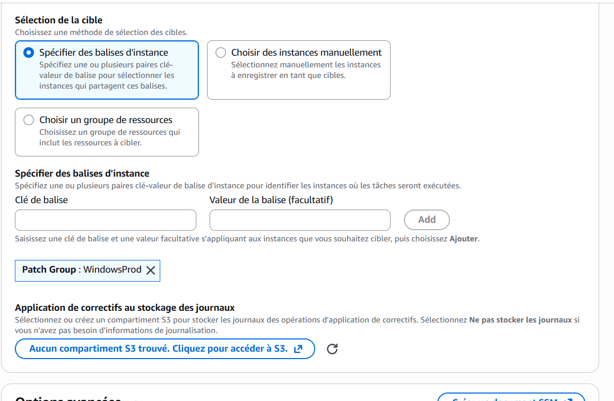
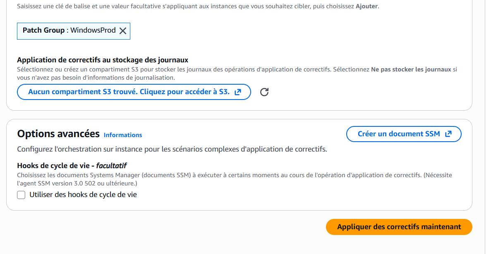
3. Une nouvelle page s'affiche. Une fois disponible, choisissez le lien pointant vers l'**ID d'exécution**.
 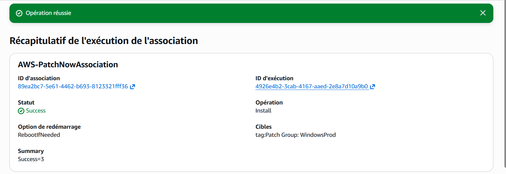
   * Une page s'ouvre dans la partie **Gestionnaire d'états** de Systems Manager.
4. Choisissez le lien **Sortie** pour l'une des instances gérées qui affiche le statut `InProgress`.
   * Une page de la partie **Exécuter la commande** de Systems Manager s'ouvre.
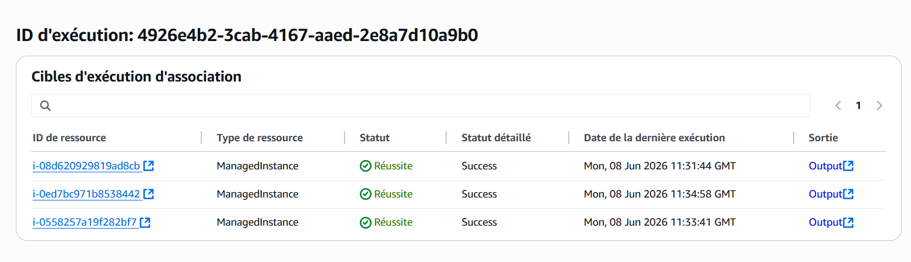
5. Développez le panneau **Sortie** pour observer les détails.
   * En coulisses, le Gestionnaire de correctifs utilise *Exécuter la commande* pour exécuter les `PatchBaselineOperations`. Si vous faites défiler la sortie, vous devriez voir les détails de `PatchGroup: WindowsProd`.
   > ℹ️ Un document Systems Manager (SSM) définit les actions exécutées par Systems Manager sur vos instances gérées.
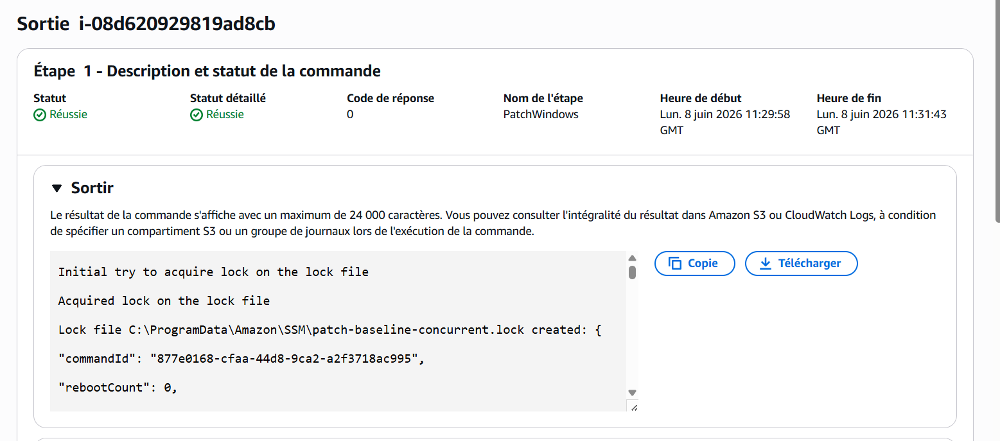
---

## 📊 Tâche 4 : Vérifier la conformité

1. Dans le volet de navigation de gauche, sous **Gestion des nœuds**, choisissez **Gestionnaire de correctifs**.
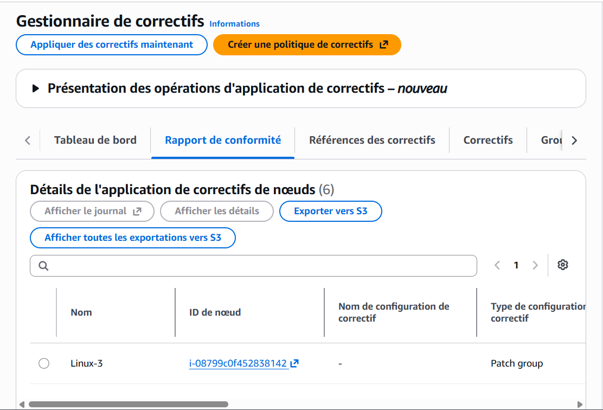
2. Cliquez sur l'onglet **Tableau de bord**. Sous **Récapitulatif de conformité**, vous devez maintenant voir la mention **Conforme : 6**, ce qui signifie que toutes les instances Windows et Linux sont conformes.
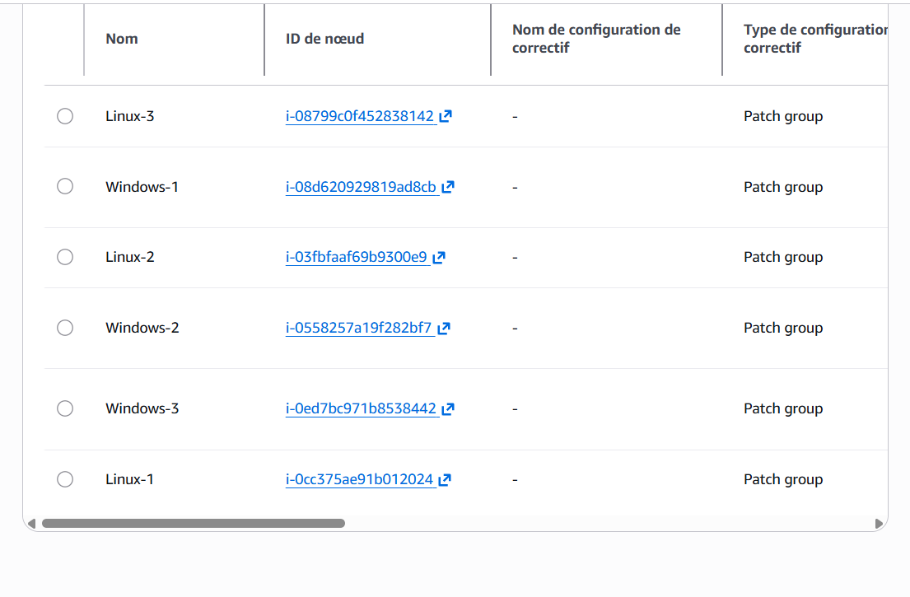
3. Cliquez sur l'onglet **Rapport de conformité**. Cet onglet fournit une vue d'ensemble de toutes les instances en cours d'exécution avec SSM. Vous pouvez vérifier que le **Statut de conformité** de toutes les instances Linux et Windows est bien **Conformez-vous** *(Conforme)*.
   * Les six instances (trois Linux et trois Windows) doivent apparaître comme étant conformes.
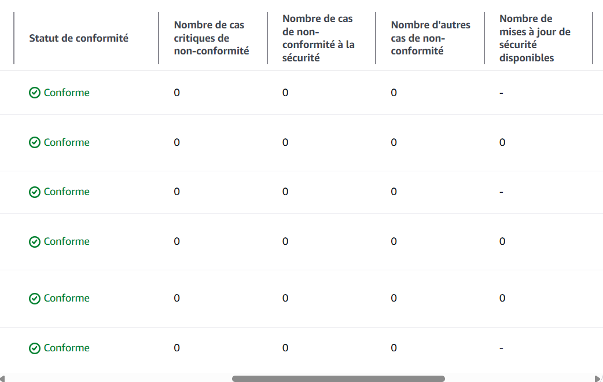
4. Faites défiler la page vers la droite dans le panneau **Détails de l'application de correctifs de nœuds** pour trouver, pour chaque instance :
   * Nombre de cas critiques de non-conformité
   * Nombre de cas de non-conformité à la sécurité
   * Nombre d'autres cas de non-conformité
   * Date de la dernière opération
   * ID de référence
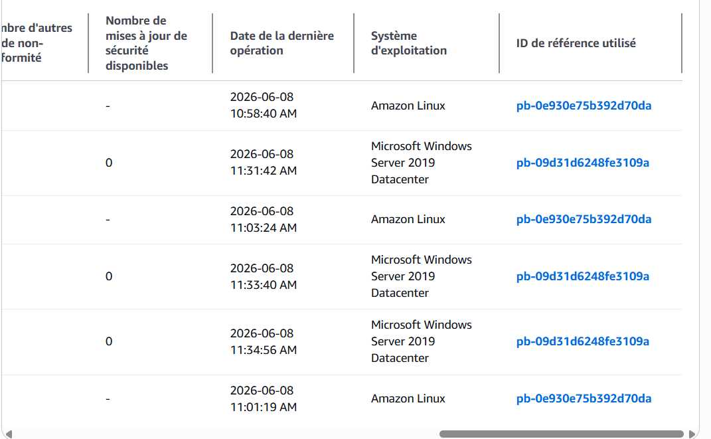
5. Choisissez l'**ID de nœud** pour l'un des nœuds Windows.
6. Dans la page ID du nœud qui s'ouvre, choisissez l'onglet **Correctif**.
7. Faites défiler la page vers le bas et observez quels correctifs ont été appliqués à cette instance, ainsi que l'heure d'installation.
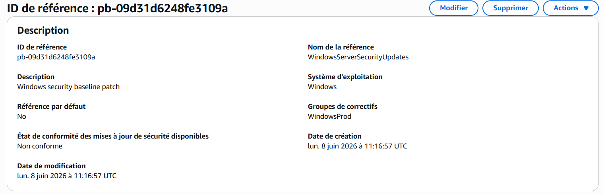
---

## 🏆 Conclusion

**Félicitations ! Vous avez réussi à :**
- [x] **Correctifs appliqués aux instances Linux à l'aide du référentiel par défaut.**
- [x] **Référentiel de correctifs personnalisés créés.**
- [x] **Groupes de correctifs utilisés pour appliquer des correctifs aux instances Windows à l'aide d'un référentiel de correctifs personnalisé.**
- [x] **Conformité des correctifs vérifiés.**

**Fin de l'atelier**
