# Surveillance de l'infrastructure AWS

## Présentation de l'atelier
Pouvoir surveiller vos applications et votre infrastructure est essentiel pour fournir des services informatiques fiables et cohérents.

Les exigences de surveillance vont de la collecte de statistiques pour une analyse à long terme jusqu'au fait de réagir rapidement aux modifications et aux interruptions. La surveillance peut également prendre en charge les rapports de conformité en vérifiant en permanence que l'infrastructure respecte les normes organisationnelles.

Cet atelier montre comment utiliser les métriques Amazon CloudWatch, Amazon CloudWatch Logs, Amazon CloudWatch Events et AWS Config pour surveiller vos applications et votre infrastructure.

---

## Objectifs
À la fin de cet atelier, vous serez en mesure d'effectuer les opérations suivantes :
* Utiliser la fonctionnalité AWS Systems Manager Run Command pour installer l'agent CloudWatch sur des instances Amazon Elastic Compute Cloud (Amazon EC2).
* Surveiller les journaux d'application à l'aide de l'agent CloudWatch et de CloudWatch Logs.
* Surveiller les métriques du système à l'aide de l'agent CloudWatch et des métriques CloudWatch.
* Créer des notifications en temps réel à l'aide de CloudWatch Events.
* Suivre la conformité de l'infrastructure à l'aide d'AWS Config.

---

## Durée
Cet atelier dure environ **60 minutes**.

---

## Accès à la console de gestion AWS
1. En haut de ces instructions, sélectionnez **Start Lab** (Démarrer l'atelier) pour lancer l'atelier.
2. Un volet **Start Lab** (Démarrer l'atelier) s'ouvre et affiche le statut de l'atelier. 
3. Attendez que le message **Lab status: ready** (Statut de l'atelier : prêt) s'affiche, puis cliquez sur **X** pour fermer le volet **Start Lab** (Démarrer l'atelier).
4. En haut de ces instructions, sélectionnez **AWS**.
5. La console de gestion AWS s'ouvre alors dans un nouvel onglet. Le système vous y connecte automatiquement.
   > **Conseil :** Si le nouvel onglet ne s'affiche pas, une bannière ou une icône située en haut du navigateur indique généralement que votre navigateur bloque l'ouverture des fenêtres contextuelles. Cliquez sur la bannière ou l'icône, puis sélectionnez **Allow pop-ups** (Autoriser les fenêtres contextuelles).
6. Disposez l'onglet Console de gestion AWS de façon à l'afficher à côté de ces instructions. Dans l'idéal, vous devez pouvoir visualiser les deux onglets en même temps pour suivre plus facilement les étapes de l'atelier.
7. Ne modifiez pas la région pendant cet atelier.

---

## Tâche 1 : Installation de l'agent CloudWatch
Vous pouvez utiliser l'agent CloudWatch pour collecter des métriques à partir des serveurs sur site et des instances EC2, notamment ce qui suit :
* **Métriques au niveau du système issues des instances EC2 :** allocation de CPU, espace disque disponible et utilisation de la mémoire. Ces métriques sont collectées à partir de la machine elle-même et viennent compléter les métriques CloudWatch standard collectées par CloudWatch.
* **Métriques au niveau du système issues des serveurs sur site :** permettent la surveillance des environnements hybrides et des serveurs non gérés par AWS.
* **Journaux système et d'application :** issus des serveurs Linux et Windows.
* **Métriques personnalisées :** issues des applications et des services utilisant les protocoles StatsD et collectd.

Au cours de cette tâche, vous utilisez Systems Manager pour installer l'agent CloudWatch sur une instance EC2. Vous le configurez pour collecter les métriques des applications et du système.

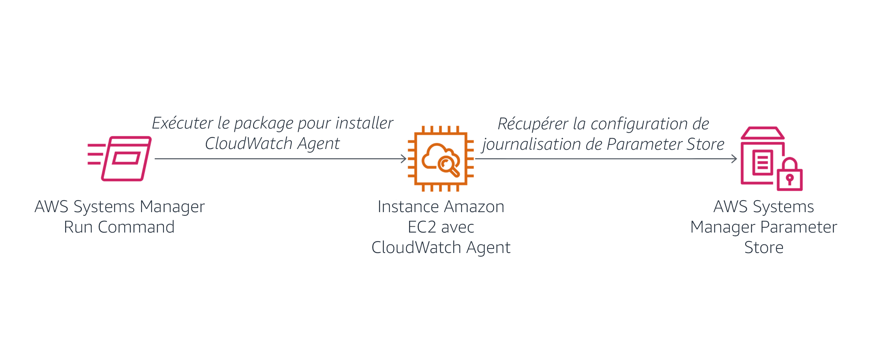


1. Dans la console de gestion AWS, dans le menu **Services**, sélectionnez **Systems Manager**.
2. Dans le volet de navigation de gauche, choisissez **Exécuter la commande**.

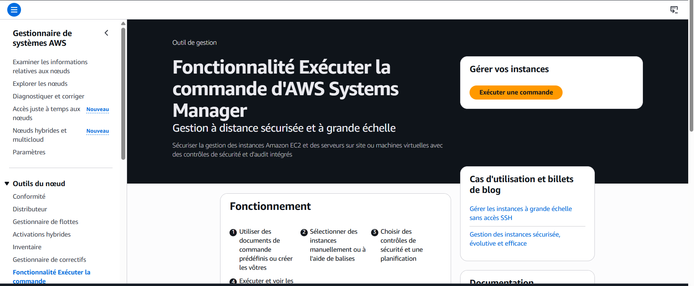

3. Choisissez **Exécuter une commande**.
4. Sélectionnez le bouton situé à côté de `AWS-ConfigureAWSPackage` (apparaît généralement en haut de la liste). 

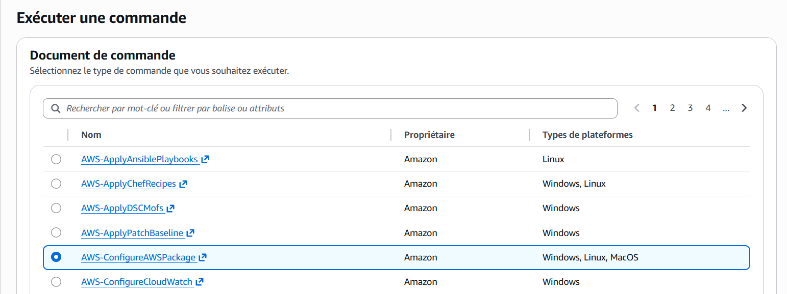

5. Faites défiler la page jusqu'à la section **Paramètres de la commande** et configurez les informations suivantes :
   * **Action :** sélectionnez `Installer`.
   * **Nom :** entrez `AmazonCloudWatchAgent`.
   * **Version :** entrez `latest`.

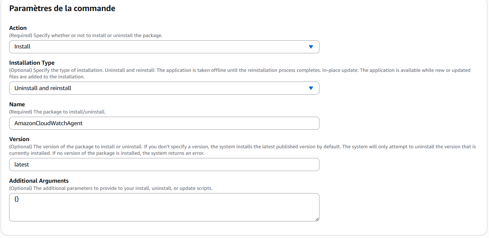

6. Dans la section **Cibles**, sélectionnez **Choisir les instances manuellement**, puis sous **Instances**, cochez la case en regard de **Web Server**.

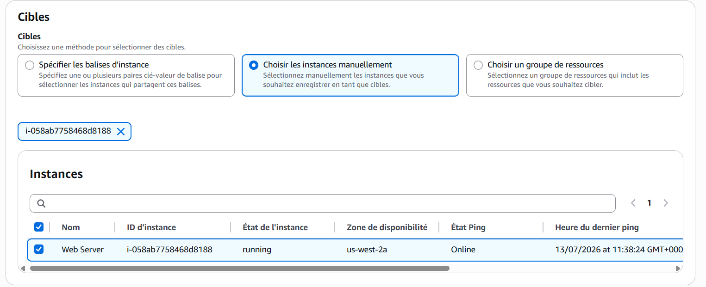

7. Au bas de la page, choisissez **Exécuter**.
8. Attendez que **Statut global** prenne la valeur **Succès**.

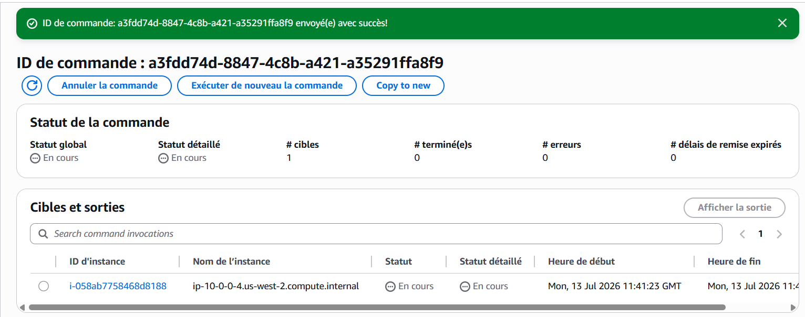

9. Sous **Cibles et sorties**, choisissez à côté de l'instance, puis cliquez sur **Afficher la sortie**.

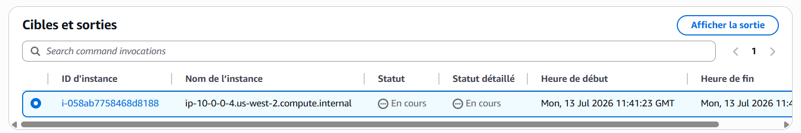

10. Développez **Étape 1 – Sortie**.
    Vous devriez voir le message : `Successfully installed arn:aws:ssm:::package/AmazonCloudWatchAgent`.

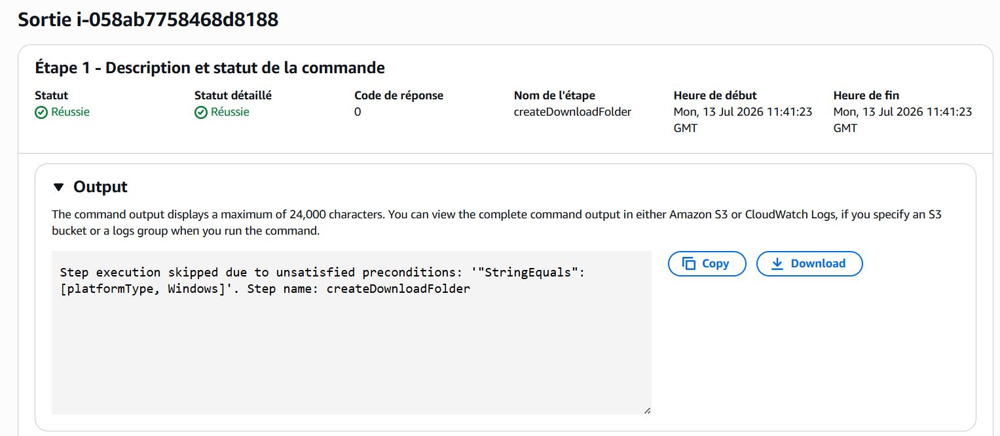

     *(Note : Si le message `Step execution skipped due to unsatisfied preconditions...` s'affiche pour Windows, développez **Étape 2 – Sortie** à la place)*.

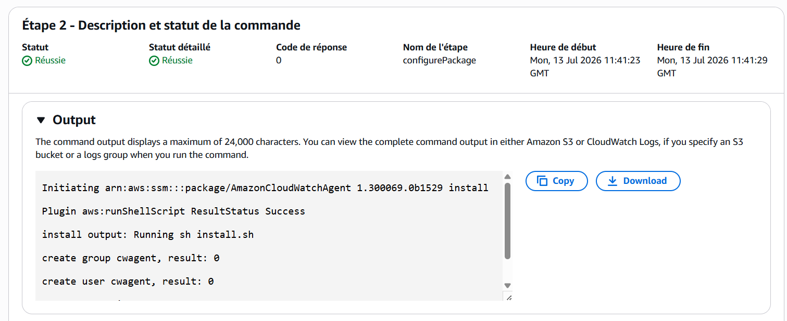


### Stockage de la configuration dans Parameter Store
Vous allez stocker le fichier de configuration dans AWS Systems Manager Parameter Store, où l'agent CloudWatch pourra le récupérer.

1. Dans le volet de navigation de gauche, choisissez **Parameter Store**.

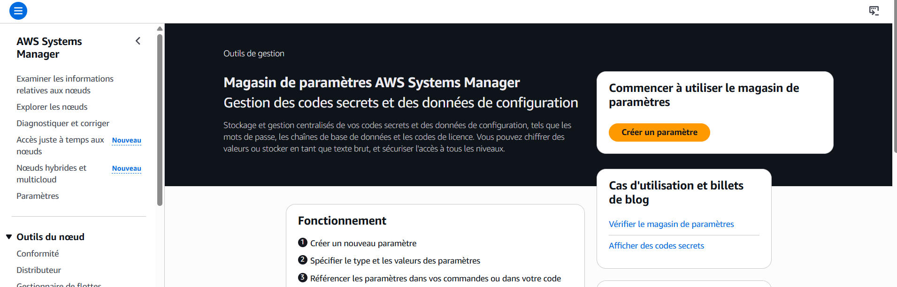

2. Choisissez **Créer un paramètre**, puis configurez les informations suivantes :
   * **Nom :** entrez `Monitor-Web-Server`.
   * **Description :** entrez `Collect web logs and system metrics`.
   * **Valeur :** copiez et collez le JSON suivant :

```json
{
  "logs": {
    "logs_collected": {
      "files": {
        "collect_list": [
          {
            "log_group_name": "HttpAccessLog",
            "file_path": "/var/log/httpd/access_log",
            "log_stream_name": "{instance_id}",
            "timestamp_format": "%b %d %H:%M:%S"
          },
          {
            "log_group_name": "HttpErrorLog",
            "file_path": "/var/log/httpd/error_log",
            "log_stream_name": "{instance_id}",
            "timestamp_format": "%b %d %H:%M:%S"
          }
        ]
      }
    }
  },
  "metrics": {
    "metrics_collected": {
      "cpu": {
        "measurement": [
          "cpu_usage_idle",
          "cpu_usage_iowait",
          "cpu_usage_user",
          "cpu_usage_system"
        ],
        "metrics_collection_interval": 10,
        "totalcpu": false
      },
      "disk": {
        "measurement": [
          "used_percent",
          "inodes_free"
        ],
        "metrics_collection_interval": 10,
        "resources": [
          "*"
        ]
      },
      "diskio": {
        "measurement": [
          "io_time"
        ],
        "metrics_collection_interval": 10,
        "resources": [
          "*"
        ]
      },
      "mem": {
        "measurement": [
          "mem_used_percent"
        ],
        "metrics_collection_interval": 10
      },
      "swap": {
        "measurement": [
          "swap_used_percent"
        ],
        "metrics_collection_interval": 10
      }
    }
  }
}
```

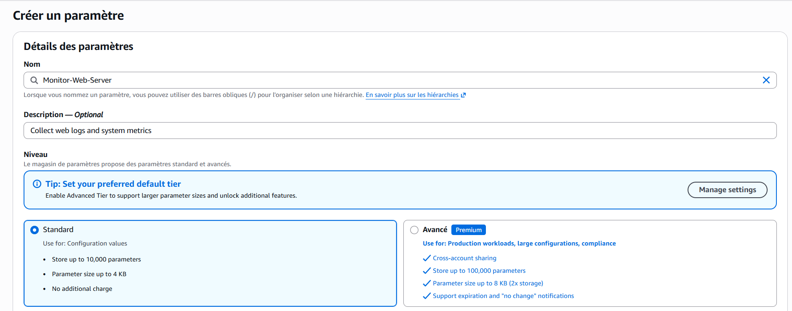
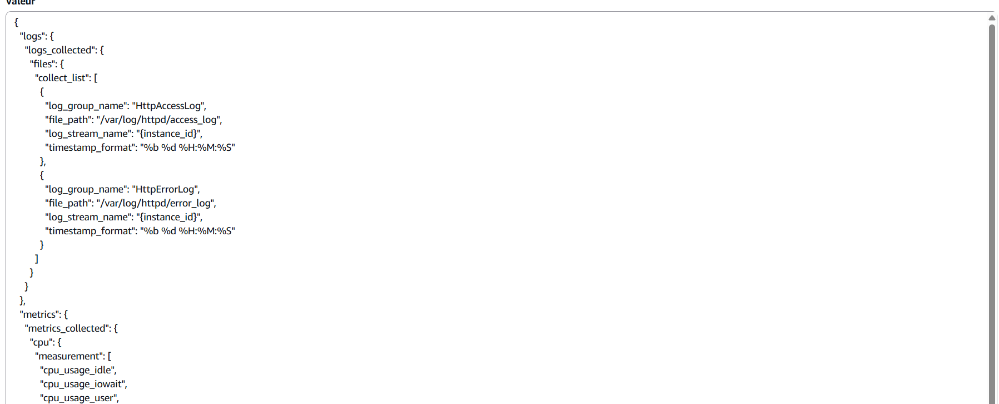
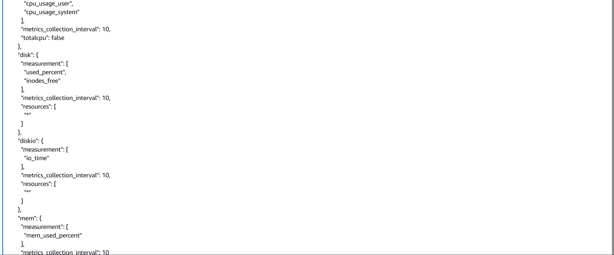
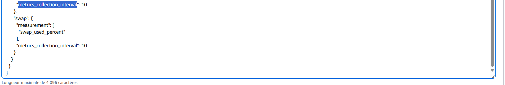
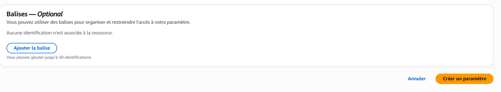

3. Choisissez **Créer un paramètre**.

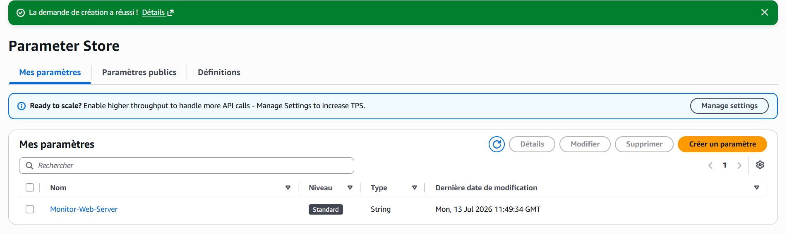

### Démarrage de l'agent CloudWatch sur l'instance
1. Dans le volet de navigation de gauche, choisissez **Exécuter la commande**.

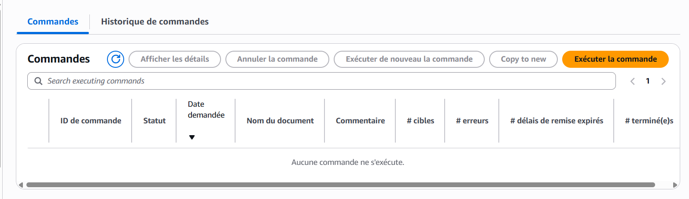

2. Choisissez **Exécuter la commande**.
3. Appliquez le filtre : **Préfixe de nom de document : Égal à : `AmazonCloudWatch-ManageAgent`** et appuyez sur Entrée.

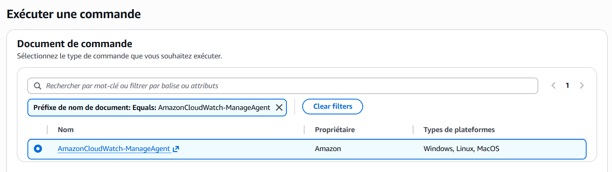
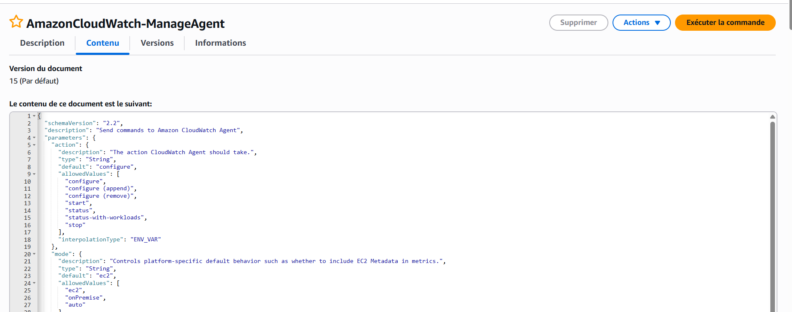

4. Cochez le bouton à côté de **AmazonCloudWatch-ManageAgent**.

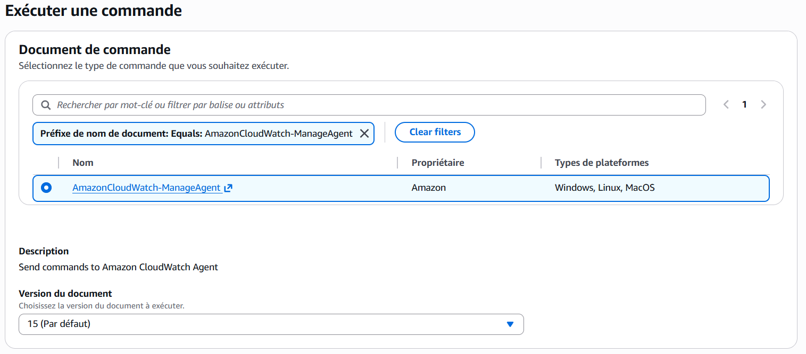

5. Dans la section **Paramètres de la commande**, configurez les éléments suivants :
   * **Action :** sélectionnez `configure`.
   * **Mode :** sélectionnez `ec2`.
   * **Optional Configuration Source :** sélectionnez `ssm`.
   * **Optional Configuration Location :** entrez `Monitor-Web-Server`.
   * **Optional Restart :** sélectionnez `yes`.

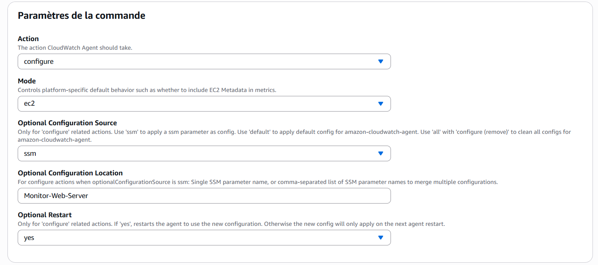

6. Dans la section **Cibles**, sélectionnez **Choisir les instances manuellement**.
7. Cochez la case à côté de **Web Server**.

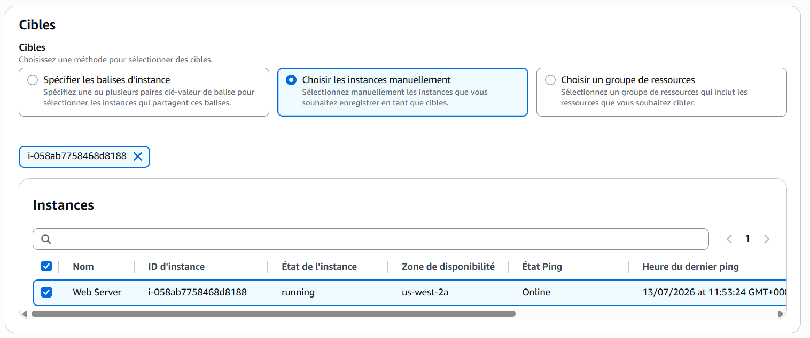

8. Choisissez **Exécuter** et attendez que le statut passe à **Succès**.

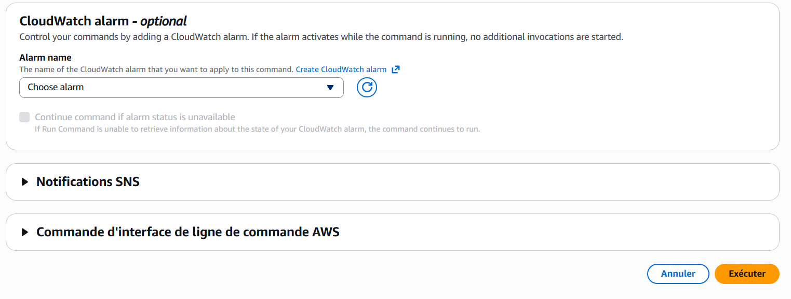
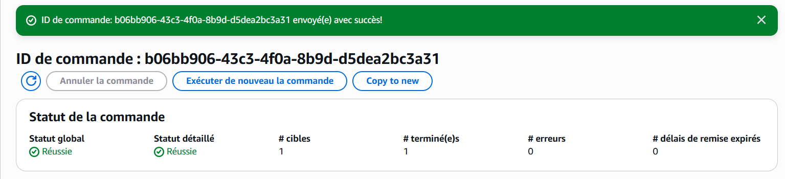

---

## Tâche 2 : Surveillance des journaux d'application à l'aide de CloudWatch Logs

Vous pouvez utiliser CloudWatch Logs pour surveiller les applications et les systèmes à l'aide des données de journal. Par exemple, CloudWatch Logs peut suivre le nombre d'erreurs survenues dans vos journaux d'applications et vous envoyer une notification lorsque le taux d'erreurs dépasse le seuil que vous avez spécifié.

CloudWatch Logs utilise vos données de journal existantes pour la surveillance ; aucune modification de code n'est donc requise. Vous pouvez par exemple surveiller les journaux d'applications pour rechercher des expressions littérales spécifiques (comme « NullReferenceException ») ou compter le nombre d'occurrences d'une expression littérale à une position particulière dans les données de journal (comme les codes d'état 404 dans un journal d'accès au serveur web). Lorsque l'expression que vous recherchez est trouvée, CloudWatch Logs signale les données à une métrique CloudWatch que vous spécifiez. Les données des journaux sont chiffrées en transit et au repos

Au cours de cette tâche, vous générez des données de journal sur le serveur web, puis surveillez les journaux à l'aide de CloudWatch Logs.

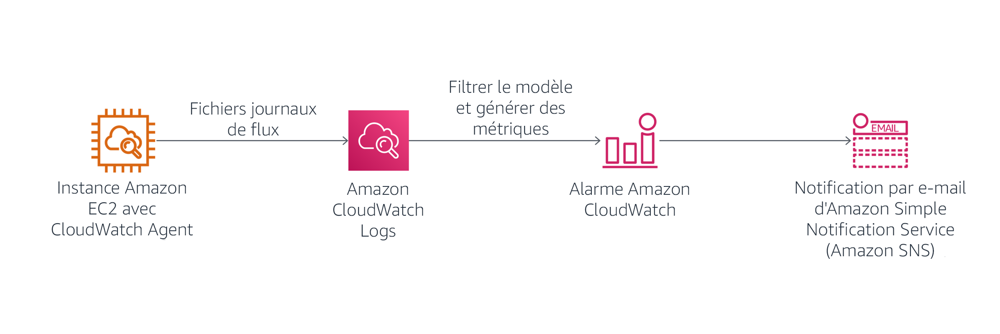


### Génération de données de journal
1. Choisissez le menu déroulant **Détails** au-dessus des instructions et cliquez sur **Afficher**.
2. Copiez la valeur de `WebServerIP`.
3. Ouvrez un nouvel onglet, collez l'adresse IP et appuyez sur Entrée (affichage de la page de test).

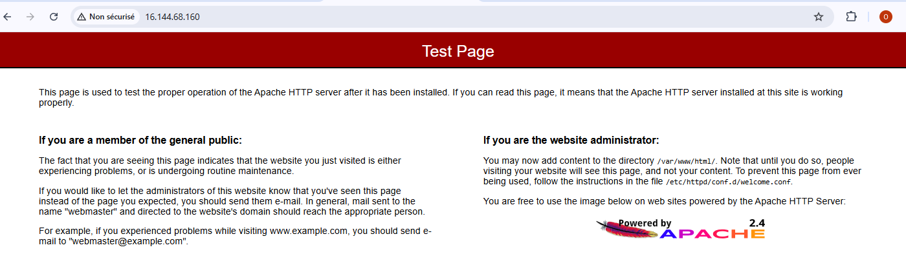

4. Ajoutez `/start` à la fin de l'URL pour provoquer une erreur 404 (Introuvable).

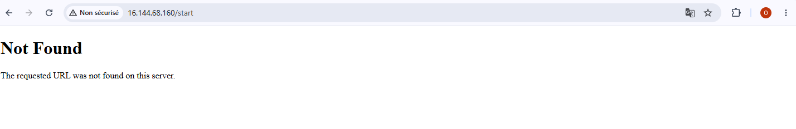

5. Dans la console AWS, accédez au service **CloudWatch**.
6. Dans le volet de navigation de gauche, sélectionnez **Groupes de journaux**.

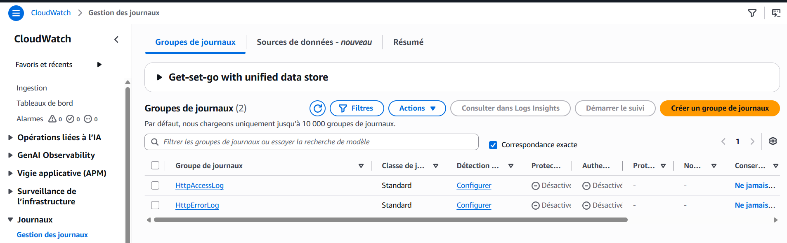

7. Sélectionnez `HttpAccessLog`, puis cliquez sur le nom du **Flux de journaux** (correspondant à l'ID d'instance).

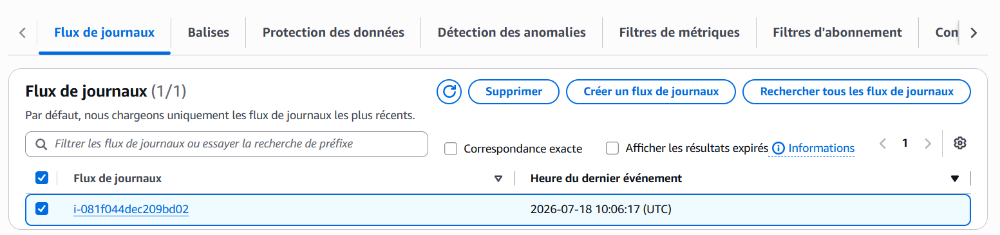

8. Observez la ligne de votre requête `/start` accompagnée du code `404`.

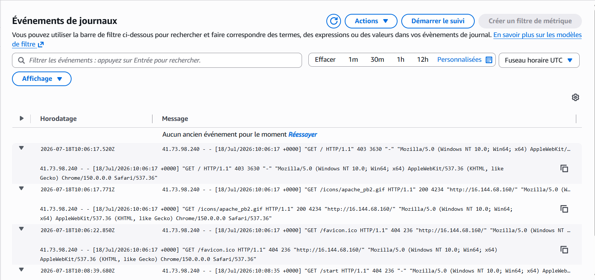


### Création d'un filtre de métriques dans CloudWatch Logs
1. Dans **Groupes de journaux**, cochez la case en regard de `HttpAccessLog`.
2. Dans le menu déroulant **Actions**, sélectionnez **Créer un filtre de métrique**.

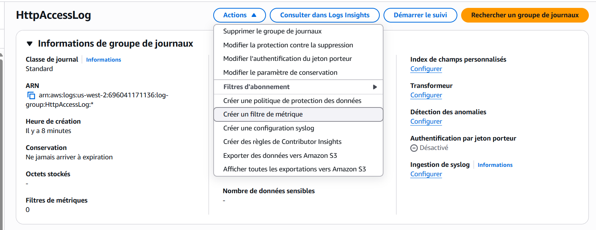

3. Collez la ligne suivante dans la zone **Modèle de filtre** :
   ```text
   [ip, id, user, timestamp, request, status_code=404, size]
   ```
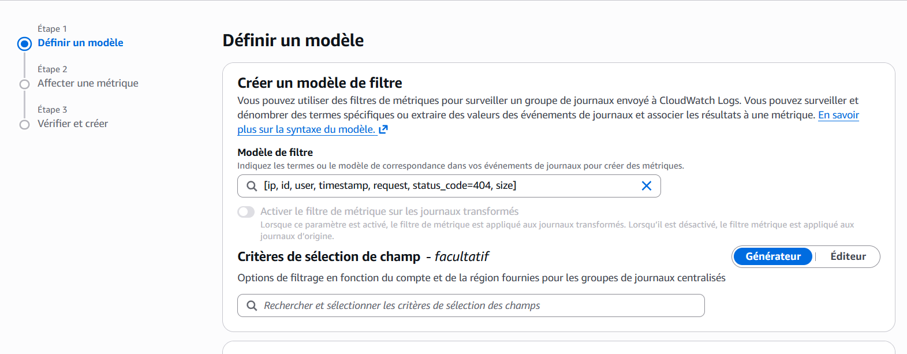

4. Dans **Tester le modèle**, sélectionnez l'ID de votre instance EC2 et cliquez sur **Tester le modèle**.

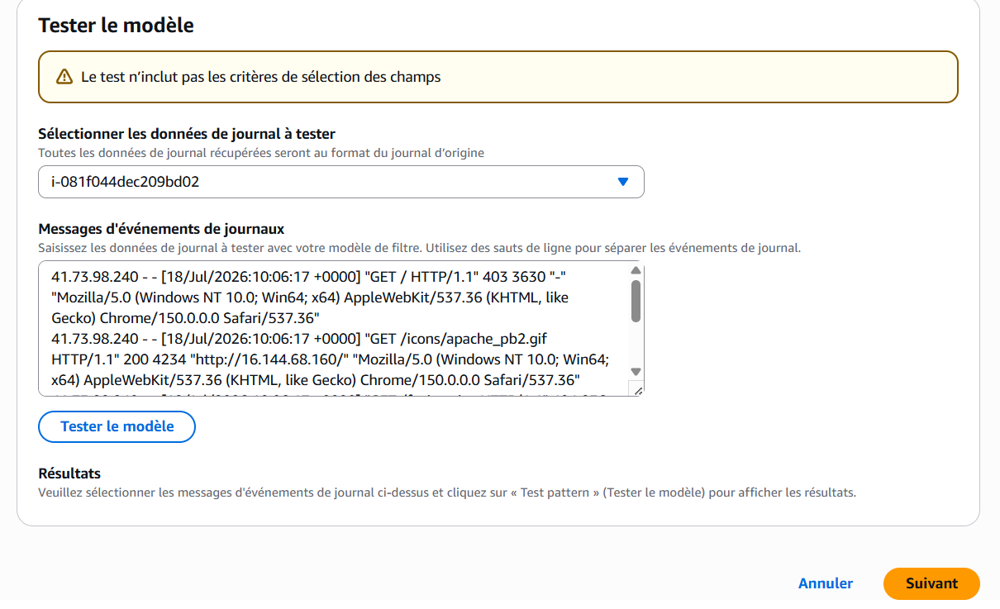
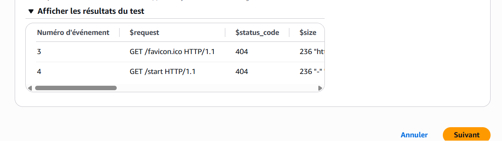

5. Choisissez **Suivant**.
6. Pour **Nom du filtre**, entrez `404Errors`.
7. Dans **Informations de métrique** :
   * **Espace de noms de métrique :** entrez `LogMetrics`.
   * **Nom de la métrique :** entrez `404Errors`.
   * **Valeur de métrique :** entrez `1`.

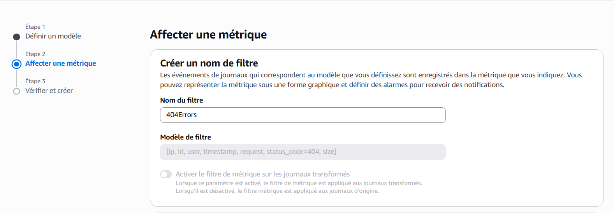
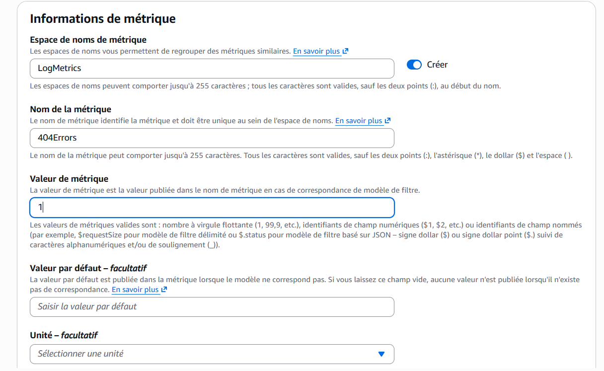
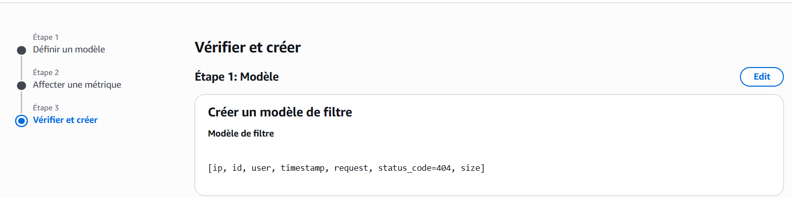
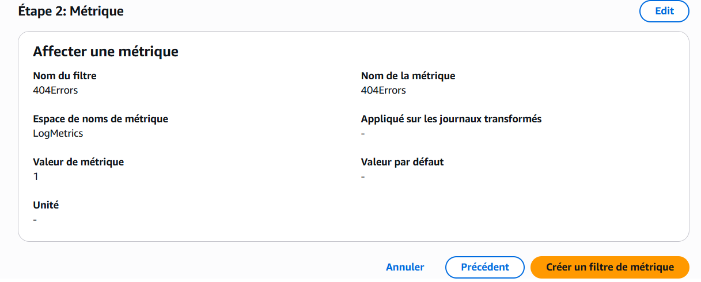

8. Choisissez **Suivant**, puis **Créer un filtre de métrique**.

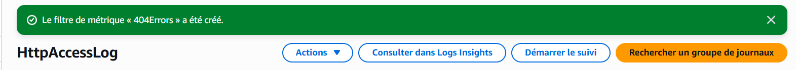

### Création d'une alarme à l'aide du filtre
1. Dans le volet `404Errors`, décochez/cochez la case et choisissez **Créer une alarme**.

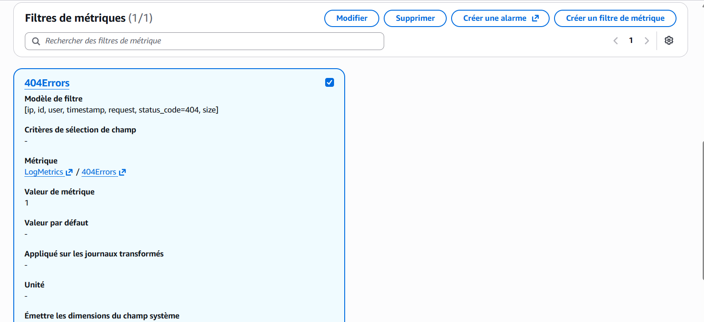

2. Dans la section **Métriques**, définissez la **Période** sur `1 minute`.
3. Dans **Conditions**, sélectionnez `Supérieur/égal à` et entrez `5`.
4. Choisissez **Suivant**.
5. Dans **Notification** :
   * Sélectionnez `Créer une nouvelle rubrique`.
   * Pour l'adresse e-mail, indiquez une adresse e-mail valide à laquelle vous avez accès.
   * Cliquez sur **Créer une rubrique**.
6. Choisissez **Suivant**.
7. **Nom de l'alarme :** entrez `404 Errors`.
8. **Description de l'alarme :** entrez `Alert when too many 404s detected on an instance`.

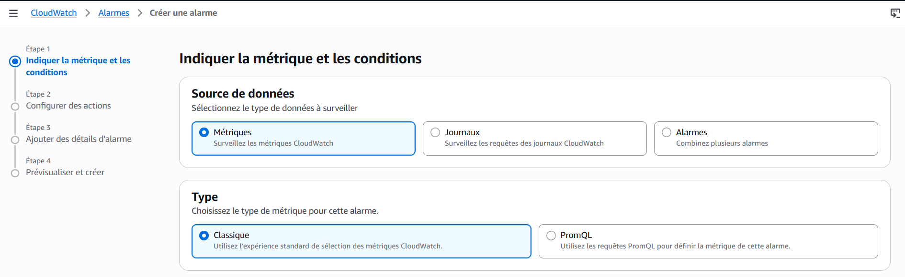
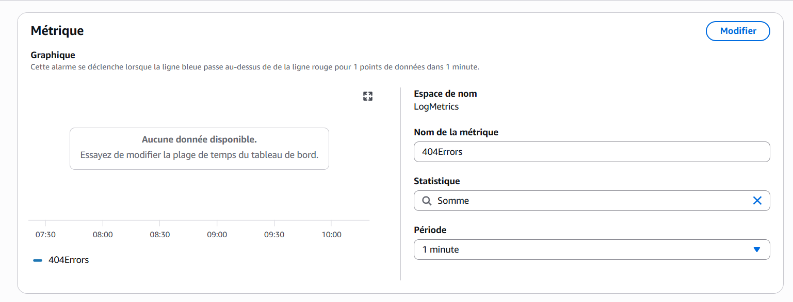
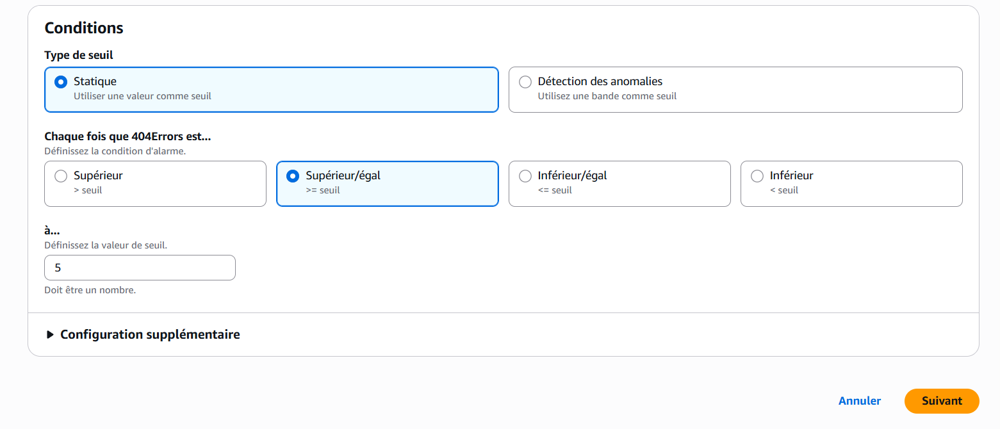
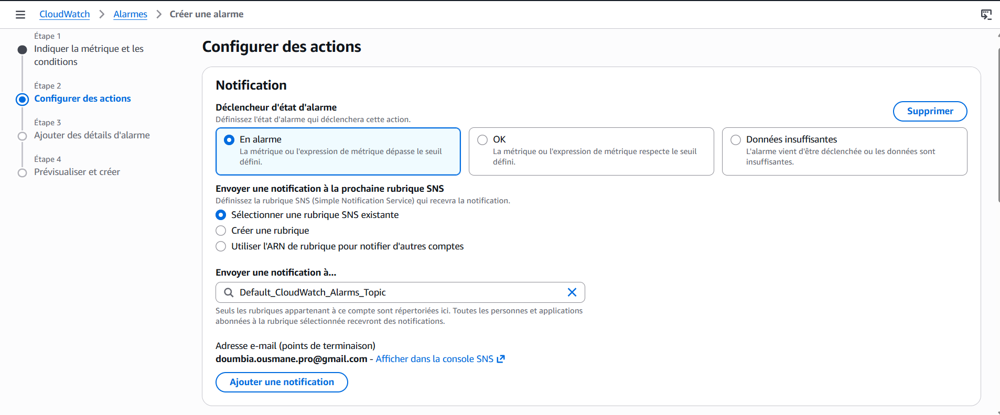
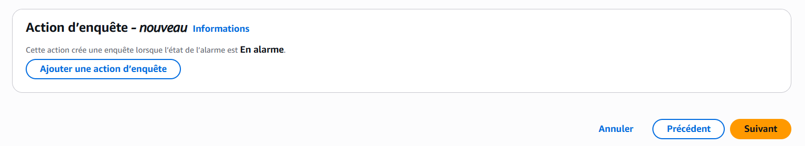
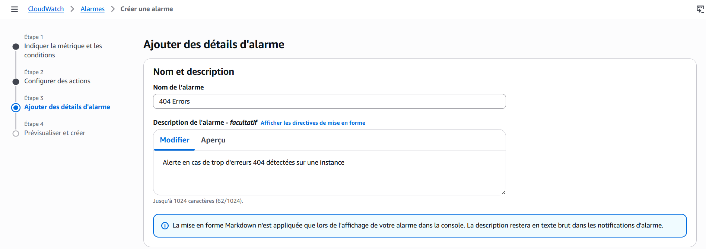
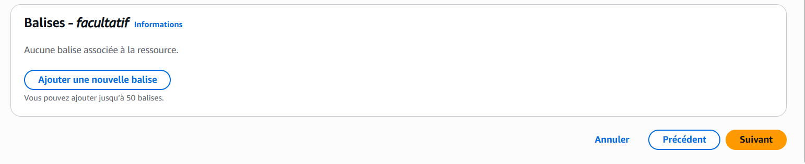

9. Choisissez **Suivant**, puis **Créer une alarme**.

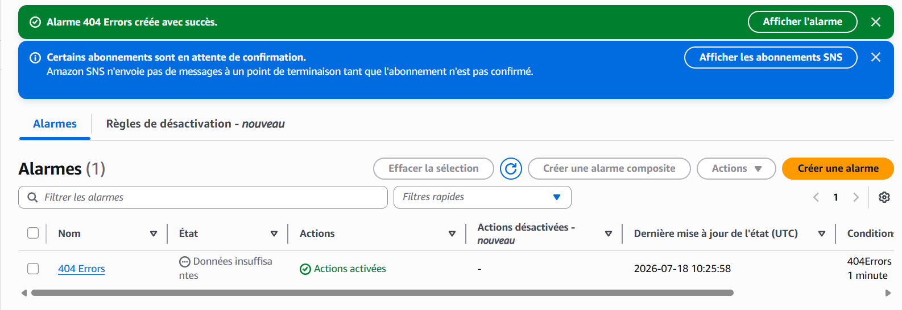

10. Accédez à votre boîte de messagerie et cliquez sur le lien **Confirmer l'abonnement** dans l'e-mail reçu.
11. Générez au moins 5 requêtes d'erreurs (ex: `http://<WebServerIP>/start2`, `/start3`, etc.) pour déclencher l'alarme.
12. Attendez 1 à 2 minutes pour voir l'état passer en **Alarme** dans CloudWatch et recevoir un message e-mail.

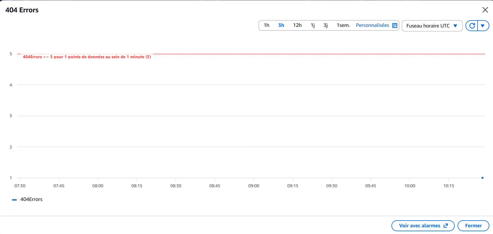
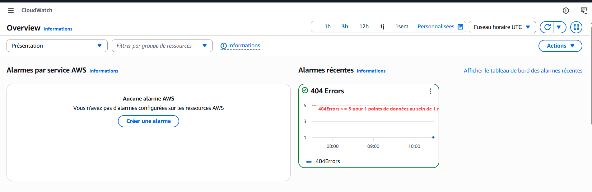

---

## Tâche 3 : Surveillance des métriques de l'instance à l'aide de CloudWatch

Les métriques sont des données sur les performances de vos systèmes. CloudWatch stocke les métriques des services AWS que vous utilisez. Vous pouvez également publier vos propres métriques d'application via l'agent CloudWatch ou directement depuis votre application. CloudWatch peut présenter les métriques de recherche, de graphiques, de tableaux de bord et d'alarmes.

Au cours de cette tâche, vous utilisez les métriques fournies par CloudWatch.


1. Dans le menu **Services**, choisissez **EC2** > **Instances**.
2. Cochez **Web Server** et consultez l'onglet **Surveillance**.


3. Pour voir les métriques personnalisées internes (mémoire, espace disque) collectées par l'agent :
   * Accédez au service **CloudWatch** > **Métriques** > **Toutes les métriques**.
   * Sélectionnez **CWAgent** > **device, fstype, host, path** (pour l'espace disque) ou **host** (pour la mémoire).


---

## Tâche 4 : Création de notifications en temps réel

CloudWatch Events fournit un flux d'événements système en quasi temps réel, qui décrit les modifications apportées aux ressources AWS. Des règles simples peuvent faire correspondre les événements et les router vers un ou plusieurs flux ou fonctions cibles. CloudWatch Events détecte les changements opérationnels dès qu'ils se produisent.

CloudWatch Events répond à ces changements opérationnels et prend les mesures correctives nécessaires en envoyant des messages pour répondre à l'environnement, en activant des fonctions, en procédant à des modifications et en enregistrant des informations d'état. Vous pouvez également utiliser CloudWatch Events pour planifier des actions automatisées qui se déclenchent automatiquement à certaines heures à l'aide d'expressions cron ou de fréquence.

Au cours de cette tâche, vous créez une notification en temps réel qui vous informe lorsqu'une instance est arrêtée ou résiliée.


1. Dans le service **CloudWatch**, sous **Événements**, choisissez **Règles**.


2. Choisissez **Créer une règle**.
3. Dans **Source de l'événement** :
   * **Nom du service :** sélectionnez `EC2`.
   * **Type d'événement :** sélectionnez `EC2 Instance State-change Notification`.
   * Cochez **État(s) spécifique(s)** et sélectionnez `arrêté` et `résilié`.
4. Dans **Cibles** :
   * Choisissez **Ajouter une cible**.
   * Sélectionnez `Rubrique SNS` dans le menu déroulant.
   * Pour **Rubrique**, sélectionnez `Default_CloudWatch_Alarms_Topic`.
5. Choisissez **Configurer les détails**.
6. **Nom :** entrez `Instance_Stopped_Terminated`.
7. Choisissez **Créer une règle**.


### Test de la notification en temps réel
1. Accédez au service **EC2** > **Instances**.
2. Cochez **Web Server**.
3. Choisissez **État de l'instance** > **Arrêter l'instance** > **Arrêter**.


4. Vérifiez votre boîte e-mail pour recevoir la notification JSON d'arrêt de l'instance.

---

## Tâche 5 : Surveillance de la conformité de l'infrastructure

AWS Config vous permet d'évaluer, d'auditer et d'apprécier les configurations de vos ressources AWS. AWS Config surveille et enregistre en permanence les configurations de vos ressources AWS et vous permet d'automatiser l'évaluation des configurations enregistrées par rapport aux configurations souhaitées.

Avec AWS Config, vous pouvez examiner les changements de configuration et les relations entre les ressources AWS, consulter l'historique détaillé de la configuration des ressources et déterminer votre conformité globale par rapport aux configurations spécifiées dans vos directives internes. Avec AWS Config, vous pouvez simplifier l'audit de conformité, l'analyse de la sécurité, la gestion des modifications et la résolution des problèmes opérationnels.

Au cours de cette tâche, vous activez des règles AWS Config pour garantir la conformité du balisage et des volumes Amazon EBS.

1. Dans le menu **Services**, choisissez **Config**. *(Si c'est la première utilisation, cliquez sur Démarrer > Suivant > Suivant > Confirmer)*.
2. Dans le volet de navigation de gauche, choisissez **Règles** > **Ajouter une règle**.

### Règle 1 : Vérification des balises requises (`required-tags`)
1. Dans le champ de recherche des règles gérées, entrez `required-tags`.
2. Sélectionnez `required-tags` et cliquez sur **Suivant**.
3. Dans la section **Paramètres**, en face de `tag1Key`, entrez `project`.
4. Choisissez **Suivant**, puis **Ajouter une règle**.

### Règle 2 : Vérification des volumes EBS inutilisés (`ec2-volume-inuse-check`)
1. Choisissez **Ajouter une règle**.
2. Recherchez `ec2-volume-inuse-check`.
3. Sélectionnez `ec2-volume-inuse-check`, cliquez sur **Suivant**, puis à nouveau sur **Suivant** et **Ajouter une règle**.

### Consultation des résultats d'évaluation
1. Actualisez la page des règles jusqu'à l'obtention des résultats d'évaluation.
2. Cliquez sur les règles pour examiner les résultats sous **Ressources concernées** :
   * **`required-tags` :** Affiche l'instance EC2 conforme (possédant la balise `project`) et les ressources non conformes.
   * **`ec2-volume-inuse-check` :** Affiche le volume EBS attaché conforme et le volume EBS orphelin non conforme.
