# Phase 00 : Préparation du lab

## Objectif

Disposer d'un laboratoire fonctionnel : GNS3 VM opérationnelle, topologie construite, passerelle Internet configurée, plan d'adressage défini.

## Concepts

- **GNS3 VM** : machine virtuelle qui exécute les nœuds lourds (Windows Server, etc.) pour le client GNS3 installé sur Windows.
- **NAT (nœud GNS3)** : donne un accès Internet aux nœuds de la topologie.
- **Passerelle par défaut** : routeur vers lequel les machines envoient le trafic destiné à d'autres réseaux.
- **Masquerade** : traduction d'adresses (NAT source) qui permet au LAN privé de sortir avec l'adresse du routeur.

## Prérequis

- VMware Workstation et GNS3 2.2.61 installés
- GNS3 VM importée, avec les appliances Windows Server 2022, Windows 10 et MikroTik CHR 7.16
- Plan d'adressage : voir [../docs/plan-adressage.md](../docs/plan-adressage.md)

## Procédure

### 1. Réseau de la GNS3 VM dans VMware

1. Éteindre la GNS3 VM.
2. VM > Settings : **Network Adapter** en **NAT**, **Network Adapter 2** en **Host-only**.
3. Redémarrer et vérifier que l'écran de la VM affiche une adresse IP.


> Cause du problème initial (eth0 sans IP) : voir [../docs/troubleshooting.md](../docs/troubleshooting.md).

### 2. Création du projet GNS3

1. Nouveau projet : `DoumbiaCorp-WinServer2022`.
2. Ajouter : NAT, MikroTik CHR, Ethernet switch, Windows Server 2022 (x2), Windows 10.
3. Câblage : `NAT - ether1 (MikroTik)`, `ether2 (MikroTik) - switch`, puis le switch vers chaque machine.
4. Renommer les nœuds : `GW-DOUMBIACORP`, `DC01`, `SRV02`, `CL01`.

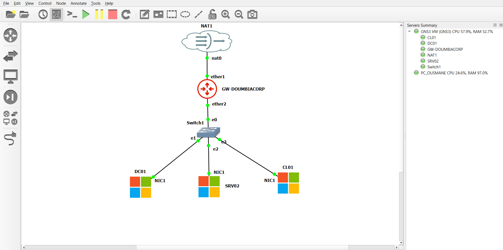

### 3. Configuration du MikroTik (console)

Connexion : utilisateur `admin` (mot de passe vide au premier démarrage, RouterOS demande d'en définir un).

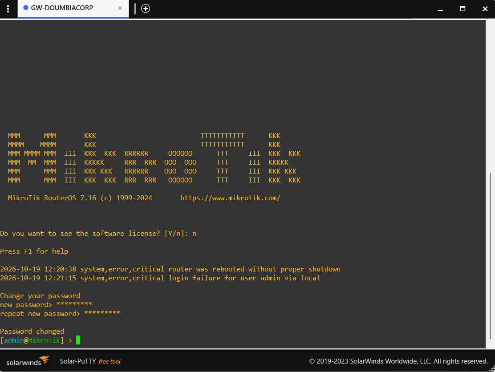

```/system identity set name=GW-DOUMBIACORP```

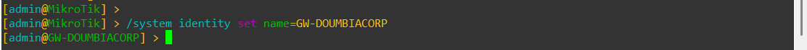

```/ip dhcp-client print```

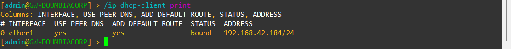

```/ip dhcp-client add interface=ether1 disabled=no```

```/ip address add address=192.168.10.1/24 interface=ether2```

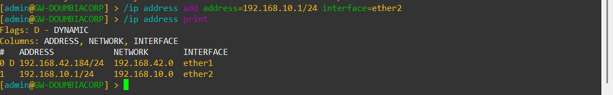

```/ip firewall nat add chain=srcnat out-interface=ether1 action=masquerade```

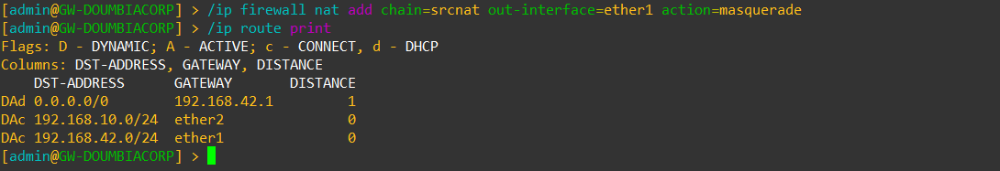

```/ip dns set servers=8.8.8.8 allow-remote-requests=yes```

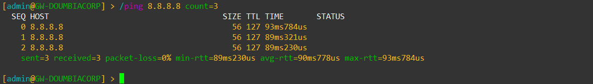


Si `/ip dhcp-client print` montre déjà un client sur ether1, ne pas relancer la commande `add`.

### 4. Configuration réseau de DC01 (PowerShell administrateur)
```
powershell
Rename-Computer -NewName "DC01" -Restart
```
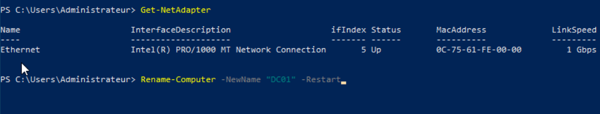


Après le redémarrage :
```
powershell
New-NetIPAddress -InterfaceAlias "Ethernet" -IPAddress 192.168.10.10 -PrefixLength 24 -DefaultGateway 192.168.10.1
```
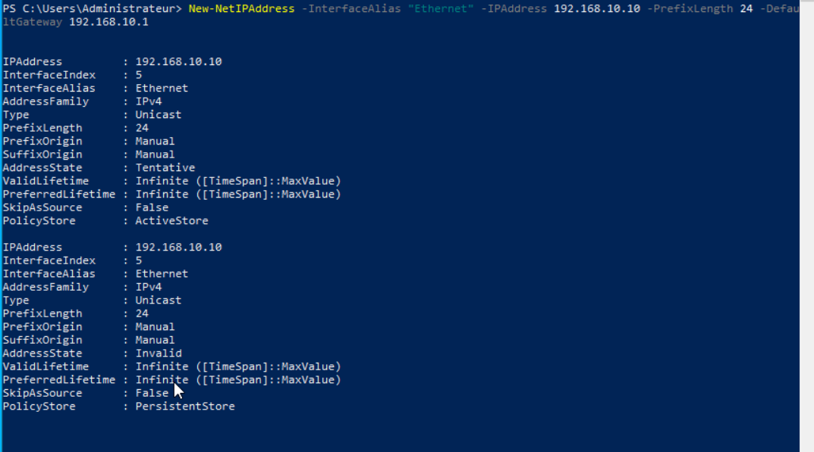

```Set-DnsClientServerAddress -InterfaceAlias "Ethernet" -ServerAddresses 8.8.8.8```

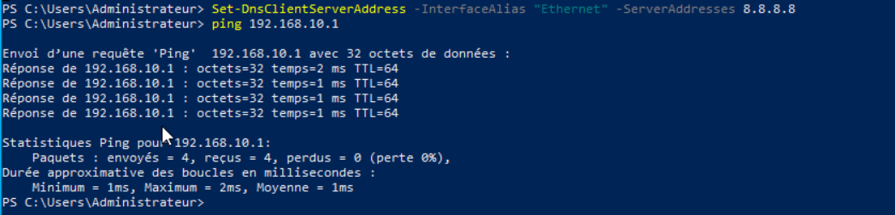


Le nom de l'interface peut différer (`Get-NetAdapter` pour le vérifier).

## Vérification


# Sur le MikroTik

```/ip address print```


```/ping 8.8.8.8 count=3```


# Sur DC01

```ipconfig /all```

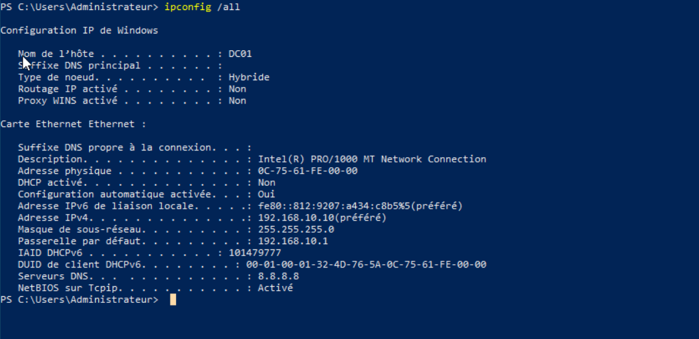

```ping 192.168.10.1```

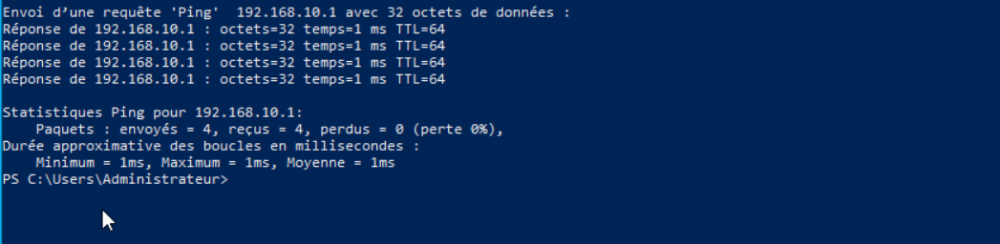

```ping 8.8.8.8```

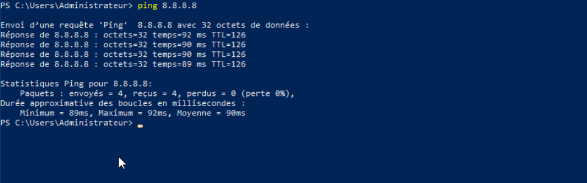

```ping google.com```

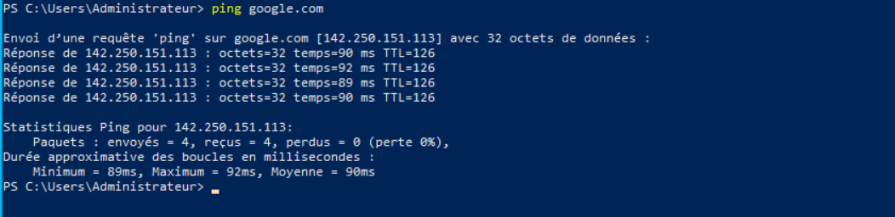


Résultat attendu : les quatre pings répondent.

## Problèmes rencontrés et solutions

Voir [../docs/troubleshooting.md](../docs/troubleshooting.md).

## Bonnes pratiques

- Prendre un **snapshot** de chaque machine à la fin de la phase.
- Exporter la configuration du routeur : `/export file=gw-phase00`.
- Ne jamais réutiliser de vrais mots de passe dans le lab.

## Résultats obtenus

| Test | Résultat |
|---|---|
| MikroTik : `/ip dhcp-client print` | ether1 `bound`, adresse 192.168.42.184/24 (fournie par le NAT) |
| MikroTik : `/ping 8.8.8.8` et `/ping google.com` | 3/3, 0 % de perte, environ 90 ms |
| DC01 : `ipconfig /all` | 192.168.10.10/24, passerelle 192.168.10.1, DNS 8.8.8.8 |
| DC01 : `ping 192.168.10.1` | 4/4, 1 ms |
| DC01 : `ping 8.8.8.8` et `ping google.com` | 4/4, 0 % de perte, environ 90 ms |

**Statut : phase validée.** Snapshot DC01 : `Phase00-OK`. Export routeur : `gw-phase00`.
