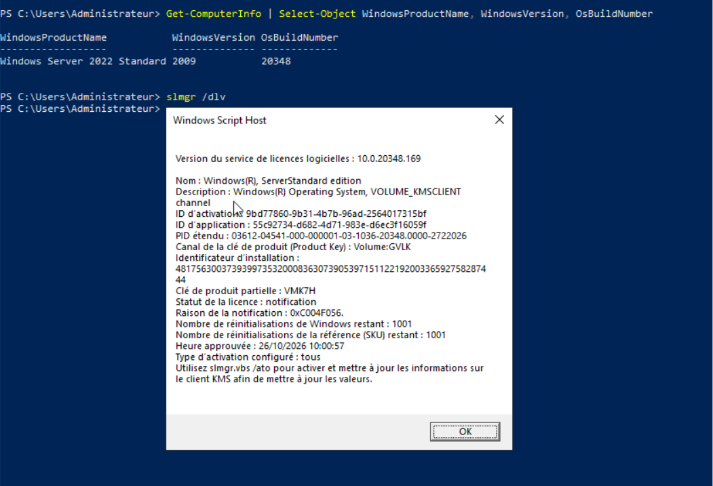
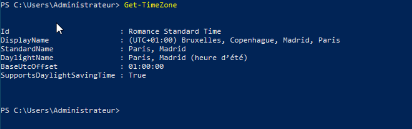
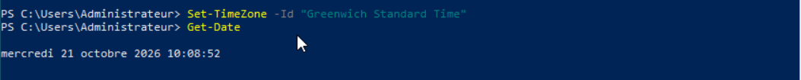
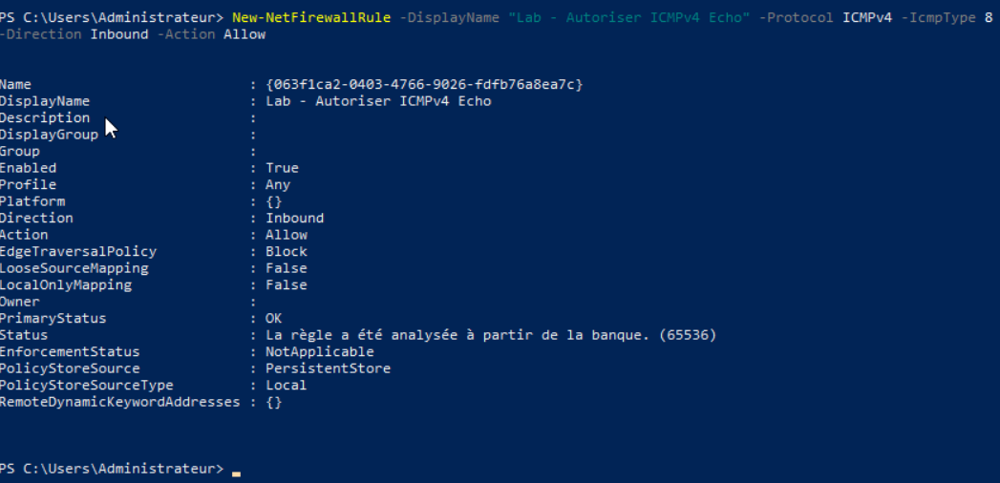
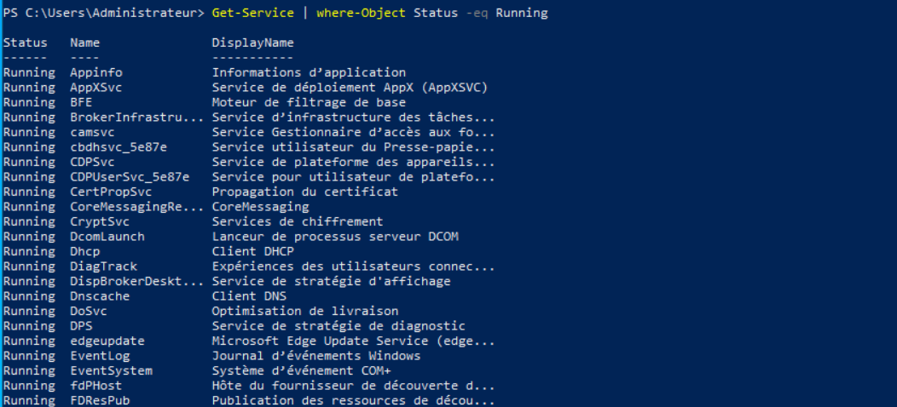
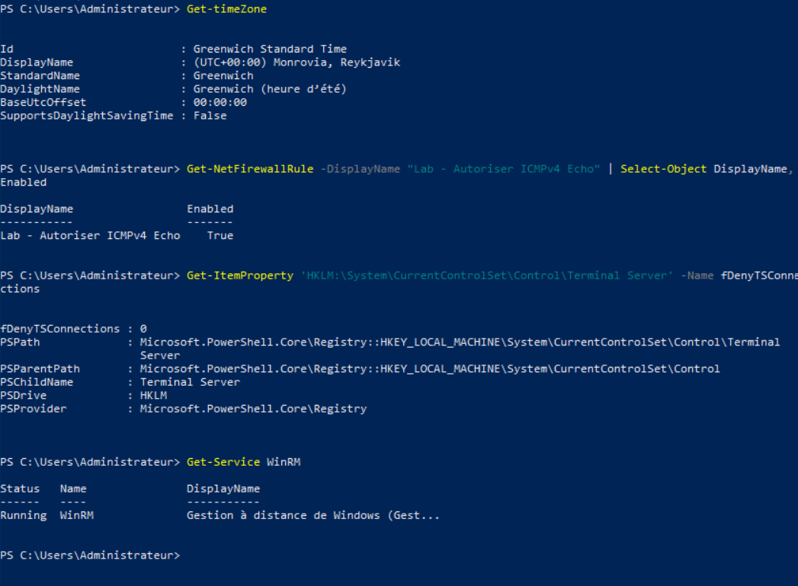
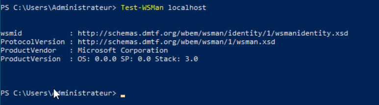
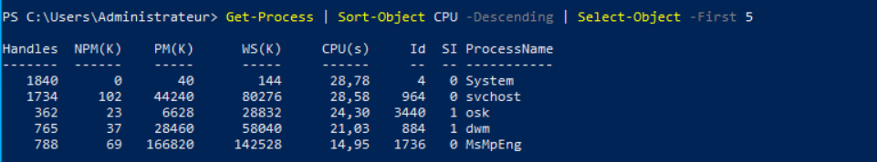

# Phase 01 : Installation et configuration de base

## Objectif

Mettre DC01 dans un état de base propre et documenté avant d'installer Active Directory : licence vérifiée, fuseau horaire, pare-feu, accès distant, mises à jour, prise en main de PowerShell.

## Concepts

- **Édition et licence** : `slmgr /dlv` indique l'édition, le canal de licence et l'état d'activation.
- **Kerberos et l'heure** : l'authentification Active Directory refuse les échanges si l'écart d'horloge dépasse 5 minutes ; le fuseau horaire doit donc être correct.
- **RDP / WinRM** : RDP donne le bureau à distance, WinRM la ligne de commande PowerShell à distance.
- **NLA** (Network Level Authentication) : le client s'authentifie avant l'ouverture de session RDP.
- **PowerShell** : manipule des objets ; le pipe `|` passe les objets d'une commande à la suivante.

## Prérequis

- Phase 00 validée (DC01 en 192.168.10.10 avec accès Internet)
- Snapshot VMware de la GNS3 VM (voir problème 005)

## Procédure

### 1. Vérifier l'édition et la licence

```powershell
Get-ComputerInfo | Select-Object WindowsProductName, WindowsVersion, OsBuildNumber
slmgr /dlv
```

Résultat : Windows Server 2022 **Standard**, canal `VOLUME_KMSCLIENT` (clé générique GVLK), statut **notification** (non activé, aucun serveur KMS dans le lab, code `0xC004F056`). Le serveur fonctionne normalement ; usage laboratoire uniquement.



### 2. Fuseau horaire

```powershell
Get-TimeZone
Set-TimeZone -Id "Greenwich Standard Time"
Get-Date
```

Avant : `Romance Standard Time` (UTC+01:00, avec heure d'été), soit environ 2 heures d'écart avec l'heure réelle. Après : `Greenwich Standard Time` (UTC+00:00, sans changement d'heure), adapté au Mali.




### 3. Autoriser les pings entrants (choix de lab)

```powershell
New-NetFirewallRule -DisplayName "Lab - Autoriser ICMPv4 Echo" -Protocol ICMPv4 -IcmpType 8 -Direction Inbound -Action Allow
```


Réévalué en phase 06 (durcissement).

### 4. Accès distant (RDP et WinRM)

```powershell
Set-ItemProperty -Path 'HKLM:\System\CurrentControlSet\Control\Terminal Server' -Name fDenyTSConnections -Value 0
Get-NetFirewallRule -Group "@FirewallAPI.dll,-28752" | Select-Object DisplayName, Enabled, Profile
Enable-NetFirewallRule -Group "@FirewallAPI.dll,-28752"
Enable-PSRemoting -Force
```

Note : `-Group` attend l'identifiant interne (identique dans toutes les langues), `-DisplayGroup` le nom affiché traduit (voir problème 004). Les règles sont en profil `Any` ; à restreindre au profil *Domain* en phase 06.

### 5. Prise en main de PowerShell

```powershell
Get-Help Get-Service -Examples
Get-Command -Noun NetIPAddress
Get-Service | Where-Object Status -eq Running
Get-Process | Sort-Object CPU -Descending | Select-Object -First 5
Get-PSDrive C
```

Remarque : la colonne `CPU(s)` est le temps processeur **cumulé**, pas la charge actuelle. Pour la charge instantanée : `Get-Counter '\Processor(_Total)\% Processor Time' -SampleInterval 2 -MaxSamples 3`.

Espace disque : 11,36 Go utilisés, 87,99 Go libres.




### 6. Mises à jour Windows (`sconfig`)

`sconfig` > **6** (Installer les mises à jour) > catégorie **1** (Toutes les mises à jour qualité) > à l'invite, **T** (installer toutes) ; **A** signifie *aucune*.

| Mise à jour | Résultat (1re tentative) |
|---|---|
| KB5010475 (.NET, aperçu 2022-02) | Réussie |
| KB890830 (outil de suppression de logiciels malveillants) | Échec |
| KB5128928 (.NET cumulative 2026-10) | Réussie |
| Signatures Microsoft Defender (2,2 Go) | Échec |
| KB5122882 (cumulative Windows Server 2026-09) | Échec |

Hypothèse : un redémarrage en attente (imposé par les mises à jour .NET) bloque les installations suivantes. État après redémarrage : _à compléter avec `Get-HotFix`_. Voir problème 006.

## Vérification

```powershell
Get-TimeZone
Get-NetFirewallRule -DisplayName "Lab - Autoriser ICMPv4 Echo" | Select-Object DisplayName, Enabled
Get-ItemProperty 'HKLM:\System\CurrentControlSet\Control\Terminal Server' -Name fDenyTSConnections
Get-NetFirewallRule -Group "@FirewallAPI.dll,-28752" | Select-Object DisplayName, Enabled
Get-Service WinRM
Test-WSMan localhost
Get-HotFix | Sort-Object InstalledOn -Descending | Select-Object -First 5
```




| Contrôle | Résultat |
|---|---|
| Fuseau | `Greenwich Standard Time`, UTC+00:00 |
| Règle ping | `Enabled = True` |
| `fDenyTSConnections` | `0` (RDP autorisé) |
| Règles « Bureau à distance » | 3 règles `Enabled = True` |
| WinRM | `Running`, `Test-WSMan` répond (Microsoft Corporation) |

## Problèmes rencontrés et solutions

Voir [../docs/troubleshooting.md](../docs/troubleshooting.md) : entrées 002 (tiret manquant), 004 (`-DisplayGroup` / `-Group`), 005 (snapshot GNS3) et 006 (mises à jour partielles).

## Bonnes pratiques

- Snapshot **VMware** de la GNS3 VM avant les mises à jour et à la fin de chaque phase.
- Documenter chaque règle de pare-feu ouverte et sa justification.
- Relire les menus de l'outil avant de saisir une lettre : les choix dépendent de la langue.
