# Phase 05 : Serveur de fichiers, permissions NTFS (AGDLP) et lecteurs réseau

## Objectif

Mettre en place un serveur de fichiers (`SRV02`) où chaque service accède à son dossier et seulement au sien, avec des droits gérés par groupes selon le modèle **AGDLP**, puis donner à chaque utilisateur ses lecteurs réseau automatiquement par GPO.

## Concepts

| Notion | Explication |
|---|---|
| **AGDLP** | *Accounts, Global groups, Domain Local groups, Permissions* : les comptes vont dans des groupes globaux (par service), eux-mêmes placés dans des groupes de domaine local (par ressource et par droit), qui reçoivent les permissions |
| **Groupe global (`GG_`)** | Regroupe des personnes (ici un service) |
| **Groupe de domaine local (`DL_`)** | Représente un droit sur une ressource (`DL_RH_Modif` = modifier le dossier RH) |
| **Permissions NTFS** | Droits sur les dossiers et fichiers du disque |
| **Permissions de partage (SMB)** | Droits d'entrée par le réseau ; le droit effectif est le plus restrictif des deux couches |
| **Héritage** | Un dossier reprend les droits de son parent ; on le coupe à la racine pour ne pas hériter de `Utilisateurs` |
| **SID** | Identifiant universel d'un compte ou groupe, indépendant de la langue de Windows |
| **ABE** (*Access-Based Enumeration*) | Masque, à l'intérieur d'un partage, les fichiers et dossiers auxquels l'utilisateur n'a pas droit |
| **Préférences de GPO (lecteurs mappés)** | Créent des lecteurs réseau à la connexion ; le ciblage au niveau de l'élément limite chaque lecteur à un groupe |

## Prérequis

- Phase 04 validée (snapshot `Phase04-OK`)
- Groupes `GG_RH`, `GG_Finance`, `GG_IT` remplis (phase 02) ; OU `Serveurs` et `Groupes` existantes
- DC01 et le routeur démarrés ; plan d'adressage : SRV02 en `192.168.10.11`

## Plan des droits

| Dossier | Modification | Lecture seule |
|---|---|---|
| RH | `GG_RH` | personne d'autre |
| Finance | `GG_Finance` | personne d'autre |
| IT | `GG_IT` | personne d'autre |
| Commun | `GG_IT` | `GG_RH`, `GG_Finance` |

Choix volontaire : l'équipe IT administre le serveur mais n'a pas accès aux données RH et Finance.

## Procédure

### 1. Installer SRV02

Nouveau nœud GNS3 issu du modèle Windows Server 2022 (jamais une copie du disque de DC01 : même SID, même identité de contrôleur de domaine), relié à `Switch1`, 2 Go de RAM.

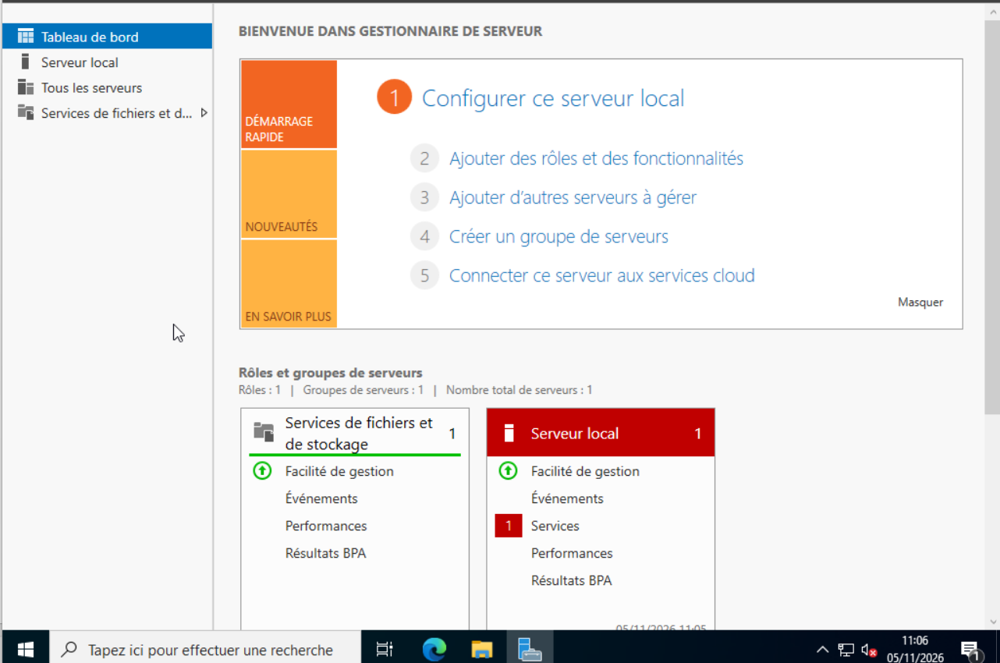

### 2. IP fixe et DNS (sur SRV02)

```powershell
$if = (Get-NetAdapter | Where-Object Status -eq 'Up' | Select-Object -First 1).Name
Set-NetIPInterface -InterfaceAlias $if -Dhcp Disabled
Get-NetIPAddress -InterfaceAlias $if -AddressFamily IPv4 -ErrorAction SilentlyContinue | Remove-NetIPAddress -Confirm:$false
Remove-NetRoute -InterfaceAlias $if -DestinationPrefix 0.0.0.0/0 -Confirm:$false -ErrorAction SilentlyContinue
New-NetIPAddress -InterfaceAlias $if -IPAddress 192.168.10.11 -PrefixLength 24 -DefaultGateway 192.168.10.1
Set-DnsClientServerAddress -InterfaceAlias $if -ServerAddresses 192.168.10.10
```

Le DNS doit être DC01 : c'est lui qui sait où se trouve le contrôleur de domaine. Vérification : `Test-Connection` vers `192.168.10.1` et `192.168.10.10`, puis `Resolve-DnsName doumbiacorp.local` (résultat `192.168.10.10`). Voir dépannage 015 et 016 (messages sans gravité).

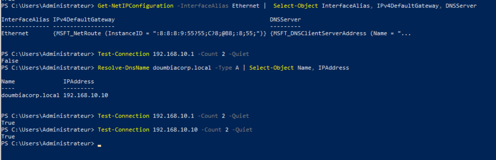

### 3. Renommer et joindre le domaine

```powershell
Add-Computer -DomainName doumbiacorp.local -NewName SRV02 -Credential DOUMBIACORP\Administrateur -Restart
```

Le nom et la jonction se font en une commande, avec un seul redémarrage. Puis, sur DC01, déplacer l'objet de `CN=Computers` (conteneur sur lequel on ne peut pas lier de GPO) vers l'OU `Serveurs`, pour qu'il échappe aux GPO des postes clients :

```powershell
Move-ADObject -Identity (Get-ADComputer SRV02).DistinguishedName -TargetPath "OU=Serveurs,OU=Ordinateurs,OU=DoumbiaCorp,DC=doumbiacorp,DC=local"
Get-ADComputer SRV02 | Select-Object Name, DistinguishedName
```

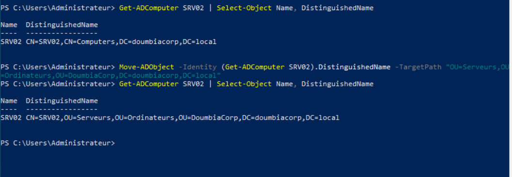

### 4. Rôle Serveur de fichiers et dossiers (sur SRV02)

```powershell
Install-WindowsFeature FS-FileServer -IncludeManagementTools
Get-WindowsFeature FS-FileServer | Select-Object Name, InstallState

$racine = "C:\Partages"
foreach ($d in "RH","Finance","IT","Commun") {
    New-Item -Path "$racine\$d" -ItemType Directory -Force | Out-Null
}
```

Aucun redémarrage nécessaire. Les données sont sur `C:` faute de second disque ; en production, un volume séparé (`D:\Partages`) permet de réinstaller Windows sans toucher aux données et de les sauvegarder ou agrandir à part.

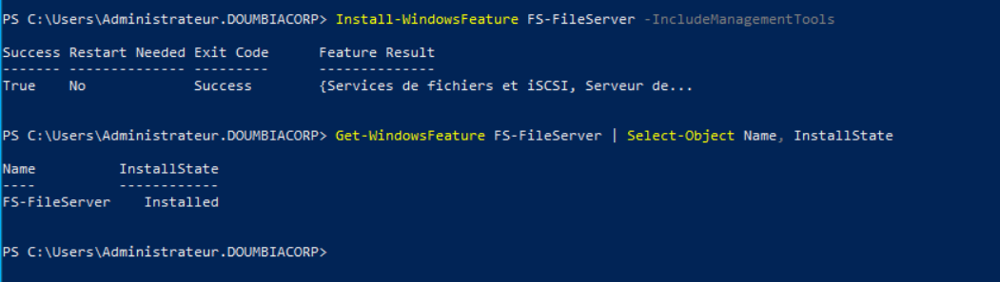
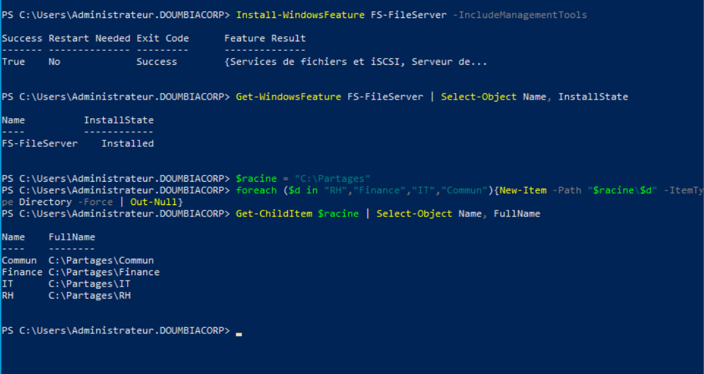

### 5. Groupes DL et imbrication AGDLP (sur DC01)

```powershell
$racine = "OU=DoumbiaCorp," + (Get-ADDomain).DistinguishedName
$droits = @{ "Modif" = "Modification"; "Lecture" = "Lecture seule" }

foreach ($dossier in "RH","Finance","IT","Commun") {
    foreach ($d in $droits.Keys) {
        New-ADGroup -Name "DL_${dossier}_$d" -SamAccountName "DL_${dossier}_$d" `
            -GroupScope DomainLocal -GroupCategory Security `
            -Path "OU=Groupes,$racine" `
            -Description "$($droits[$d]) sur le dossier $dossier"
    }
}

Add-ADGroupMember -Identity DL_RH_Modif       -Members GG_RH
Add-ADGroupMember -Identity DL_Finance_Modif  -Members GG_Finance
Add-ADGroupMember -Identity DL_IT_Modif       -Members GG_IT
Add-ADGroupMember -Identity DL_Commun_Modif   -Members GG_IT
Add-ADGroupMember -Identity DL_Commun_Lecture -Members GG_RH, GG_Finance
```

Résultat : 8 groupes `DomainLocal`. Contenu : `DL_RH_Modif` contient `GG_RH`, `DL_Finance_Modif` contient `GG_Finance`, `DL_IT_Modif` et `DL_Commun_Modif` contiennent `GG_IT`, `DL_Commun_Lecture` contient `GG_Finance` et `GG_RH` ; les trois autres `Lecture` sont vides.

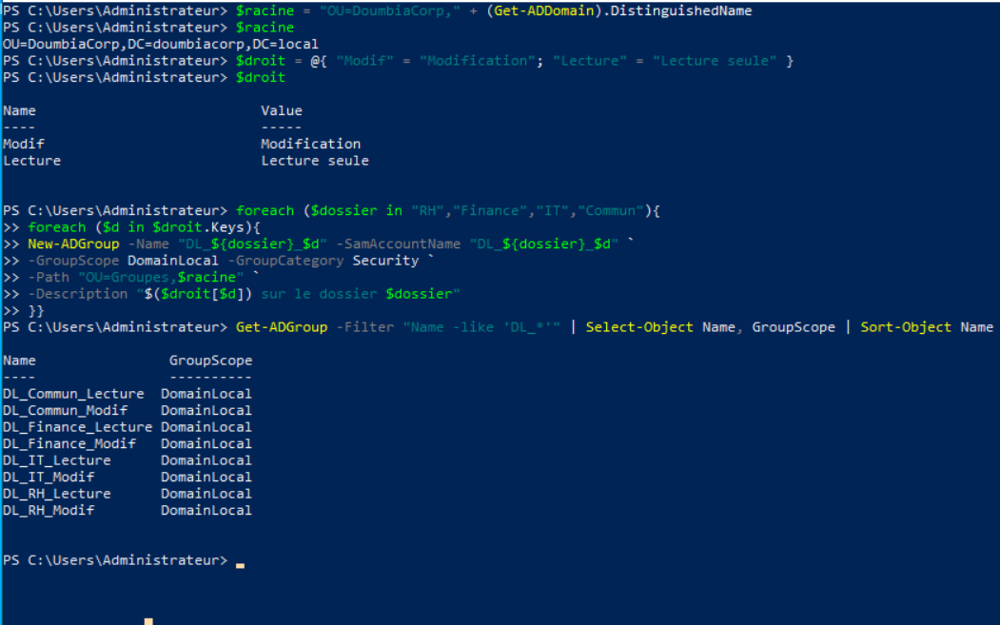
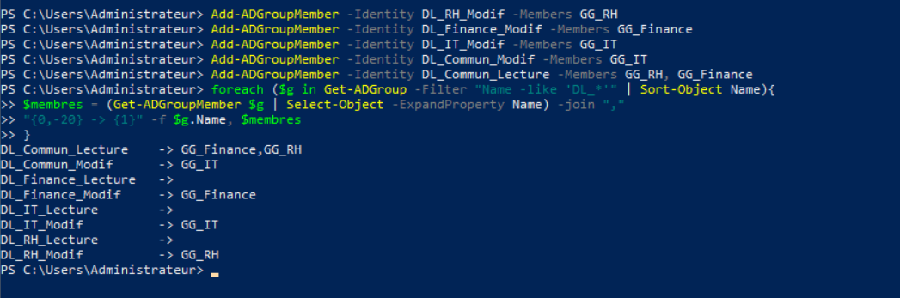

### 6. Permissions NTFS (sur SRV02)

```powershell
icacls C:\Partages /inheritance:r
icacls C:\Partages /grant "*S-1-5-32-544:(OI)(CI)F" "*S-1-5-18:(OI)(CI)F"

$dom = "DOUMBIACORP"
foreach ($n in "RH","Finance","IT","Commun") {
    icacls "C:\Partages\$n" /grant "${dom}\DL_${n}_Modif:(OI)(CI)M" "${dom}\DL_${n}_Lecture:(OI)(CI)RX"
}
foreach ($n in "RH","Finance","IT","Commun") { icacls "C:\Partages\$n" }
```

`/inheritance:r` supprime les droits hérités de `C:\` (sinon `Utilisateurs` et `Utilisateurs authentifiés` accèderaient aux dossiers). Les SID `*S-1-5-32-544` (Administrateurs) et `*S-1-5-18` (SYSTEM) évitent les noms localisés (Windows est en français). Résultat : chaque dossier n'affiche que `Système` et `Administrateurs` en `(F)` hérités, plus ses deux groupes DL (`(M)` et `(RX)`).

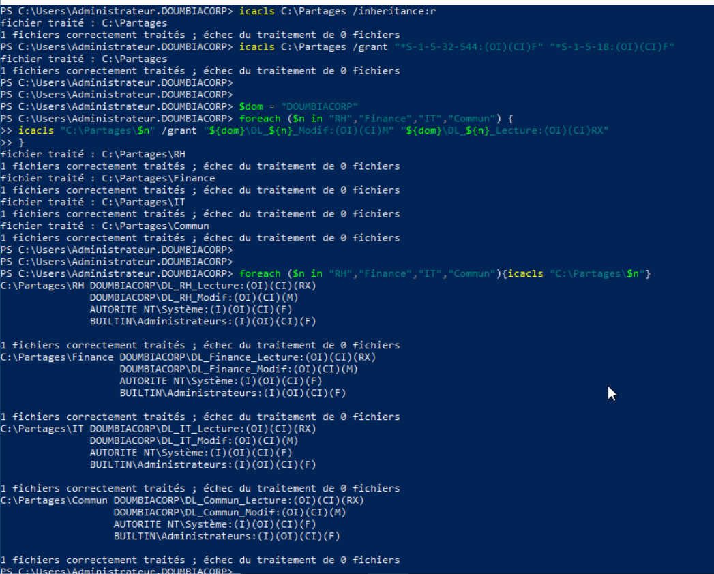

### 7. Partages SMB (sur SRV02)

```powershell
$auth = (New-Object System.Security.Principal.SecurityIdentifier "S-1-5-11").Translate([System.Security.Principal.NTAccount]).Value
$adm  = (New-Object System.Security.Principal.SecurityIdentifier "S-1-5-32-544").Translate([System.Security.Principal.NTAccount]).Value

foreach ($n in "RH","Finance","IT","Commun") {
    New-SmbShare -Name $n -Path "C:\Partages\$n" -FullAccess $adm -ChangeAccess $auth `
        -FolderEnumerationMode AccessBased -Description "Dossier $n DoumbiaCorp"
}
Get-SmbShare | Where-Object Path -like "C:\Partages*" | Select-Object Name, Path, FolderEnumerationMode
Get-SmbShareAccess -Name RH
```

Les permissions de partage sont volontairement larges (modification pour les utilisateurs authentifiés) : le filtrage se fait uniquement par le NTFS, donc à un seul endroit.

Remarque : `AccessBased` masque les éléments à l'intérieur d'un partage, pas les partages eux-mêmes. Chaque dossier étant son propre partage, un utilisateur voit la liste des partages et obtient « Accès refusé » sur ceux qui ne le concernent pas.

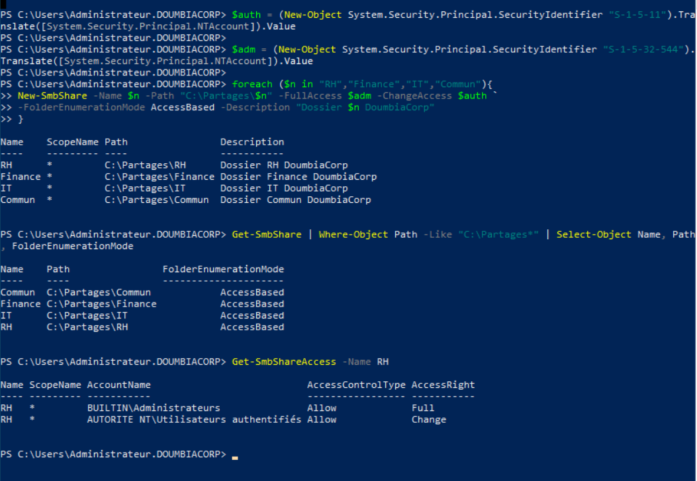

### 8. Tests des droits depuis CL01

Résultats avec un compte RH (`awa.traore`) :

| Test | Résultat |
|---|---|
| `dir \\SRV02\RH` | Affiché |
| `dir \\SRV02\Commun` | Affiché |
| `dir \\SRV02\Finance` | Accès refusé |
| Écriture dans `RH` | Réussie (relecture confirmée) |
| Écriture dans `Commun` | Accès refusé (lecture seule) |

Avec un compte Finance (`ibrahim.sangare`) : `Finance` et `Commun` accessibles, `RH` et `IT` refusés, écriture dans `Finance` réussie. L'écriture dans `Commun` et le nettoyage du fichier de test sont confirmés par l'utilisateur, sans capture.

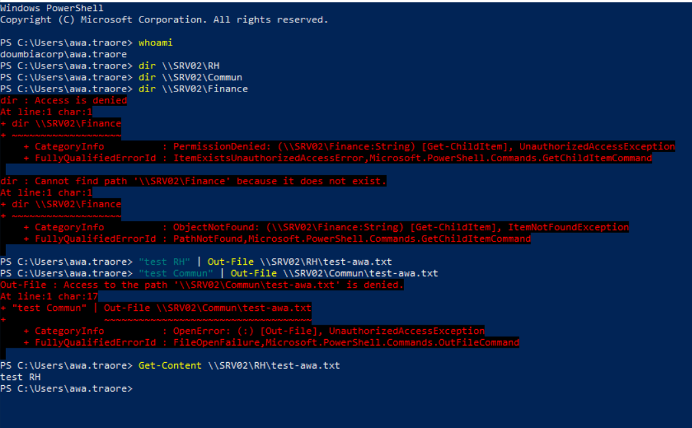
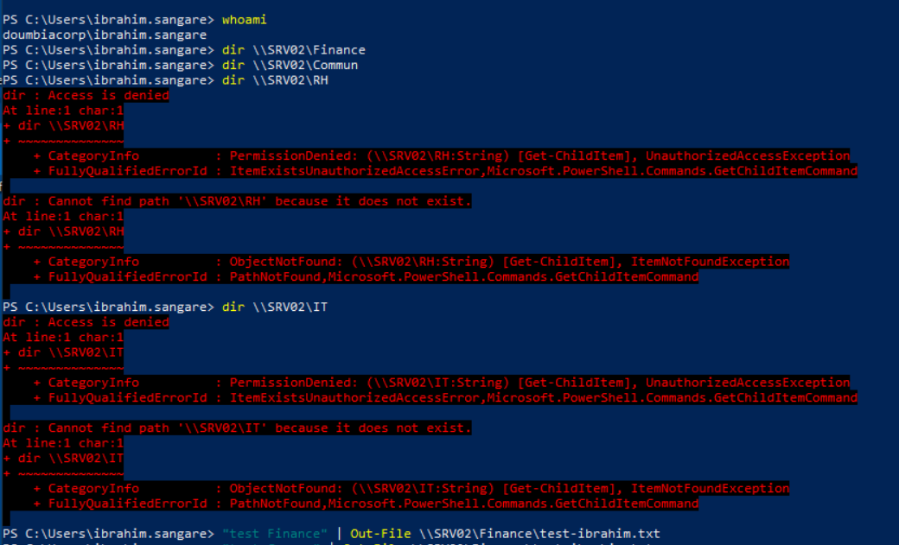

### 9. Lecteurs réseau par GPO

Création et liaison (sur DC01) :

```powershell
$racine = "OU=DoumbiaCorp," + (Get-ADDomain).DistinguishedName
New-GPO -Name "USR-Lecteurs-Reseau" -Comment "Lecteurs reseau par service (phase 05)"
New-GPLink -Name "USR-Lecteurs-Reseau" -Target "OU=Utilisateurs,$racine" -LinkEnabled Yes
```

Contenu, dans l'éditeur de la GPO (`gpmc.msc`, *Configuration utilisateur, Préférences, Paramètres Windows, Mappages de lecteurs*) :

| Lecteur | Emplacement | Ciblage (groupe de sécurité, « l'utilisateur dans le groupe ») |
|---|---|---|
| `S:` | `\\SRV02\Commun` | aucun (tout le monde) |
| `R:` | `\\SRV02\RH` | `GG_RH` |
| `F:` | `\\SRV02\Finance` | `GG_Finance` |
| `I:` | `\\SRV02\IT` | `GG_IT` |

Action *Mettre à jour* (crée ou modifie, le plus sûr) et *Reconnecter* coché pour chaque lecteur. Une seule GPO liée à l'OU parente `Utilisateurs` suffit : le ciblage par groupe réutilise le modèle AGDLP.

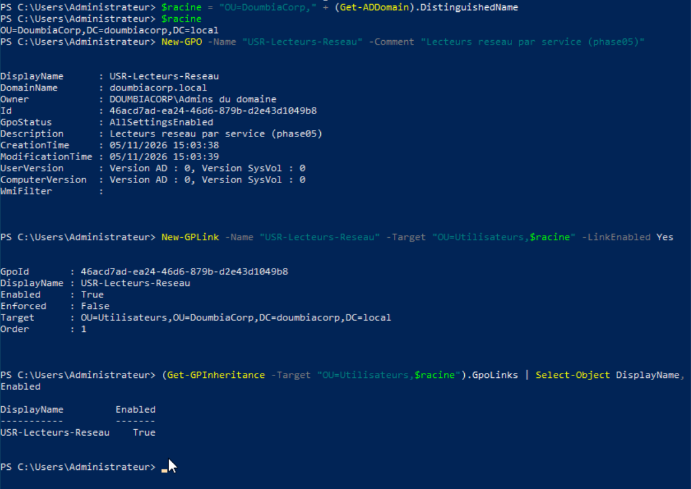
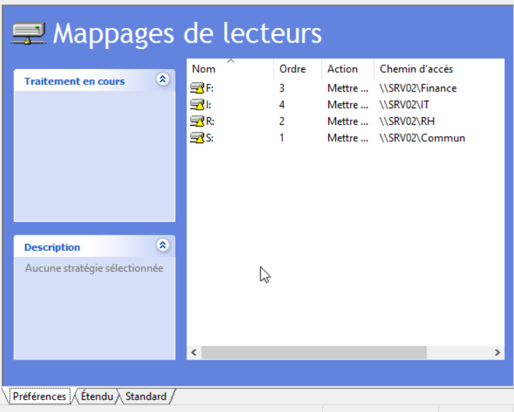

Test sur CL01 : `gpupdate /force`, puis ouverture de session.

| Compte | Lecteurs obtenus |
|---|---|
| `awa.traore` (RH) | `R:` RH, `S:` Commun |
| `ibrahim.sangare` (Finance) | `F:` Finance, `S:` Commun |
| `rokia.haidara` (IT) | `I:` IT, `S:` Commun |

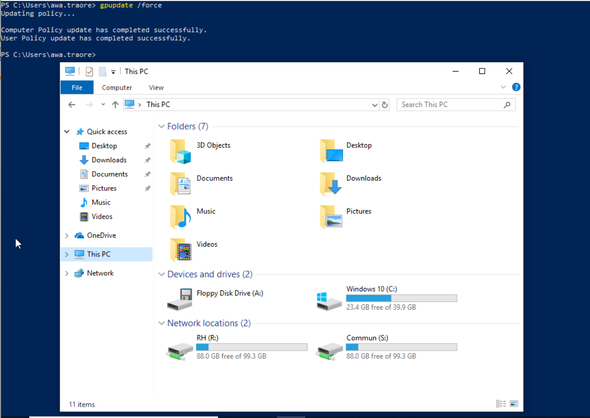
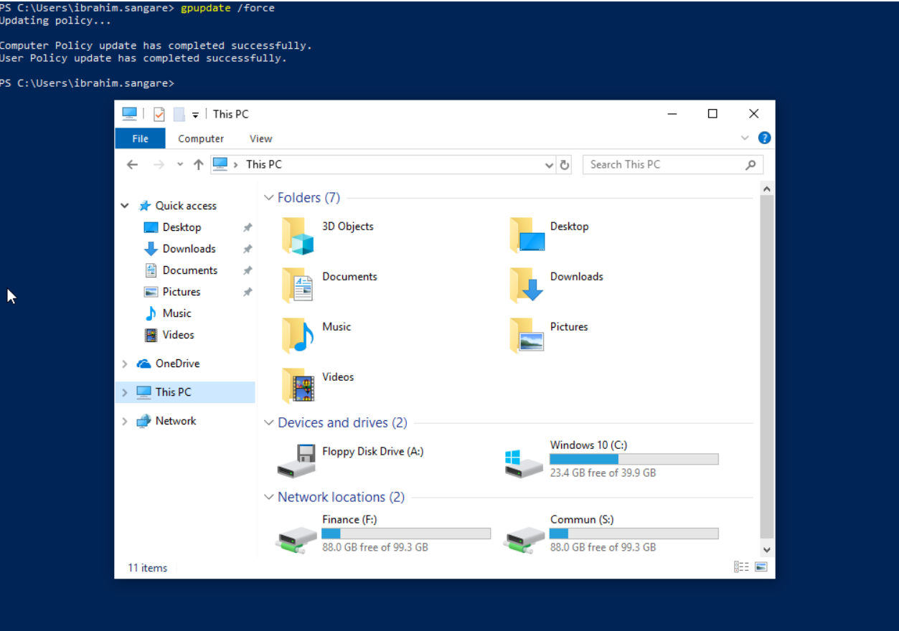
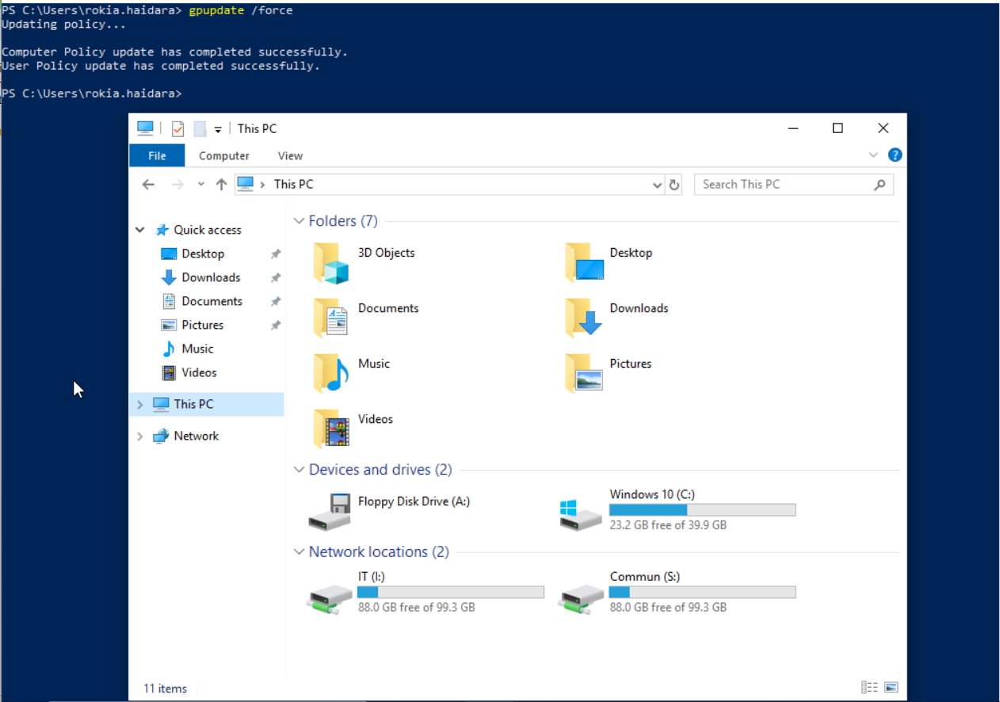

## Problèmes rencontrés et solutions

Aucun blocage. Deux messages d'erreur sans gravité : voir [../docs/troubleshooting.md](../docs/troubleshooting.md), 015 et 016.

## Choix de lab et limites

- Données sur `C:` (un seul disque) ; en production, volume dédié.
- Permissions de partage larges, filtrage par NTFS uniquement.
- Les dossiers `IT` ne sont accessibles qu'à l'IT : aucun accès de l'IT aux données RH et Finance (à ajuster selon la politique de l'entreprise).
- Pas encore de quotas, de filtrage de fichiers ni de sauvegarde (phases 06 et 08).
- Les droits d'un utilisateur ne changent qu'à sa prochaine ouverture de session (jeton d'accès).

## Bonnes pratiques

- Ne jamais donner de droits à un utilisateur directement : toujours via les groupes (AGDLP).
- Verrouiller (NTFS) avant d'ouvrir (partage).
- Tester avec de vrais comptes, y compris les refus attendus.
- Ne pas dupliquer le disque d'une machine du domaine.

## Prochaine étape

Snapshot VMware `Phase05-OK`, puis phase 06 (sécurité et durcissement).
