# Phase 06 : Sécurité et durcissement

## Objectif

Réduire la surface d'attaque du serveur de fichiers `SRV02` et rendre les actions traçables : mesurer l'état initial, imposer la signature SMB, chiffrer les partages sensibles, journaliser les accès (audit), créer un compte d'administration nominatif et agrandir le journal Sécurité. Les réglages sont poussés par une GPO liée à l'OU `Serveurs`, et non faits à la main.

## Concepts

| Notion | Explication |
|---|---|
| **Durcissement** (*hardening*) | Réduire ce qui peut être attaqué : désactiver l'inutile, imposer les protections, vérifier |
| **Signature SMB** | Chaque paquet est authentifié ; un échange modifié en chemin est rejeté |
| **Chiffrement SMB (SMB 3)** | Le contenu des échanges est chiffré (AES) ; réservé aux partages sensibles |
| **SMBv1** | Ancien protocole vulnérable (WannaCry) ; doit rester désactivé |
| **NLA** | Authentification au niveau du réseau avant l'ouverture d'une session RDP |
| **Audit avancé** | Journalisation fine par sous-catégories (ouverture de session, système de fichiers, partage de fichiers...) |
| **SACL** | Liste qui indique, dossier par dossier, quelles actions journaliser (sans elle, l'audit des fichiers ne produit rien) |
| **Moindre privilège** | Chaque administrateur a son propre compte nominatif, utilisé uniquement pour administrer |
| **Événements** | 4624 ouverture de session réussie, 4625 échec, 4663 accès à un objet, 5140 accès à un partage |

## Prérequis

- Phase 05 validée ; SRV02 dans l'OU `Serveurs` (la GPO ne touche donc ni les postes ni les contrôleurs de domaine)
- OU `Administration` et politique `PSO-IT` existantes (phases 02 et 04)
- Snapshot `Phase05-OK` recommandé avant de durcir

## Procédure

### 1. État des lieux de SRV02 (lecture seule, 2026-11-09)

```powershell
Get-NetFirewallProfile | Select-Object Name, Enabled
Get-SmbServerConfiguration | Select-Object EnableSMB1Protocol, RequireSecuritySignature, EncryptData
(Get-ItemProperty "HKLM:\System\CurrentControlSet\Control\Terminal Server").fDenyTSConnections
(Get-ItemProperty "HKLM:\System\CurrentControlSet\Control\Terminal Server\WinStations\RDP-Tcp").UserAuthentication
Get-MpComputerStatus | Select-Object AntivirusEnabled, RealTimeProtectionEnabled, AntivirusSignatureLastUpdated
Get-LocalGroupMember -SID S-1-5-32-544 | Select-Object Name, ObjectClass
Get-NetTCPConnection -State Listen | Where-Object LocalAddress -in "0.0.0.0","::" |
    Sort-Object LocalPort -Unique |
    Select-Object LocalPort, @{n="Processus";e={(Get-Process -Id $_.OwningProcess).ProcessName}}
```

| Élément | Résultat | Décision |
|---|---|---|
| Pare-feu | 3 profils actifs | rien à faire |
| SMBv1 | désactivé | rien à faire |
| Signature SMB exigée | `False` | à corriger |
| Chiffrement SMB | `False` | à corriger (RH et Finance) |
| RDP | désactivé (`fDenyTSConnections = 1`), NLA exigé | laissé désactivé : un service éteint ne s'attaque pas ; SRV02 s'administre par la console et PowerShell |
| Defender | actif, temps réel, signatures du jour | rien à faire |
| Administrateurs locaux | `Admins du domaine`, `SRV02\Administrateur` | normal |
| Ports en écoute | 135, 445, 5357, 5985, 47001, ports RPC dynamiques (49664 et suivants) | cohérent ; pas de 3389 car RDP est désactivé |

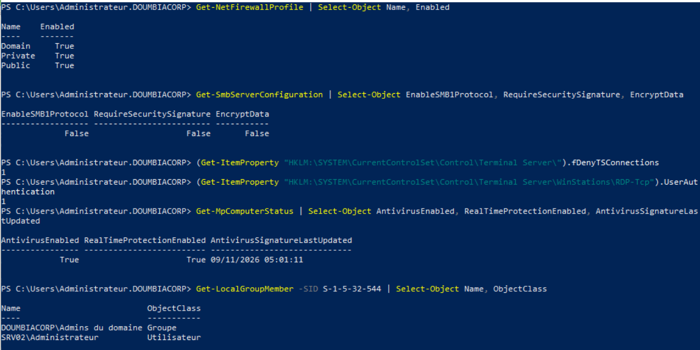
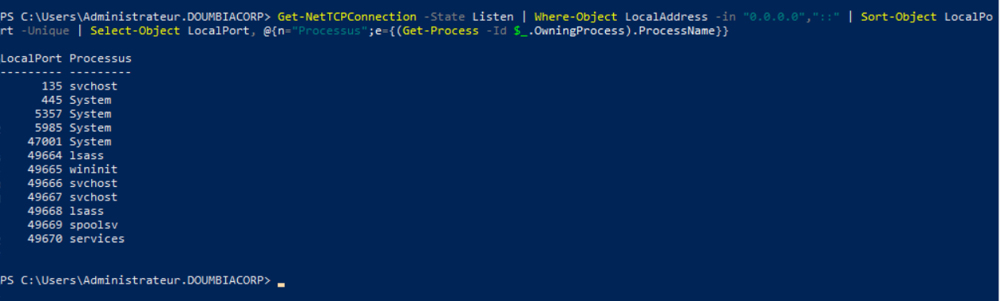

### 2. GPO des serveurs (sur DC01)

```powershell
$racine = "OU=DoumbiaCorp," + (Get-ADDomain).DistinguishedName
New-GPO -Name "CMP-Serveurs-Securite" -Comment "Durcissement des serveurs membres (phase 06)"
New-GPLink -Name "CMP-Serveurs-Securite" -Target "OU=Serveurs,OU=Ordinateurs,$racine" -LinkEnabled Yes
```

Le préfixe `CMP-` désigne une GPO de configuration ordinateur (comme `CMP-Postes-Verrouillage`). Elle s'applique à l'OU `Serveurs` uniquement.

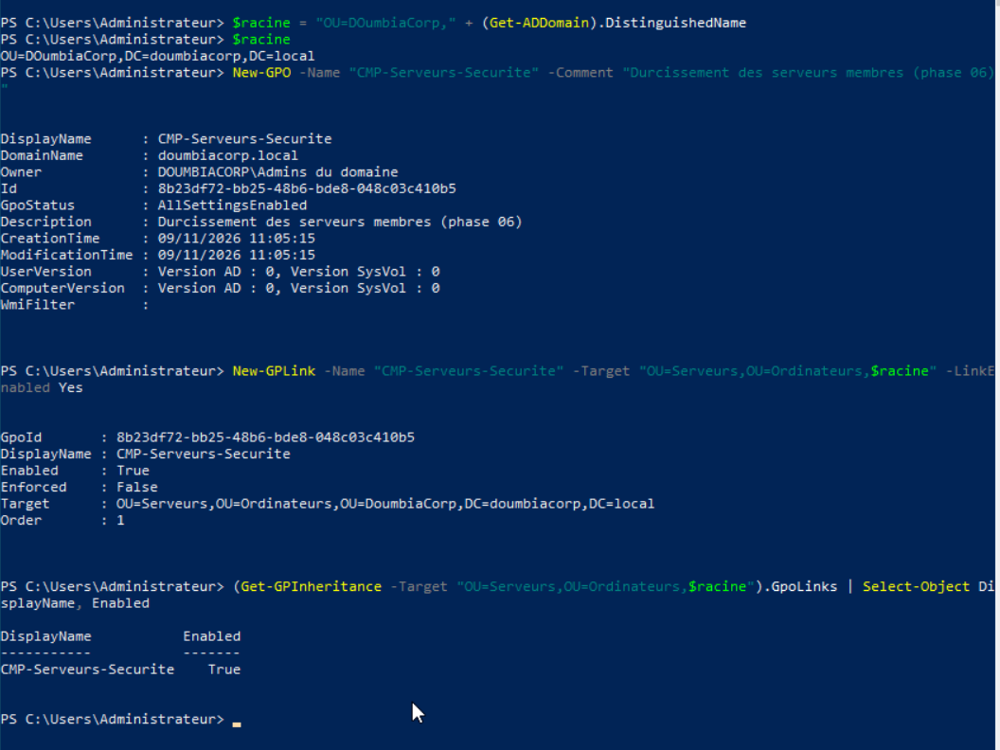

### 3. Signature SMB exigée

Dans l'éditeur de la GPO, *Configuration ordinateur, Stratégies, Paramètres Windows, Paramètres de sécurité, Stratégies locales, Options de sécurité* :

- **Serveur réseau Microsoft : communications signées numériquement (toujours)** : Activé
- **Client réseau Microsoft : communications signées numériquement (toujours)** : Activé

Vérification sur SRV02 : `gpupdate /force`, puis `Get-SmbServerConfiguration | Select-Object RequireSecuritySignature` doit renvoyer `True`. Compromis : un très vieux client sans signature SMB ne pourrait plus se connecter.


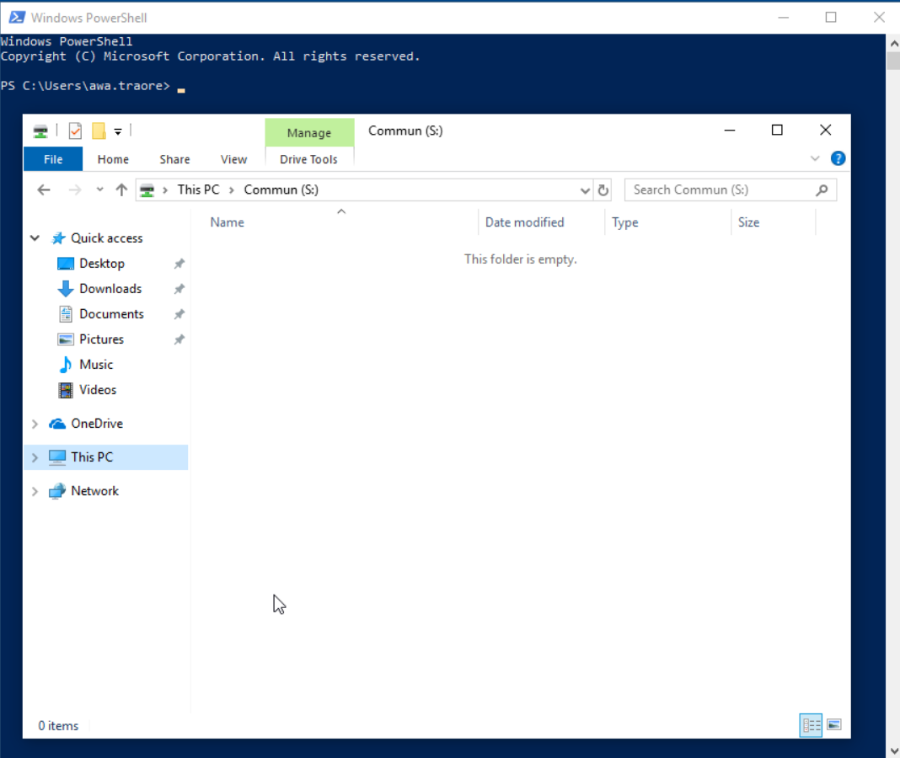

### 4. Chiffrement des partages RH et Finance (sur SRV02)

```powershell
Set-SmbShare -Name RH      -EncryptData $true -Force
Set-SmbShare -Name Finance -EncryptData $true -Force
Get-SmbShare -Name RH, Finance | Select-Object Name, EncryptData
```

Seuls les partages sensibles sont chiffrés : le chiffrement a un coût en performance. Un client sans SMB 3 ne pourrait plus les ouvrir.

Vérification sur CL01 après réouverture de session (les connexions déjà ouvertes gardent leurs anciens réglages) :

```powershell
Get-SmbConnection | Select-Object ServerName, ShareName, Dialect, Signed, Encrypted
```

Résultat : `Commun` en dialecte 3.1.1, `Signed True`, `Encrypted False` ; `RH` en 3.1.1, `Encrypted True` (`Signed False` : le chiffrement garantit déjà l'intégrité).

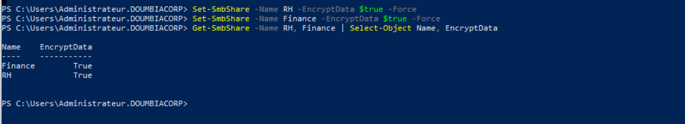
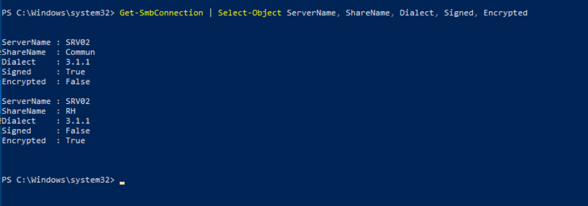

### 5. Audit

Dans la même GPO :

1. *Options de sécurité* : **Audit : forcer les paramètres de sous-catégorie de stratégie d'audit... à remplacer les paramètres de catégorie** : Activé (sans lui, l'ancienne stratégie par catégories peut écraser la nouvelle sans message).
2. *Configuration avancée de la stratégie d'audit, Stratégies d'audit* :

| Sous-catégorie | Succès | Échec |
|---|---|---|
| Ouvrir la session | oui | oui |
| Système de fichiers | oui | oui |
| Partage de fichiers | oui | oui |
| Gestion des groupes de sécurité | oui | oui |
| Modification de la stratégie d'audit | oui | non |

Vérification : `gpupdate /force` puis `auditpol /get /category:*` ; les cinq lignes affichent « Succès et échec » (ou « Réussite »), le reste « Pas d'audit ».

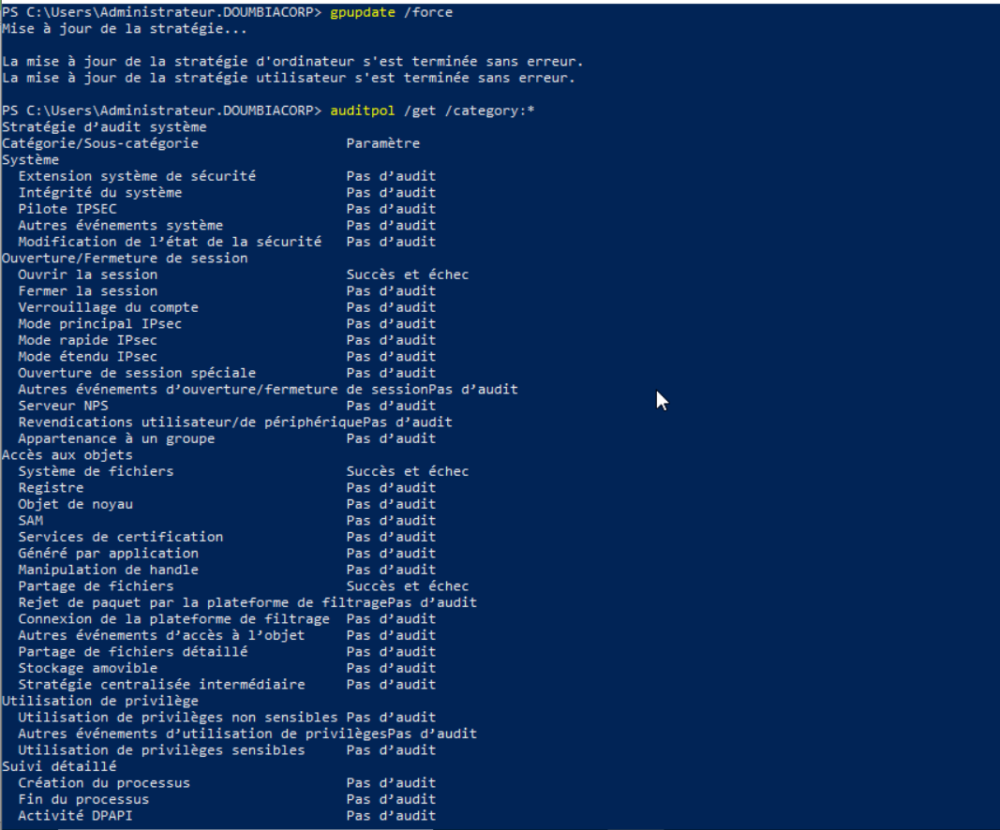
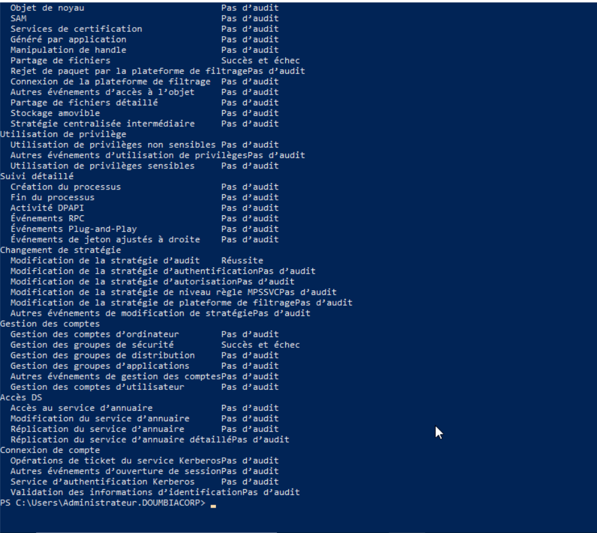

**SACL sur les dossiers sensibles** (l'audit des fichiers en a besoin ; on ne surveille que `RH` et `Finance` pour éviter le bruit) :

```powershell
$cible = "C:\Partages\RH","C:\Partages\Finance"
$tous  = New-Object System.Security.Principal.SecurityIdentifier "S-1-1-0"
$herit = [System.Security.AccessControl.InheritanceFlags]"ContainerInherit,ObjectInherit"
$prop  = [System.Security.AccessControl.PropagationFlags]::None

$succes = New-Object System.Security.AccessControl.FileSystemAuditRule($tous, "Delete,DeleteSubdirectoriesAndFiles,ChangePermissions,TakeOwnership", $herit, $prop, "Success")
$echec  = New-Object System.Security.AccessControl.FileSystemAuditRule($tous, "FullControl", $herit, $prop, "Failure")

foreach ($c in $cible) {
    $acl = Get-Acl $c -Audit
    $acl.AddAuditRule($succes)
    $acl.AddAuditRule($echec)
    Set-Acl $c $acl
}
(Get-Acl C:\Partages\RH -Audit).Audit | Select-Object IdentityReference, FileSystemRights, AuditFlags
```

Choix : on journalise en succès les seules actions destructrices ou de changement de droits (sinon chaque ouverture remplirait le journal) et en échec toute tentative refusée.

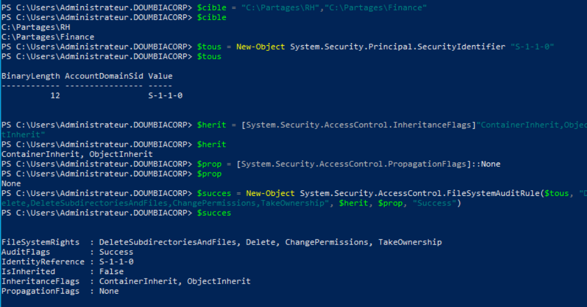
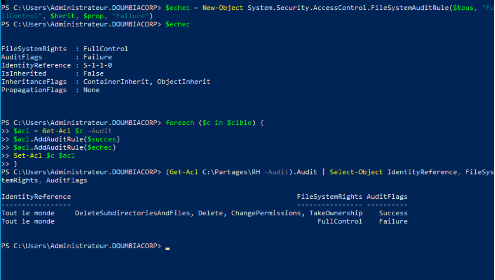

**Test** : depuis CL01 avec `awa.traore` (connexion vers l'IP avec un compte inexistant, création puis suppression d'un fichier dans `R:`, accès refusé à Finance), puis lecture du journal sur SRV02 :

```powershell
Get-WinEvent -FilterHashtable @{LogName='Security'; Id=4625,4656,4663,5140; StartTime=(Get-Date).AddMinutes(-30)} -MaxEvents 20 |
    Select-Object TimeCreated, Id, @{n="Résumé";e={($_.Message -split "`n")[0]}}
```

Événements retrouvés : 4625 (connexion ratée), 4663 (suppression du fichier dans `RH`) et 5140 (accès aux partages). Le détail de l'événement 4663 donne le compte, l'objet et l'accès demandé. L'événement d'accès refusé à `Finance` (SACL de `Finance` et événement d'échec) est confirmé par l'utilisateur, sans capture.

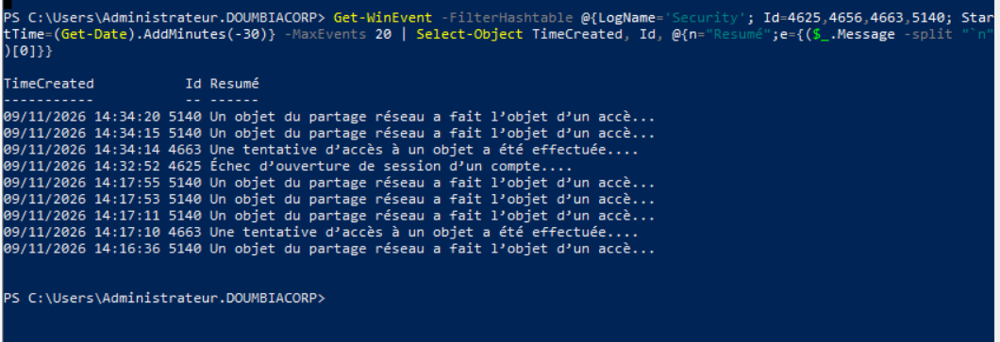

### 6. Compte d'administration nominatif (sur DC01, 2026-11-13)

```powershell
$racine = "OU=DoumbiaCorp," + (Get-ADDomain).DistinguishedName
$mdp = Read-Host -Prompt "Mot de passe du compte d'administration" -AsSecureString

New-ADUser -Name "Bakary Samake (admin)" -SamAccountName "adm.bakary.samake" `
    -UserPrincipalName "adm.bakary.samake@doumbiacorp.local" `
    -Description "Compte d'administration de Bakary Samake (usage admin uniquement)" `
    -Path "OU=Administration,$racine" `
    -AccountPassword $mdp -Enabled $true -ChangePasswordAtLogon $true

Add-ADGroupMember -Identity "Admins du domaine" -Members "adm.bakary.samake"
Add-ADFineGrainedPasswordPolicySubject -Identity "PSO-IT" -Subjects "adm.bakary.samake"
Get-ADUserResultantPasswordPolicy "adm.bakary.samake" | Select-Object Name, MinPasswordLength, LockoutThreshold
```

`Read-Host -AsSecureString` évite que le mot de passe apparaisse à l'écran, dans l'historique ou dans le dépôt. Résultat : compte activé dans `OU=Administration`, politique `PSO-IT` (14 caractères, verrouillage à 3).

Test : connexion à la console de SRV02 avec ce compte (changement de mot de passe imposé), puis :

```powershell
Get-WinEvent -FilterHashtable @{LogName='Security'; Id=4624; StartTime=(Get-Date).AddMinutes(-15)} |
    Where-Object { $_.Properties[5].Value -eq 'adm.bakary.samake' } |
    Select-Object TimeCreated, @{n="Compte";e={$_.Properties[5].Value}}, @{n="TypeLogon";e={$_.Properties[8].Value}}
```

Quatre événements 4624 de type 2 (console) au nom du compte : plusieurs sessions techniques pour une même connexion d'administrateur (par exemple avec et sans droits élevés), ce qui est normal.

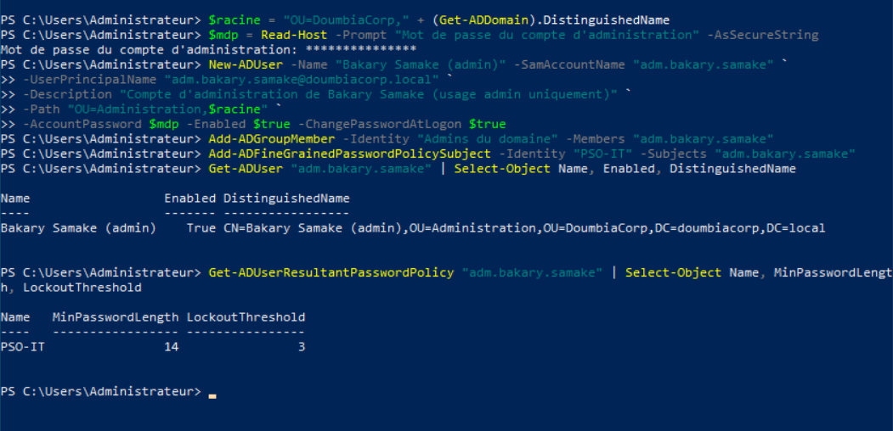
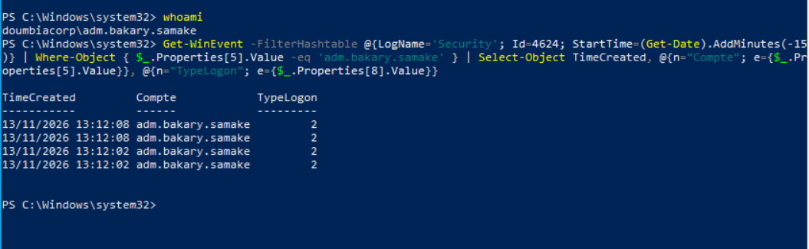

### 7. Taille du journal Sécurité

Dans la GPO : *Configuration ordinateur, Stratégies, Modèles d'administration, Composants Windows, Service Journal des événements, Sécurité, Spécifier la taille maximale du fichier journal (Ko)* : Activé, `131072` (128 Mo).

| Moment | `MaximumSizeInBytes` |
|---|---|
| Avant | `20971520` (20 Mo) |
| Après `gpupdate /force` | `20971520` (réglage reçu dans le registre, `MaxSize = 131072`, mais pas encore appliqué) |
| Après redémarrage de SRV02 | `134217728` (128 Mo) |

Voir dépannage 019.

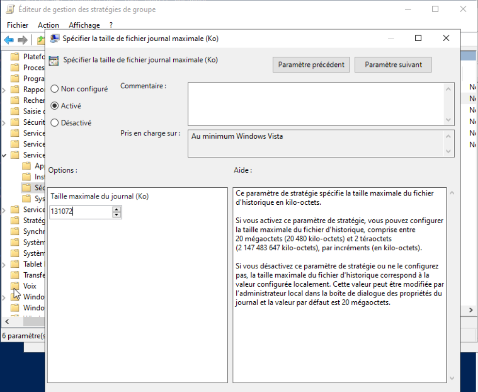
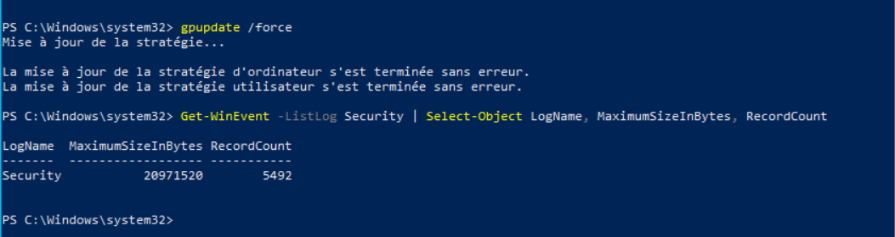
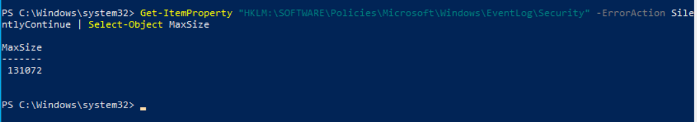
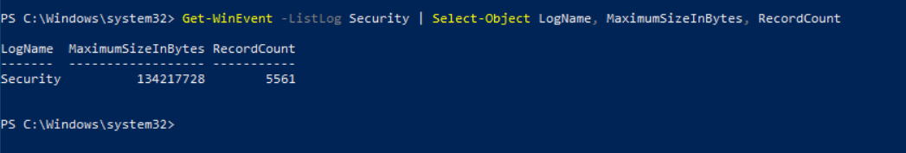

## Problèmes rencontrés et solutions

Voir [../docs/troubleshooting.md](../docs/troubleshooting.md), 017 (`Get-SmbShare` à la place de `Set-SmbShare`), 018 (`StarTime` au lieu de `StartTime`) et 019 (taille du journal inchangée après `gpupdate`).

## Choix de lab et limites

- La GPO ne s'applique qu'à l'OU `Serveurs` : **DC01 n'est pas durci ni audité par ces réglages** (une GPO distincte sur l'OU `Domain Controllers` reste à faire).
- RDP laissé désactivé sur SRV02 ; s'il devenait nécessaire, le NLA est déjà exigé et l'accès serait limité à `GG_IT`.
- Le compte local `SRV02\Administrateur` n'est pas géré par LAPS (nécessite une extension du schéma Active Directory) ; option à étudier.
- Le journal reste sur le serveur : un attaquant qui le compromet peut l'effacer. La collecte centralisée relève de la phase 07.
- Le pare-feu est actif mais n'est pas imposé par GPO.
- L'audit des fichiers ne couvre que `RH` et `Finance` ; `Commun` et `IT` ne sont pas surveillés.

## Bonnes pratiques

- Mesurer l'état initial avant de durcir (le « avant/après » prouve le travail).
- Pousser les réglages par GPO plutôt qu'à la main.
- Tester côté client : un réglage serveur qui ne gêne personne peut aussi être un réglage qui n'est pas appliqué.
- Un compte d'administration par administrateur, séparé du compte de travail.
- Ne jamais saisir un mot de passe en clair dans une commande ou un dépôt.

## Prochaine étape

Snapshot VMware `Phase06-OK`, puis phase 07 (supervision et journaux : collecte centralisée des événements).
