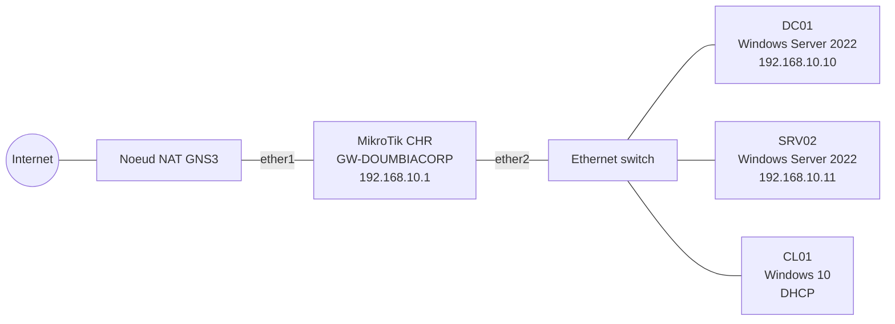

# Administration Windows Server 2022 : projet DoumbiaCorp

Projet pratique et documenté d'administration système Windows Server 2022, réalisé de A à Z dans un lab GNS3 / VMware.
L'objectif : construire l'infrastructure d'une entreprise fictive comme le ferait un administrateur système en entreprise, et documenter chaque étape (concepts, procédure, commandes PowerShell, vérification, problèmes rencontrés).

## Scénario

**DoumbiaCorp** est une PME fictive de 50 utilisateurs répartis en trois services : RH, Finance et IT.
Domaine Active Directory : `doumbiacorp.local`.

## Topologie



Détails : [docs/architecture.md](docs/architecture.md) et [docs/plan-adressage.md](docs/plan-adressage.md).

## Environnement

| Élément | Valeur |
|---|---|
| Hyperviseur | VMware Workstation |
| Simulateur | GNS3 2.2.61 + GNS3 VM |
| Serveurs | Windows Server 2022 |
| Client | Windows 10 |
| Routeur / passerelle | MikroTik CHR 7.16 |
| Automatisation | PowerShell |

## Avancement

| Phase | Sujet | Statut |
|---|---|---|
| 00 | [Préparation du lab](00-lab-setup/README.md) | En cours |
| 01 | Installation et configuration de base | À faire |
| 02 | Active Directory Domain Services | À faire |
| 03 | DNS et DHCP | À faire |
| 04 | Stratégies de groupe (GPO) | À faire |
| 05 | Serveur de fichiers et permissions | À faire |
| 06 | Sécurité et durcissement | À faire |
| 07 | Supervision et journaux | À faire |
| 08 | Sauvegarde et restauration | À faire |
| 09 | Services avancés (2e DC, IIS, WSUS...) | À faire |
| Scripts | Automatisation PowerShell | Continu |

## Structure du dépôt

```
├── 00-lab-setup/ ... 09-services-avances/   documentation par phase
├── scripts/                                 scripts PowerShell commentés
├── docs/                                    architecture, adressage, dépannage
└── assets/                                  captures d'écran et schémas
```

## Avertissement

Toutes les adresses, noms et mots de passe de ce dépôt sont des valeurs de laboratoire fictives.

## Auteur

Ousmane Doumbia
